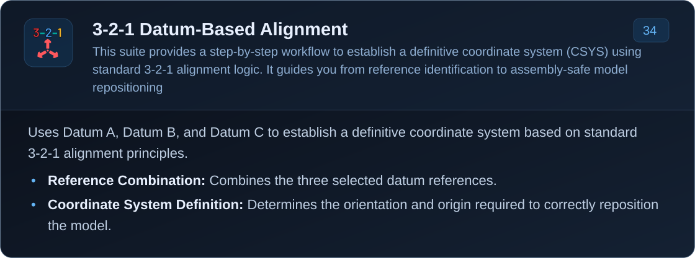
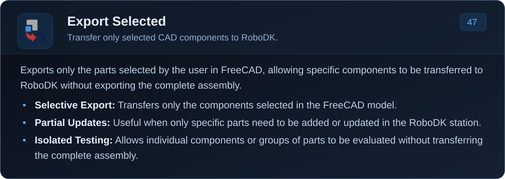

<!-- MANUFAI documentation: all visible content is rendered from SVG assets. -->

    

<table align="center">
<tbody>
<tr>
<td align="center" valign="middle" width="220" height="80"></td>
<td align="center" valign="middle" width="220" height="80"></td>
</tr>
</tbody>
</table>

<table align="center">
<tbody>
<tr>
<td align="center" valign="middle" width="220" height="80"></td>
<td align="center" valign="middle" width="220" height="80"></td>
</tr>
</tbody>
</table>

<table align="center">
<tbody>
<tr>
<td align="center" valign="middle" width="220" height="80"></td>
<td align="center" valign="middle" width="220" height="80"></td>
</tr>
</tbody>
</table>

<table align="center">
<tbody>
<tr>
<td align="center" valign="middle" width="220" height="80"></td>
<td align="center" valign="middle" width="220" height="80"></td>
</tr>
</tbody>
</table>

<table align="center">
<tbody>
<tr>
<td align="center" valign="middle" width="220" height="80"></td>
<td align="center" valign="middle" width="220" height="80"></td>
</tr>
</tbody>
</table>

<table align="center">
<tbody>
<tr>
<td align="center" valign="middle" width="220" height="80"></td>
<td align="center" valign="middle" width="220" height="80"></td>
</tr>
</tbody>
</table>

<table align="center">
<tbody>
<tr>
<td align="center" valign="middle" width="220" height="80"></td>
<td align="center" valign="middle" width="220" height="80"></td>
</tr>
</tbody>
</table>

<table align="center">
<tbody>
<tr>
<td align="center" valign="middle" width="220" height="80"></td>
<td align="center" valign="middle" width="220" height="80"></td>
</tr>
</tbody>
</table>

<table align="center">
<tbody>
<tr>
<td align="center" valign="middle" width="220" height="80"></td>
<td align="center" valign="middle" width="220" height="80"></td>
</tr>
</tbody>
</table>

<table align="center">
<tbody>
<tr>
<td align="center" valign="middle" width="220" height="80"></td>
<td align="center" valign="middle" width="220" height="80"></td>
</tr>
</tbody>
</table>

<table align="center">
<tbody>
<tr>
<td align="center" valign="middle" width="220" height="80"></td>
<td align="center" valign="middle" width="220" height="80"></td>
</tr>
</tbody>
</table>

<table align="center">
<tbody>
<tr>
<td align="center" valign="middle" width="220" height="80"></td>
<td align="center" valign="middle" width="220" height="80"></td>
</tr>
</tbody>
</table>

<table align="center">
<tbody>
<tr>
<td align="center" valign="middle" width="220" height="80"></td>
<td align="center" valign="middle" width="220" height="80"></td>
</tr>
</tbody>
</table>

<table align="center">
<tbody>
<tr>
<td align="center" valign="middle" width="220" height="80"></td>
<td align="center" valign="middle" width="220" height="80"></td>
</tr>
</tbody>
</table>

<table align="center">
<tbody>
<tr>
<td align="center" valign="middle" width="220" height="80"></td>
<td align="center" valign="middle" width="220" height="80"></td>
</tr>
</tbody>
</table>

<table align="center">
<tbody>
<tr>
<td align="center" valign="middle" width="220" height="80"></td>
<td align="center" valign="middle" width="220" height="80"></td>
</tr>
</tbody>
</table>

<table align="center">
<tbody>
<tr>
<td align="center" valign="middle" width="220" height="80"></td>
<td align="center" valign="middle" width="220" height="80"></td>
</tr>
</tbody>
</table>

<table align="center">
<tbody>
<tr>
<td align="center" valign="middle" width="220" height="80"></td>
<td align="center" valign="middle" width="220" height="80"></td>
</tr>
</tbody>
</table>

<table align="center">
<tbody>
<tr>
<td align="center" valign="middle" width="220" height="80"></td>
<td align="center" valign="middle" width="220" height="80"></td>
</tr>
</tbody>
</table>

<table align="center">
<tbody>
<tr>
<td align="center" valign="middle" width="220" height="80"></td>
<td align="center" valign="middle" width="220" height="80"></td>
</tr>
</tbody>
</table>

<table align="center">
<tbody>
<tr>
<td align="center" valign="middle" width="220" height="80"></td>
<td align="center" valign="middle" width="220" height="80"></td>
</tr>
</tbody>
</table>

<table align="center">
<tbody>
<tr>
<td align="center" valign="middle" width="220" height="80"></td>
<td align="center" valign="middle" width="220" height="80"></td>
</tr>
</tbody>
</table>

<table align="center">
<tbody>
<tr>
<td align="center" valign="middle" width="220" height="80"></td>
<td align="center" valign="middle" width="220" height="80"></td>
<td align="center" valign="middle" width="220" height="80"></td>
</tr>
</tbody>
</table>

<table align="center">
<tbody>
<tr>
<td align="center" valign="middle" width="220" height="80"></td>
<td align="center" valign="middle" width="220" height="80"></td>
</tr>
</tbody>
</table>

<table align="center">
<tbody>
<tr>
<td align="center" valign="middle" width="220" height="80"></td>
<td align="center" valign="middle" width="220" height="80"></td>
</tr>
</tbody>
</table>

<table align="center">
<tbody>
<tr>
<td align="center" valign="middle" width="220" height="80"></td>
<td align="center" valign="middle" width="220" height="80"></td>
</tr>
</tbody>
</table>

<table align="center">
<tbody>
<tr>
<td align="center" valign="middle" width="220" height="80"></td>
<td align="center" valign="middle" width="220" height="80"></td>
</tr>
</tbody>
</table>

 

<table align="center">
<tbody>
<tr>
<td align="center" valign="middle" width="220" height="80"></td>
<td align="center" valign="middle" width="220" height="80"></td>
</tr>
</tbody>
</table>

<table align="center">
<tbody>
<tr>
<td align="center" valign="middle" width="220" height="80"></td>
<td align="center" valign="middle" width="220" height="80"></td>
</tr>
</tbody>
</table>

<table align="center">
<tbody>
<tr>
<td align="center" valign="middle" width="220" height="80"></td>
<td align="center" valign="middle" width="220" height="80"></td>
</tr>
</tbody>
</table>

<table align="center">
<tbody>
<tr>
<td align="center" valign="middle" width="220" height="80"></td>
<td align="center" valign="middle" width="220" height="80"></td>
</tr>
</tbody>
</table>

<table align="center">
<tbody>
<tr>
<td align="center" valign="middle" width="220" height="80"></td>
<td align="center" valign="middle" width="220" height="80"></td>
</tr>
</tbody>
</table>

<table align="center">
<tbody>
<tr>
<td align="center" valign="middle" width="220" height="80"></td>
<td align="center" valign="middle" width="220" height="80"></td>
</tr>
</tbody>
</table>

<table align="center">
<tbody>
<tr>
<td align="center" valign="middle" width="220" height="80"></td>
<td align="center" valign="middle" width="220" height="80"></td>
</tr>
</tbody>
</table>

<table align="center">
<tbody>
<tr>
<td align="center" valign="middle" width="220" height="80"></td>
<td align="center" valign="middle" width="220" height="80"></td>
</tr>
</tbody>
</table>

<table align="center">
<tbody>
<tr>
<td align="center" valign="middle" width="220" height="80"></td>
<td align="center" valign="middle" width="220" height="80"></td>
</tr>
</tbody>
</table>

<table align="center">
<tbody>
<tr>
<td align="center" valign="middle" width="220" height="80"></td>
<td align="center" valign="middle" width="220" height="80"></td>
</tr>
</tbody>
</table>

<table align="center">
<tbody>
<tr>
<td align="center" valign="middle" width="220" height="80"></td>
<td align="center" valign="middle" width="220" height="80"></td>
</tr>
</tbody>
</table>

<table align="center">
<tbody>
<tr>
<td align="center" valign="middle" width="220" height="80"></td>
<td align="center" valign="middle" width="220" height="80"></td>
</tr>
</tbody>
</table>

<table align="center">
<tbody>
<tr>
<td align="center" valign="middle" width="220" height="80"></td>
<td align="center" valign="middle" width="220" height="80"></td>
</tr>
</tbody>
</table>

<table align="center">
<tbody>
<tr>
<td align="center" valign="middle" width="220" height="80"></td>
<td align="center" valign="middle" width="220" height="80"></td>
</tr>
</tbody>
</table>

 

<table align="center">
<tbody>
<tr>
<td align="center" valign="middle" width="220" height="80"></td>
<td align="center" valign="middle" width="220" height="80"></td>
</tr>
</tbody>
</table>

<table align="center">
<tbody>
<tr>
<td align="center" valign="middle" width="220" height="80"></td>
<td align="center" valign="middle" width="220" height="80"></td>
</tr>
</tbody>
</table>

<table align="center">
<tbody>
<tr>
<td align="center" valign="middle" width="220" height="80"></td>
<td align="center" valign="middle" width="220" height="80"></td>
</tr>
</tbody>
</table>

 

<table align="center">
<tbody>
<tr>
<td align="center" valign="middle" width="220" height="80"></td>
<td align="center" valign="middle" width="220" height="80"></td>
<td align="center" valign="middle" width="220" height="80"></td>
<td align="center" valign="middle" width="220" height="80"></td>
</tr>
</tbody>
</table>

<table align="center">
<tbody>
<tr>
<td align="center" valign="middle" width="220" height="80"></td>
<td align="center" valign="middle" width="220" height="80"></td>
</tr>
</tbody>
</table>

<table align="center">
<tbody>
<tr>
<td align="center" valign="middle" width="220" height="80"></td>
<td align="center" valign="middle" width="220" height="80"></td>
</tr>
</tbody>
</table>

<table align="center">
<tbody>
<tr>
<td align="center" valign="middle" width="220" height="80"></td>
<td align="center" valign="middle" width="220" height="80"></td>
</tr>
</tbody>
</table>

<table align="center">
<tbody>
<tr>
<td align="center" valign="middle" width="220" height="80"></td>
<td align="center" valign="middle" width="220" height="80"></td>
</tr>
</tbody>
</table>

 
