<!-- MANUFAI documentation: SVG descriptions and navigation, with original HTML video previews. -->

<a name="readme-image-001" href="#readme-image-001"><picture><source media="(prefers-color-scheme: dark)" srcset="./docs/readme-svg/manufai-hero.svg"><source media="(prefers-color-scheme: light)" srcset="./docs/light/manufai-hero-light.svg"></picture></a>

<a name="readme-image-002" href="#readme-image-002"><picture><source media="(prefers-color-scheme: dark)" srcset="./docs/readme-svg/overview.svg"><source media="(prefers-color-scheme: light)" srcset="./docs/light/overview-light.svg">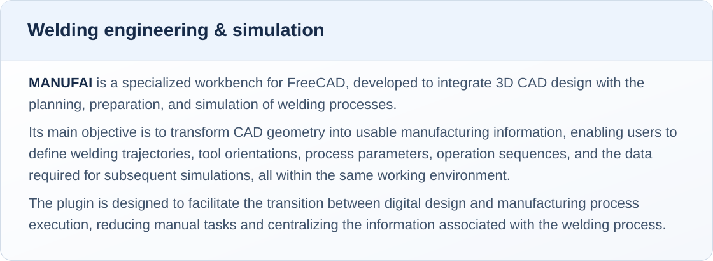</picture></a>

<a name="readme-image-003" href="#readme-image-003"><picture><source media="(prefers-color-scheme: dark)" srcset="./docs/readme-svg/key-capabilities.svg"><source media="(prefers-color-scheme: light)" srcset="./docs/light/key-capabilities-light.svg">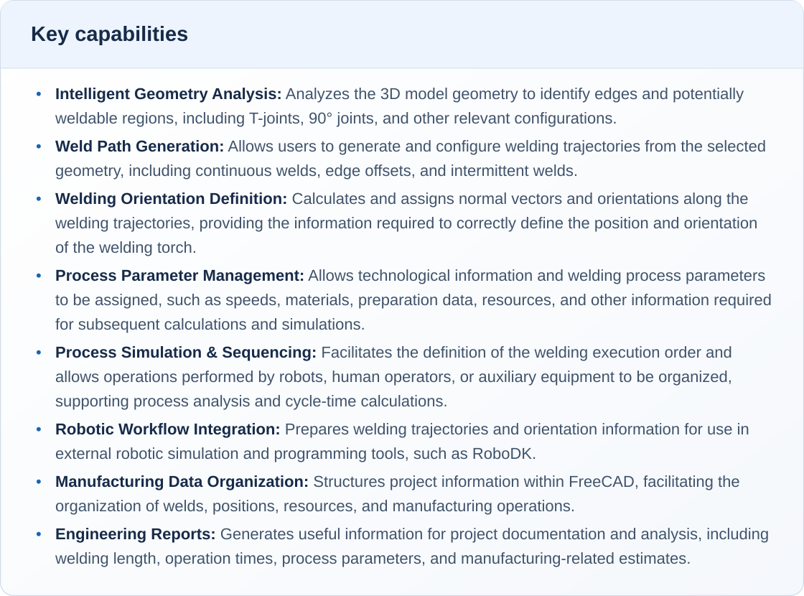</picture></a>

<a name="readme-image-004" href="#readme-image-004"><picture><source media="(prefers-color-scheme: dark)" srcset="./docs/readme-svg/interoperability.svg"><source media="(prefers-color-scheme: light)" srcset="./docs/light/interoperability-light.svg">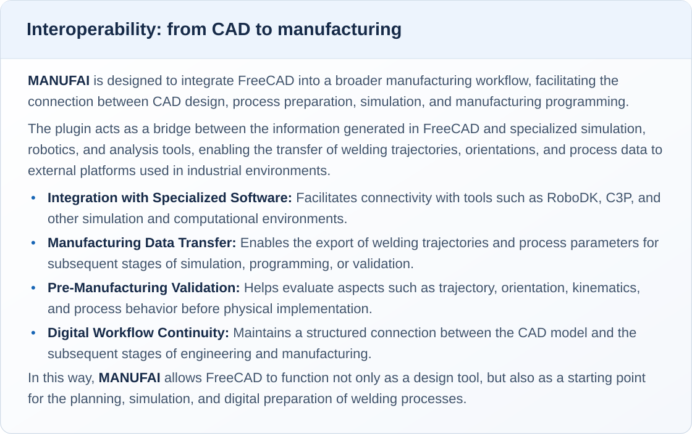</picture></a>

<a name="readme-image-005" href="#readme-image-005"><picture><source media="(prefers-color-scheme: dark)" srcset="./docs/readme-svg/double.svg"><source media="(prefers-color-scheme: light)" srcset="./docs/light/double-light.svg"></picture></a>

<a name="readme-image-006" href="#readme-image-006"><picture><source media="(prefers-color-scheme: dark)" srcset="./docs/readme-svg/installation.svg"><source media="(prefers-color-scheme: light)" srcset="./docs/light/installation-light.svg">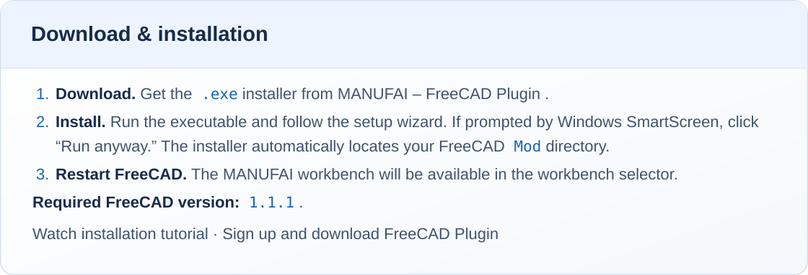</picture></a>

<a href="https://www.manufai.com/freecad"><picture><source media="(prefers-color-scheme: dark)" srcset="./docs/readme-svg/open-download.svg"><source media="(prefers-color-scheme: light)" srcset="./docs/light/open-download-light.svg"></picture></a> <a href="https://youtu.be/3LZCjwZW4YY"><picture><source media="(prefers-color-scheme: dark)" srcset="./docs/readme-svg/installation-tutorial.svg"><source media="(prefers-color-scheme: light)" srcset="./docs/light/installation-tutorial-light.svg"></picture></a>

<a name="readme-image-007" href="#readme-image-007"><picture><source media="(prefers-color-scheme: dark)" srcset="./docs/readme-svg/double.svg"><source media="(prefers-color-scheme: light)" srcset="./docs/light/double-light.svg"></picture></a>

<a name="readme-image-008" href="#readme-image-008"><picture><source media="(prefers-color-scheme: dark)" srcset="./docs/readme-svg/activation.svg"><source media="(prefers-color-scheme: light)" srcset="./docs/light/activation-light.svg">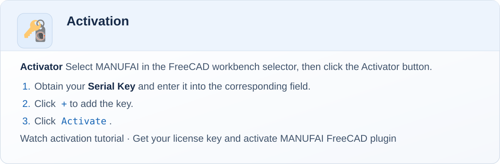</picture></a>

<a href="https://youtu.be/MNOla3Mc2aI"><picture><source media="(prefers-color-scheme: dark)" srcset="./docs/readme-svg/activation-tutorial.svg"><source media="(prefers-color-scheme: light)" srcset="./docs/light/activation-tutorial-light.svg"></picture></a>

<a name="readme-image-009" href="#readme-image-009"><picture><source media="(prefers-color-scheme: dark)" srcset="./docs/readme-svg/double.svg"><source media="(prefers-color-scheme: light)" srcset="./docs/light/double-light.svg"></picture></a>

<a name="readme-image-010" href="#readme-image-010"><picture><source media="(prefers-color-scheme: dark)" srcset="./docs/readme-svg/component-manager.svg"><source media="(prefers-color-scheme: light)" srcset="./docs/light/component-manager-light.svg">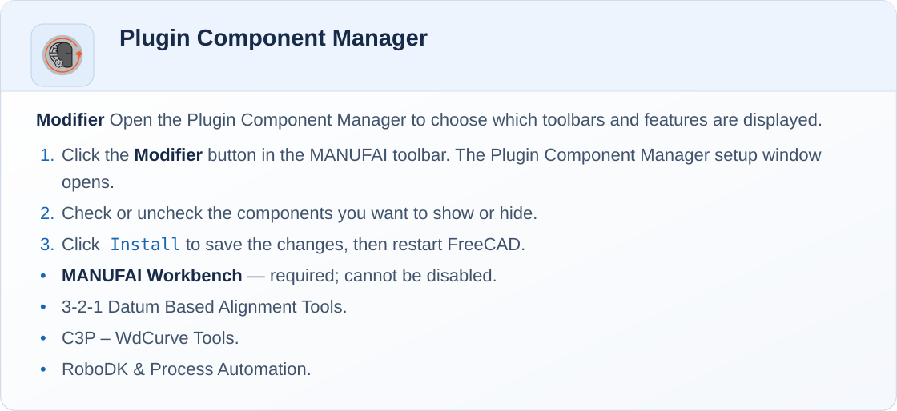</picture></a>

<a name="readme-image-011" href="#readme-image-011"><picture><source media="(prefers-color-scheme: dark)" srcset="./docs/readme-svg/double.svg"><source media="(prefers-color-scheme: light)" srcset="./docs/light/double-light.svg"></picture></a>

<a name="readme-image-012" href="#readme-image-012"><picture><source media="(prefers-color-scheme: dark)" srcset="./docs/readme-svg/repository-resources.svg"><source media="(prefers-color-scheme: light)" srcset="./docs/light/repository-resources-light.svg">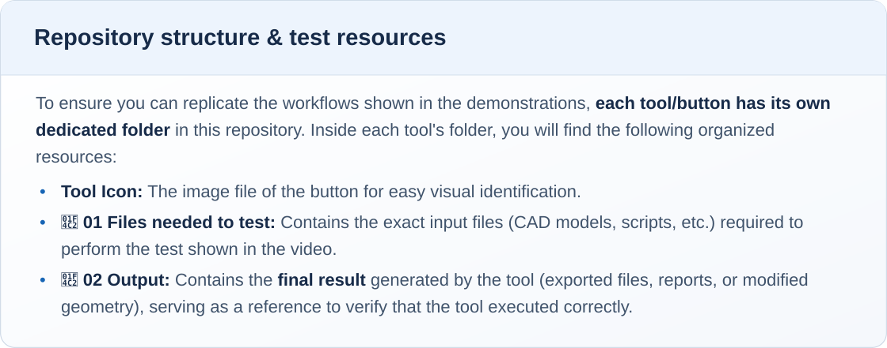</picture></a>

<picture><source media="(prefers-color-scheme: dark)" srcset="./docs/readme-svg/index-manufai-workbench.svg"><source media="(prefers-color-scheme: light)" srcset="./docs/light/index-manufai-workbench-light.svg"></picture>

<picture><source media="(prefers-color-scheme: dark)" srcset="./docs/readme-svg/index-make-weld-trajectories.svg"><source media="(prefers-color-scheme: light)" srcset="./docs/light/index-make-weld-trajectories-light.svg"></picture>

<a href="#edge-split"><picture><source media="(prefers-color-scheme: dark)" srcset="./docs/readme-svg/nav-edge-split.svg"><source media="(prefers-color-scheme: light)" srcset="./docs/light/nav-edge-split-light.svg"></picture></a>
<a href="#find-weldable-edges"><picture><source media="(prefers-color-scheme: dark)" srcset="./docs/readme-svg/nav-find-weldable-edges.svg"><source media="(prefers-color-scheme: light)" srcset="./docs/light/nav-find-weldable-edges-light.svg"></picture></a>
<a href="#weld-creators"><picture><source media="(prefers-color-scheme: dark)" srcset="./docs/readme-svg/nav-weld-creators.svg"><source media="(prefers-color-scheme: light)" srcset="./docs/light/nav-weld-creators-light.svg"></picture></a>
<a href="#add-normals"><picture><source media="(prefers-color-scheme: dark)" srcset="./docs/readme-svg/nav-add-normals.svg"><source media="(prefers-color-scheme: light)" srcset="./docs/light/nav-add-normals-light.svg"></picture></a>
 
<a href="#surface-weld"><picture><source media="(prefers-color-scheme: dark)" srcset="./docs/readme-svg/nav-surface-weld.svg"><source media="(prefers-color-scheme: light)" srcset="./docs/light/nav-surface-weld-light.svg"></picture></a>
<a href="#weld-loader"><picture><source media="(prefers-color-scheme: dark)" srcset="./docs/readme-svg/nav-weld-loader.svg"><source media="(prefers-color-scheme: light)" srcset="./docs/light/nav-weld-loader-light.svg"></picture></a>

<picture><source media="(prefers-color-scheme: dark)" srcset="./docs/readme-svg/index-positions.svg"><source media="(prefers-color-scheme: light)" srcset="./docs/light/index-positions-light.svg"></picture>

<a href="#make-positions"><picture><source media="(prefers-color-scheme: dark)" srcset="./docs/readme-svg/nav-make-positions.svg"><source media="(prefers-color-scheme: light)" srcset="./docs/light/nav-make-positions-light.svg"></picture></a>
<a href="#assign-welds-to-robots"><picture><source media="(prefers-color-scheme: dark)" srcset="./docs/readme-svg/nav-assign-welds-to-robots.svg"><source media="(prefers-color-scheme: light)" srcset="./docs/light/nav-assign-welds-to-robots-light.svg"></picture></a>
<a href="#subassembly"><picture><source media="(prefers-color-scheme: dark)" srcset="./docs/readme-svg/nav-subassembly.svg"><source media="(prefers-color-scheme: light)" srcset="./docs/light/nav-subassembly-light.svg"></picture></a>
<a href="#assign-positions"><picture><source media="(prefers-color-scheme: dark)" srcset="./docs/readme-svg/nav-assign-positions.svg"><source media="(prefers-color-scheme: light)" srcset="./docs/light/nav-assign-positions-light.svg"></picture></a>
 
<a href="#move-subassembly"><picture><source media="(prefers-color-scheme: dark)" srcset="./docs/readme-svg/nav-move-subassembly.svg"><source media="(prefers-color-scheme: light)" srcset="./docs/light/nav-move-subassembly-light.svg"></picture></a>
<a href="#move-welds"><picture><source media="(prefers-color-scheme: dark)" srcset="./docs/readme-svg/nav-move-welds.svg"><source media="(prefers-color-scheme: light)" srcset="./docs/light/nav-move-welds-light.svg"></picture></a>

<picture><source media="(prefers-color-scheme: dark)" srcset="./docs/readme-svg/index-length.svg"><source media="(prefers-color-scheme: light)" srcset="./docs/light/index-length-light.svg"></picture>

<a href="#weld-length-report"><picture><source media="(prefers-color-scheme: dark)" srcset="./docs/readme-svg/nav-weld-length-report.svg"><source media="(prefers-color-scheme: light)" srcset="./docs/light/nav-weld-length-report-light.svg"></picture></a>

<picture><source media="(prefers-color-scheme: dark)" srcset="./docs/readme-svg/index-cycle-time-tools.svg"><source media="(prefers-color-scheme: light)" srcset="./docs/light/index-cycle-time-tools-light.svg"></picture>

<a href="#process"><picture><source media="(prefers-color-scheme: dark)" srcset="./docs/readme-svg/nav-process.svg"><source media="(prefers-color-scheme: light)" srcset="./docs/light/nav-process-light.svg"></picture></a>
<a href="#assign-process"><picture><source media="(prefers-color-scheme: dark)" srcset="./docs/readme-svg/nav-assign-process.svg"><source media="(prefers-color-scheme: light)" srcset="./docs/light/nav-assign-process-light.svg"></picture></a>
<a href="#welding-parameters"><picture><source media="(prefers-color-scheme: dark)" srcset="./docs/readme-svg/nav-welding-parameters.svg"><source media="(prefers-color-scheme: light)" srcset="./docs/light/nav-welding-parameters-light.svg"></picture></a>
<a href="#assign-welding-parameters"><picture><source media="(prefers-color-scheme: dark)" srcset="./docs/readme-svg/nav-assign-welding-parameters.svg"><source media="(prefers-color-scheme: light)" srcset="./docs/light/nav-assign-welding-parameters-light.svg"></picture></a>
 
<a href="#cycle-time"><picture><source media="(prefers-color-scheme: dark)" srcset="./docs/readme-svg/nav-cycle-time.svg"><source media="(prefers-color-scheme: light)" srcset="./docs/light/nav-cycle-time-light.svg"></picture></a>

<picture><source media="(prefers-color-scheme: dark)" srcset="./docs/readme-svg/index-weight.svg"><source media="(prefers-color-scheme: light)" srcset="./docs/light/index-weight-light.svg"></picture>

<a href="#create-materials"><picture><source media="(prefers-color-scheme: dark)" srcset="./docs/readme-svg/nav-create-materials.svg"><source media="(prefers-color-scheme: light)" srcset="./docs/light/nav-create-materials-light.svg"></picture></a>
<a href="#assign-materials"><picture><source media="(prefers-color-scheme: dark)" srcset="./docs/readme-svg/nav-assign-materials.svg"><source media="(prefers-color-scheme: light)" srcset="./docs/light/nav-assign-materials-light.svg"></picture></a>
<a href="#weight-of-welding-and-welded-part"><picture><source media="(prefers-color-scheme: dark)" srcset="./docs/readme-svg/nav-weight-of-welding-and-welded-part.svg"><source media="(prefers-color-scheme: light)" srcset="./docs/light/nav-weight-of-welding-and-welded-part-light.svg"></picture></a>

<picture><source media="(prefers-color-scheme: dark)" srcset="./docs/readme-svg/index-wso.svg"><source media="(prefers-color-scheme: light)" srcset="./docs/light/index-wso-light.svg"></picture>

<a href="#export-stl"><picture><source media="(prefers-color-scheme: dark)" srcset="./docs/readme-svg/nav-export-stl.svg"><source media="(prefers-color-scheme: light)" srcset="./docs/light/nav-export-stl-light.svg"></picture></a>
<a href="#export-as-dk-project"><picture><source media="(prefers-color-scheme: dark)" srcset="./docs/readme-svg/nav-export-as-dk-project.svg"><source media="(prefers-color-scheme: light)" srcset="./docs/light/nav-export-as-dk-project-light.svg"></picture></a>

<picture><source media="(prefers-color-scheme: dark)" srcset="./docs/readme-svg/index-simulation.svg"><source media="(prefers-color-scheme: light)" srcset="./docs/light/index-simulation-light.svg"></picture>

<a href="#assign-sequence"><picture><source media="(prefers-color-scheme: dark)" srcset="./docs/readme-svg/nav-assign-sequence.svg"><source media="(prefers-color-scheme: light)" srcset="./docs/light/nav-assign-sequence-light.svg"></picture></a>
<a href="#weld-simulation"><picture><source media="(prefers-color-scheme: dark)" srcset="./docs/readme-svg/nav-weld-simulation.svg"><source media="(prefers-color-scheme: light)" srcset="./docs/light/nav-weld-simulation-light.svg"></picture></a>
<a href="#weld-visualizer"><picture><source media="(prefers-color-scheme: dark)" srcset="./docs/readme-svg/nav-weld-visualizer.svg"><source media="(prefers-color-scheme: light)" srcset="./docs/light/nav-weld-visualizer-light.svg"></picture></a>
<a href="#visualizer-cmd"><picture><source media="(prefers-color-scheme: dark)" srcset="./docs/readme-svg/nav-visualizer-cmd.svg"><source media="(prefers-color-scheme: light)" srcset="./docs/light/nav-visualizer-cmd-light.svg"></picture></a>

<picture><source media="(prefers-color-scheme: dark)" srcset="./docs/readme-svg/index-datum-alignment-tools.svg"><source media="(prefers-color-scheme: light)" srcset="./docs/light/index-datum-alignment-tools-light.svg"></picture>

<a href="#toggle-visibility-recursive"><picture><source media="(prefers-color-scheme: dark)" srcset="./docs/readme-svg/nav-toggle-visibility-recursive.svg"><source media="(prefers-color-scheme: light)" srcset="./docs/light/nav-toggle-visibility-recursive-light.svg"></picture></a>
<a href="#create-center-point"><picture><source media="(prefers-color-scheme: dark)" srcset="./docs/readme-svg/nav-create-center-point.svg"><source media="(prefers-color-scheme: light)" srcset="./docs/light/nav-create-center-point-light.svg"></picture></a>
<a href="#create-sphere-at-origin"><picture><source media="(prefers-color-scheme: dark)" srcset="./docs/readme-svg/nav-create-sphere-at-origin.svg"><source media="(prefers-color-scheme: light)" srcset="./docs/light/nav-create-sphere-at-origin-light.svg"></picture></a>
<a href="#datum-a"><picture><source media="(prefers-color-scheme: dark)" srcset="./docs/readme-svg/nav-datum-a.svg"><source media="(prefers-color-scheme: light)" srcset="./docs/light/nav-datum-a-light.svg"></picture></a>
 
<a href="#datum-b"><picture><source media="(prefers-color-scheme: dark)" srcset="./docs/readme-svg/nav-datum-b.svg"><source media="(prefers-color-scheme: light)" srcset="./docs/light/nav-datum-b-light.svg"></picture></a>
<a href="#datum-c"><picture><source media="(prefers-color-scheme: dark)" srcset="./docs/readme-svg/nav-datum-c.svg"><source media="(prefers-color-scheme: light)" srcset="./docs/light/nav-datum-c-light.svg"></picture></a>
<a href="#3-2-1-alignment"><picture><source media="(prefers-color-scheme: dark)" srcset="./docs/readme-svg/nav-3-2-1-alignment.svg"><source media="(prefers-color-scheme: light)" srcset="./docs/light/nav-3-2-1-alignment-light.svg"></picture></a>
<a href="#move-model-to-origin"><picture><source media="(prefers-color-scheme: dark)" srcset="./docs/readme-svg/nav-move-model-to-origin.svg"><source media="(prefers-color-scheme: light)" srcset="./docs/light/nav-move-model-to-origin-light.svg"></picture></a>
 
<a href="#reset-pos"><picture><source media="(prefers-color-scheme: dark)" srcset="./docs/readme-svg/nav-reset-pos.svg"><source media="(prefers-color-scheme: light)" srcset="./docs/light/nav-reset-pos-light.svg"></picture></a>
<a href="#show-welding-widget-command"><picture><source media="(prefers-color-scheme: dark)" srcset="./docs/readme-svg/nav-show-welding-widget-command.svg"><source media="(prefers-color-scheme: light)" srcset="./docs/light/nav-show-welding-widget-command-light.svg"></picture></a>
<a href="#launch-find-data-panel"><picture><source media="(prefers-color-scheme: dark)" srcset="./docs/readme-svg/nav-launch-find-data-panel.svg"><source media="(prefers-color-scheme: light)" srcset="./docs/light/nav-launch-find-data-panel-light.svg"></picture></a>
<a href="#focus-object-command"><picture><source media="(prefers-color-scheme: dark)" srcset="./docs/readme-svg/nav-focus-object-command.svg"><source media="(prefers-color-scheme: light)" srcset="./docs/light/nav-focus-object-command-light.svg"></picture></a>
 
<a href="#move-weld-lines"><picture><source media="(prefers-color-scheme: dark)" srcset="./docs/readme-svg/nav-move-weld-lines.svg"><source media="(prefers-color-scheme: light)" srcset="./docs/light/nav-move-weld-lines-light.svg"></picture></a>
<a href="#discretize"><picture><source media="(prefers-color-scheme: dark)" srcset="./docs/readme-svg/nav-discretize.svg"><source media="(prefers-color-scheme: light)" srcset="./docs/light/nav-discretize-light.svg"></picture></a>

<picture><source media="(prefers-color-scheme: dark)" srcset="./docs/readme-svg/index-c3p-wdcurve-tools.svg"><source media="(prefers-color-scheme: light)" srcset="./docs/light/index-c3p-wdcurve-tools-light.svg"></picture>

<a href="#line-weld-table"><picture><source media="(prefers-color-scheme: dark)" srcset="./docs/readme-svg/nav-line-weld-table.svg"><source media="(prefers-color-scheme: light)" srcset="./docs/light/nav-line-weld-table-light.svg"></picture></a>
<a href="#show-names"><picture><source media="(prefers-color-scheme: dark)" srcset="./docs/readme-svg/nav-show-names.svg"><source media="(prefers-color-scheme: light)" srcset="./docs/light/nav-show-names-light.svg"></picture></a>
<a href="#selection-mode"><picture><source media="(prefers-color-scheme: dark)" srcset="./docs/readme-svg/nav-selection-mode.svg"><source media="(prefers-color-scheme: light)" srcset="./docs/light/nav-selection-mode-light.svg"></picture></a>

<picture><source media="(prefers-color-scheme: dark)" srcset="./docs/readme-svg/index-robodk-process-automation.svg"><source media="(prefers-color-scheme: light)" srcset="./docs/light/index-robodk-process-automation-light.svg"></picture>

<a href="#weld-data-to-robodk"><picture><source media="(prefers-color-scheme: dark)" srcset="./docs/readme-svg/nav-weld-data-to-robodk.svg"><source media="(prefers-color-scheme: light)" srcset="./docs/light/nav-weld-data-to-robodk-light.svg"></picture></a>
<a href="#export-full"><picture><source media="(prefers-color-scheme: dark)" srcset="./docs/readme-svg/nav-export-full.svg"><source media="(prefers-color-scheme: light)" srcset="./docs/light/nav-export-full-light.svg"></picture></a>
<a href="#export-full"><picture><source media="(prefers-color-scheme: dark)" srcset="./docs/readme-svg/nav-export-selected.svg"><source media="(prefers-color-scheme: light)" srcset="./docs/light/nav-export-selected-light.svg"></picture></a>
<a href="#glue-manager"><picture><source media="(prefers-color-scheme: dark)" srcset="./docs/readme-svg/nav-glue-manager.svg"><source media="(prefers-color-scheme: light)" srcset="./docs/light/nav-glue-manager-light.svg"></picture></a>
 
<a href="#drilling-manager"><picture><source media="(prefers-color-scheme: dark)" srcset="./docs/readme-svg/nav-drilling-manager.svg"><source media="(prefers-color-scheme: light)" srcset="./docs/light/nav-drilling-manager-light.svg"></picture></a>

<a name="readme-image-013" href="#readme-image-013"><picture><source media="(prefers-color-scheme: dark)" srcset="./docs/readme-svg/double.svg"><source media="(prefers-color-scheme: light)" srcset="./docs/light/double-light.svg"></picture></a>

<a name="readme-image-014" href="#toolbar-layout"><picture><source media="(prefers-color-scheme: dark)" srcset="./docs/readme-svg/section-manufai-workbench.svg"><source media="(prefers-color-scheme: light)" srcset="./docs/light/section-manufai-workbench-light.svg"></picture></a>

<a name="readme-image-015" href="#toolbar-layout"><picture><source media="(prefers-color-scheme: dark)" srcset="./docs/readme-svg/category-make-weld-trajectories.svg"><source media="(prefers-color-scheme: light)" srcset="./docs/light/category-make-weld-trajectories-light.svg"></picture></a>

<a name="readme-image-016" href="#readme-image-016"><picture><source media="(prefers-color-scheme: dark)" srcset="./docs/readme-svg/tool-edge-split.svg"><source media="(prefers-color-scheme: light)" srcset="./docs/light/tool-edge-split-light.svg">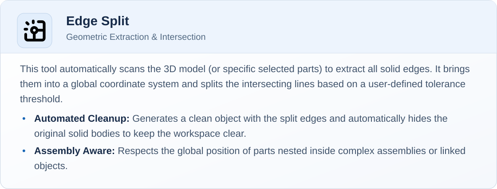</picture></a>

 
<a href="https://youtu.be/BuyjTM-gB38"><strong>Welding FreeCAD add-on - Automatic weldable edges recognition Demo</strong></a>

<a href="./MANUFAI_Workbench/Edge_Splitting"><picture><source media="(prefers-color-scheme: dark)" srcset="./docs/readme-svg/open-materials.svg"><source media="(prefers-color-scheme: light)" srcset="./docs/light/open-materials-light.svg"></picture></a>

<a name="readme-image-017" href="#readme-image-017"><picture><source media="(prefers-color-scheme: dark)" srcset="./docs/readme-svg/tool-find-weldable-edges.svg"><source media="(prefers-color-scheme: light)" srcset="./docs/light/tool-find-weldable-edges-light.svg">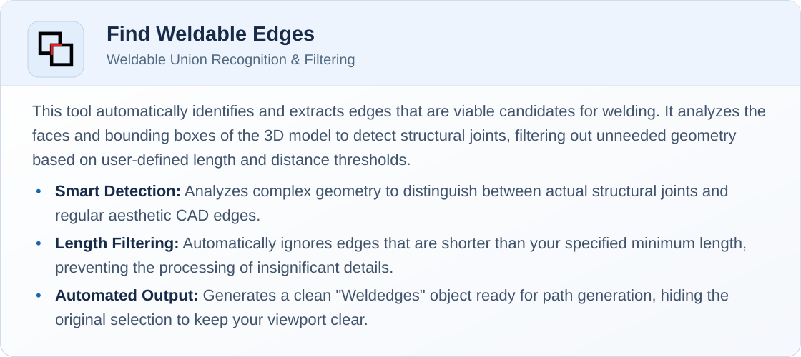</picture></a>

 
<a href="https://youtu.be/BuyjTM-gB38"><strong>Welding FreeCAD add-on - Automatic weldable edges recognition Demo</strong></a>

<a href="./MANUFAI_Workbench/Find_Weld_Edges"><picture><source media="(prefers-color-scheme: dark)" srcset="./docs/readme-svg/open-materials.svg"><source media="(prefers-color-scheme: light)" srcset="./docs/light/open-materials-light.svg"></picture></a>

<a name="readme-image-018" href="#readme-image-018"><picture><source media="(prefers-color-scheme: dark)" srcset="./docs/readme-svg/LINE.svg"><source media="(prefers-color-scheme: light)" srcset="./docs/light/LINE-light.svg"></picture></a>

<a name="readme-image-019" href="#readme-image-019"><picture><source media="(prefers-color-scheme: dark)" srcset="./docs/readme-svg/tool-weld-creators.svg"><source media="(prefers-color-scheme: light)" srcset="./docs/light/tool-weld-creators-light.svg">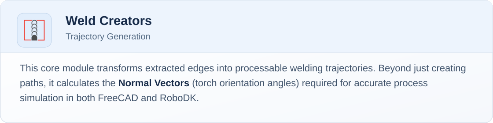</picture></a>

<a name="readme-image-020" href="#readme-image-020"><picture><source media="(prefers-color-scheme: dark)" srcset="./docs/readme-svg/weld-creators-make-weld.svg"><source media="(prefers-color-scheme: light)" srcset="./docs/light/weld-creators-make-weld-light.svg">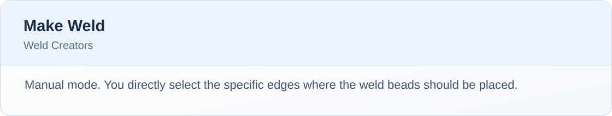</picture></a>

 
<a href="https://youtu.be/QdZxZB9vzDA"><strong>FreeCAD - Welding plugin - Define Welds Demo</strong></a>

<a name="readme-image-021" href="#readme-image-021"><picture><source media="(prefers-color-scheme: dark)" srcset="./docs/readme-svg/weld-creators-make-weld-with-all-edges.svg"><source media="(prefers-color-scheme: light)" srcset="./docs/light/weld-creators-make-weld-with-all-edges-light.svg">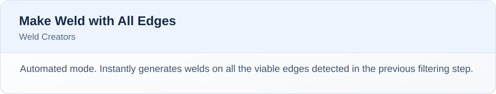</picture></a>

 
<a href="https://youtu.be/QdZxZB9vzDA"><strong>FreeCAD - Welding plugin - Define Welds Demo</strong></a>

<a name="readme-image-022" href="#readme-image-022"><picture><source media="(prefers-color-scheme: dark)" srcset="./docs/readme-svg/weld-creators-make-weld-with-specific-length.svg"><source media="(prefers-color-scheme: light)" srcset="./docs/light/weld-creators-make-weld-with-specific-length-light.svg">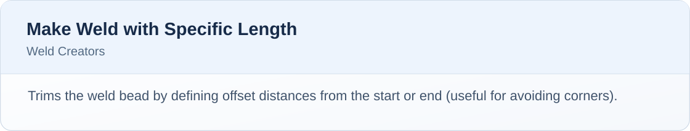</picture></a>

 
<a href="https://youtu.be/QdZxZB9vzDA"><strong>FreeCAD - Welding plugin - Define Welds Demo</strong></a>

<a name="readme-image-023" href="#readme-image-023"><picture><source media="(prefers-color-scheme: dark)" srcset="./docs/readme-svg/weld-creators-make-weld-with-chosen-points.svg"><source media="(prefers-color-scheme: light)" srcset="./docs/light/weld-creators-make-weld-with-chosen-points-light.svg">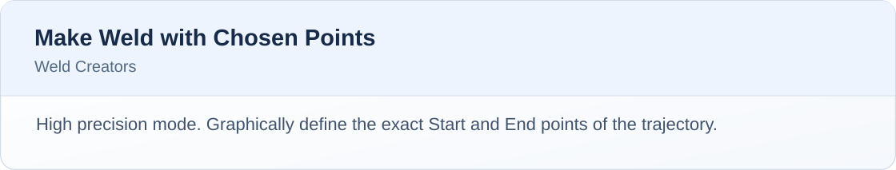</picture></a>

 
<a href="https://youtu.be/QdZxZB9vzDA"><strong>FreeCAD - Welding plugin - Define Welds Demo</strong></a>

<a name="readme-image-024" href="#readme-image-024"><picture><source media="(prefers-color-scheme: dark)" srcset="./docs/readme-svg/weld-creators-make-weld-with-multiple-specific-lengths.svg"><source media="(prefers-color-scheme: light)" srcset="./docs/light/weld-creators-make-weld-with-multiple-specific-lengths-light.svg">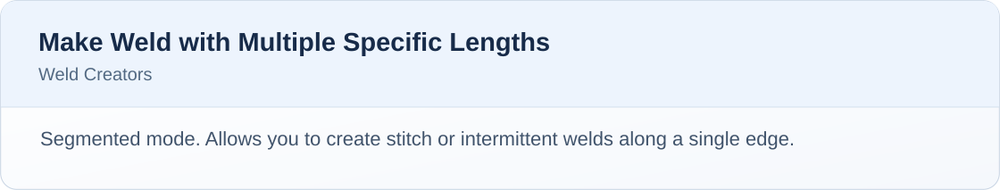</picture></a>

 
<a href="https://youtu.be/QdZxZB9vzDA"><strong>FreeCAD - Welding plugin - Define Welds Demo</strong></a>

<a name="readme-image-025" href="#readme-image-025"><picture><source media="(prefers-color-scheme: dark)" srcset="./docs/readme-svg/weld-creators-by-bead-quantity.svg"><source media="(prefers-color-scheme: light)" srcset="./docs/light/weld-creators-by-bead-quantity-light.svg">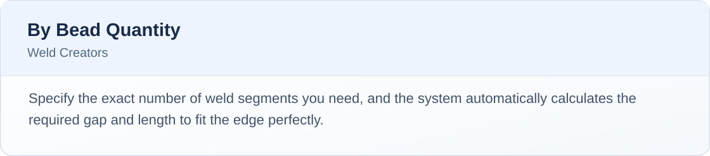</picture></a>

 
<a href="https://youtu.be/QdZxZB9vzDA"><strong>FreeCAD - Welding plugin - Define Welds Demo</strong></a>

<a name="readme-image-026" href="#readme-image-026"><picture><source media="(prefers-color-scheme: dark)" srcset="./docs/readme-svg/weld-creators-by-bead-length.svg"><source media="(prefers-color-scheme: light)" srcset="./docs/light/weld-creators-by-bead-length-light.svg">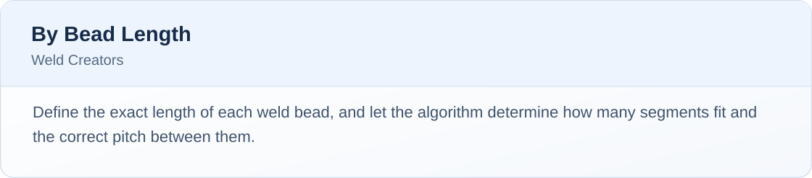</picture></a>

 
<a href="https://youtu.be/QdZxZB9vzDA"><strong>FreeCAD - Welding plugin - Define Welds Demo</strong></a>

<a name="readme-image-027" href="#readme-image-027"><picture><source media="(prefers-color-scheme: dark)" srcset="./docs/readme-svg/weld-creators-by-bead-pitch.svg"><source media="(prefers-color-scheme: light)" srcset="./docs/light/weld-creators-by-bead-pitch-light.svg">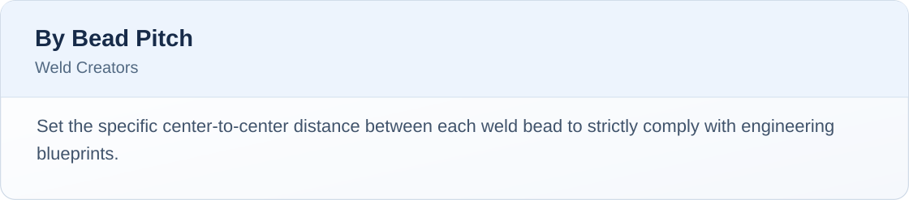</picture></a>

 
<a href="https://youtu.be/QdZxZB9vzDA"><strong>FreeCAD - Welding plugin - Define Welds Demo</strong></a>

<a name="readme-image-028" href="#readme-image-028"><picture><source media="(prefers-color-scheme: dark)" srcset="./docs/readme-svg/LINE.svg"><source media="(prefers-color-scheme: light)" srcset="./docs/light/LINE-light.svg"></picture></a>

<a href="./MANUFAI_Workbench/Weld_Trajectory_Generation"><picture><source media="(prefers-color-scheme: dark)" srcset="./docs/readme-svg/open-materials.svg"><source media="(prefers-color-scheme: light)" srcset="./docs/light/open-materials-light.svg"></picture></a>

<a name="readme-image-029" href="#readme-image-029"><picture><source media="(prefers-color-scheme: dark)" srcset="./docs/readme-svg/tool-add-normals.svg"><source media="(prefers-color-scheme: light)" srcset="./docs/light/tool-add-normals-light.svg">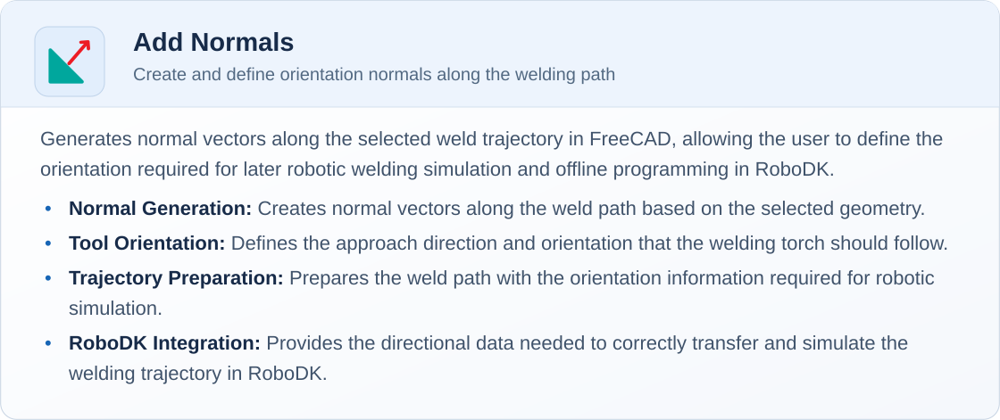</picture></a>

 
<a href="https://youtu.be/QdZxZB9vzDA"><strong>FreeCAD - Welding plugin - Define Welds Demo</strong></a>

<a href="./MANUFAI_Workbench/Weld_Trajectory_Generation"><picture><source media="(prefers-color-scheme: dark)" srcset="./docs/readme-svg/open-materials.svg"><source media="(prefers-color-scheme: light)" srcset="./docs/light/open-materials-light.svg"></picture></a>

<a name="readme-image-030" href="#readme-image-030"><picture><source media="(prefers-color-scheme: dark)" srcset="./docs/readme-svg/LINE.svg"><source media="(prefers-color-scheme: light)" srcset="./docs/light/LINE-light.svg"></picture></a>

<a name="readme-image-031" href="#readme-image-031"><picture><source media="(prefers-color-scheme: dark)" srcset="./docs/readme-svg/tool-surface-weld.svg"><source media="(prefers-color-scheme: light)" srcset="./docs/light/tool-surface-weld-light.svg">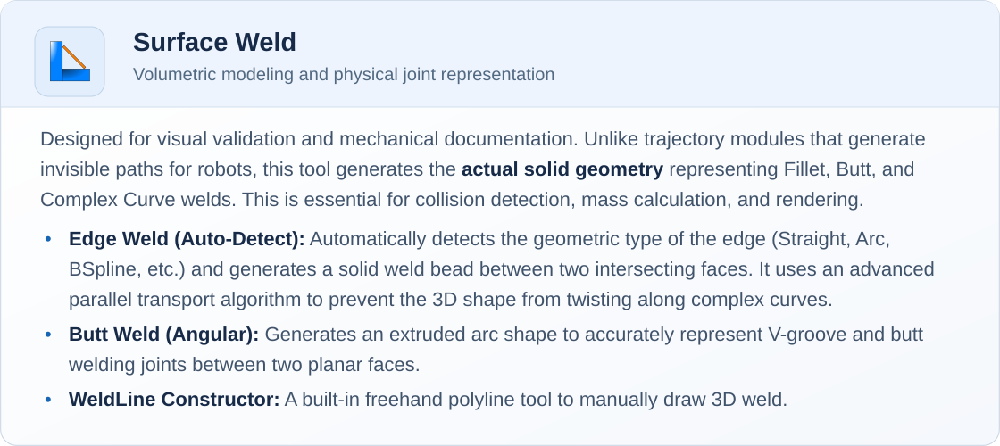</picture></a>

 
<a href="https://youtu.be/5uwMWgmB7Lk"><strong>Surface Weld Generator - FreeCAD Plugin Demo</strong></a>

<a href="./MANUFAI_Workbench/Surface_Weld_Generator"><picture><source media="(prefers-color-scheme: dark)" srcset="./docs/readme-svg/open-materials.svg"><source media="(prefers-color-scheme: light)" srcset="./docs/light/open-materials-light.svg"></picture></a>

<a name="readme-image-032" href="#readme-image-032"><picture><source media="(prefers-color-scheme: dark)" srcset="./docs/readme-svg/LINE.svg"><source media="(prefers-color-scheme: light)" srcset="./docs/light/LINE-light.svg"></picture></a>

<a name="readme-image-033" href="#readme-image-033"><picture><source media="(prefers-color-scheme: dark)" srcset="./docs/readme-svg/tool-weld-loader.svg"><source media="(prefers-color-scheme: light)" srcset="./docs/light/tool-weld-loader-light.svg">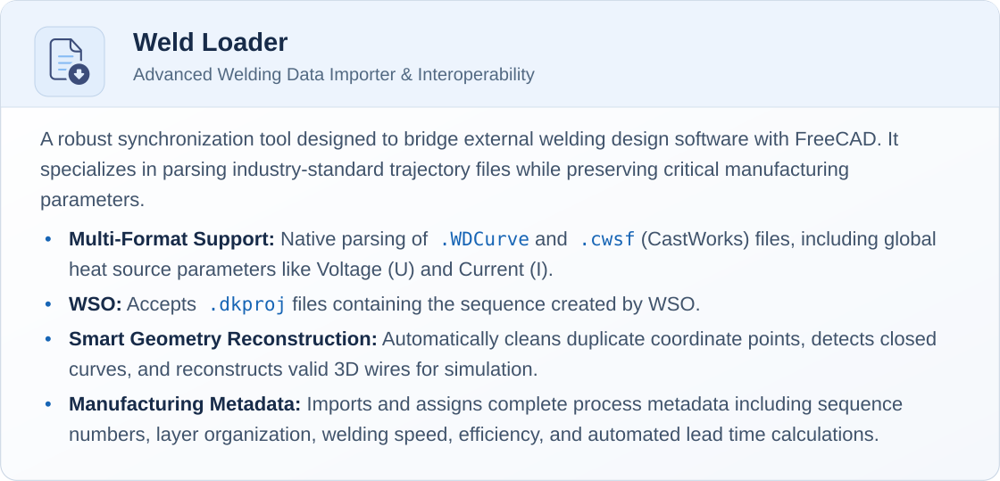</picture></a>

 
<a href="https://youtu.be/5uwMWgmB7Lk"><strong>Surface Weld Generator - FreeCAD Plugin Demo</strong></a>

<a href="./C3P_WdCurve_Tools/Weld_Loader_Pro"><picture><source media="(prefers-color-scheme: dark)" srcset="./docs/readme-svg/open-materials.svg"><source media="(prefers-color-scheme: light)" srcset="./docs/light/open-materials-light.svg"></picture></a>

<a name="readme-image-034" href="#readme-image-034"><picture><source media="(prefers-color-scheme: dark)" srcset="./docs/readme-svg/double.svg"><source media="(prefers-color-scheme: light)" srcset="./docs/light/double-light.svg"></picture></a>

<a name="readme-image-035" href="#toolbar-layout"><picture><source media="(prefers-color-scheme: dark)" srcset="./docs/readme-svg/category-positions.svg"><source media="(prefers-color-scheme: light)" srcset="./docs/light/category-positions-light.svg"></picture></a>

<a name="readme-image-036" href="#readme-image-036"><picture><source media="(prefers-color-scheme: dark)" srcset="./docs/readme-svg/tool-make-positions.svg"><source media="(prefers-color-scheme: light)" srcset="./docs/light/tool-make-positions-light.svg">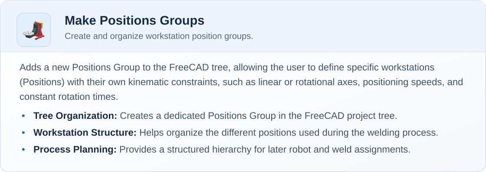</picture></a>

 
<a href="https://youtu.be/5uwMWgmB7Lk"><strong>Surface Weld Generator - FreeCAD Plugin Demo</strong></a>

<a href="./C3P_WdCurve_Tools/Weld_Loader_Pro"><picture><source media="(prefers-color-scheme: dark)" srcset="./docs/readme-svg/open-materials.svg"><source media="(prefers-color-scheme: light)" srcset="./docs/light/open-materials-light.svg"></picture></a>

<a name="readme-image-037" href="#readme-image-037"><picture><source media="(prefers-color-scheme: dark)" srcset="./docs/readme-svg/tool-assign-welds-to-robots.svg"><source media="(prefers-color-scheme: light)" srcset="./docs/light/tool-assign-welds-to-robots-light.svg">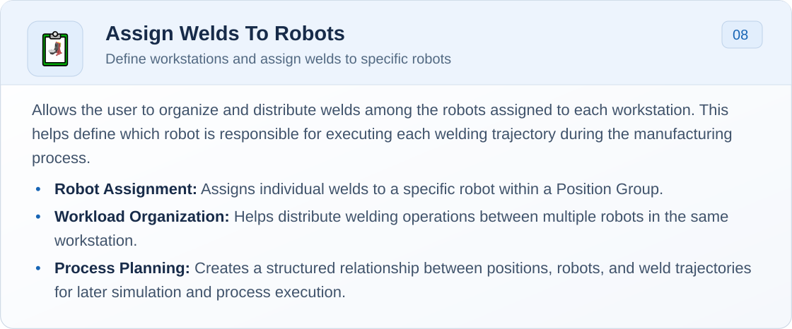</picture></a>

 
<a href="https://youtu.be/TU_ENLACE"><strong>Robotic Cell &amp; Assignment Manager - FreeCAD Plugin Demo</strong></a>

<a href="./MANUFAI_Workbench/Robot_Assignment"><picture><source media="(prefers-color-scheme: dark)" srcset="./docs/readme-svg/open-materials.svg"><source media="(prefers-color-scheme: light)" srcset="./docs/light/open-materials-light.svg"></picture></a>

<a name="readme-image-038" href="#readme-image-038"><picture><source media="(prefers-color-scheme: dark)" srcset="./docs/readme-svg/LINE.svg"><source media="(prefers-color-scheme: light)" srcset="./docs/light/LINE-light.svg"></picture></a>

<a name="readme-image-039" href="#readme-image-039"><picture><source media="(prefers-color-scheme: dark)" srcset="./docs/readme-svg/tool-subassembly.svg"><source media="(prefers-color-scheme: light)" srcset="./docs/light/tool-subassembly-light.svg">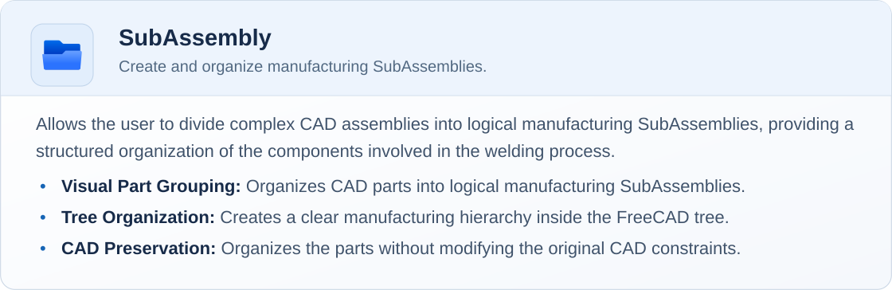</picture></a>

 
<a href="https://youtu.be/5uwMWgmB7Lk"><strong>Surface Weld Generator - FreeCAD Plugin Demo</strong></a>

<a href="./C3P_WdCurve_Tools/Weld_Loader_Pro"><picture><source media="(prefers-color-scheme: dark)" srcset="./docs/readme-svg/open-materials.svg"><source media="(prefers-color-scheme: light)" srcset="./docs/light/open-materials-light.svg"></picture></a>

<a name="readme-image-040" href="#readme-image-040"><picture><source media="(prefers-color-scheme: dark)" srcset="./docs/readme-svg/tool-assign-positions.svg"><source media="(prefers-color-scheme: light)" srcset="./docs/light/tool-assign-positions-light.svg">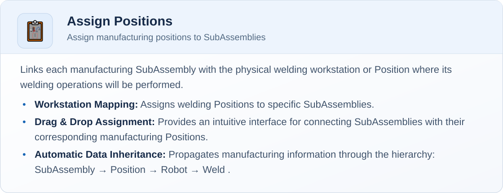</picture></a>

 
<a href="https://youtu.be/TU_ENLACE"><strong>SubAssembly &amp; Position Manager - FreeCAD Plugin Demo</strong></a>

<a href="./MANUFAI_Workbench/SubAssembly_Manager"><picture><source media="(prefers-color-scheme: dark)" srcset="./docs/readme-svg/open-materials.svg"><source media="(prefers-color-scheme: light)" srcset="./docs/light/open-materials-light.svg"></picture></a>

<a name="readme-image-041" href="#readme-image-041"><picture><source media="(prefers-color-scheme: dark)" srcset="./docs/readme-svg/LINE.svg"><source media="(prefers-color-scheme: light)" srcset="./docs/light/LINE-light.svg"></picture></a>

<a name="readme-image-042" href="#readme-image-042"><picture><source media="(prefers-color-scheme: dark)" srcset="./docs/readme-svg/tool-move-subassembly.svg"><source media="(prefers-color-scheme: light)" srcset="./docs/light/tool-move-subassembly-light.svg">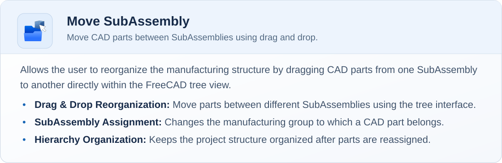</picture></a>

 
<a href="https://youtu.be/TU_ENLACE"><strong>Smart Hierarchy Organizers - FreeCAD Plugin Demo</strong></a>

<a href="./MANUFAI_Workbench/Hierarchy_Organizers"><picture><source media="(prefers-color-scheme: dark)" srcset="./docs/readme-svg/open-materials.svg"><source media="(prefers-color-scheme: light)" srcset="./docs/light/open-materials-light.svg"></picture></a>

<a name="readme-image-043" href="#readme-image-043"><picture><source media="(prefers-color-scheme: dark)" srcset="./docs/readme-svg/tool-move-welds.svg"><source media="(prefers-color-scheme: light)" srcset="./docs/light/tool-move-welds-light.svg">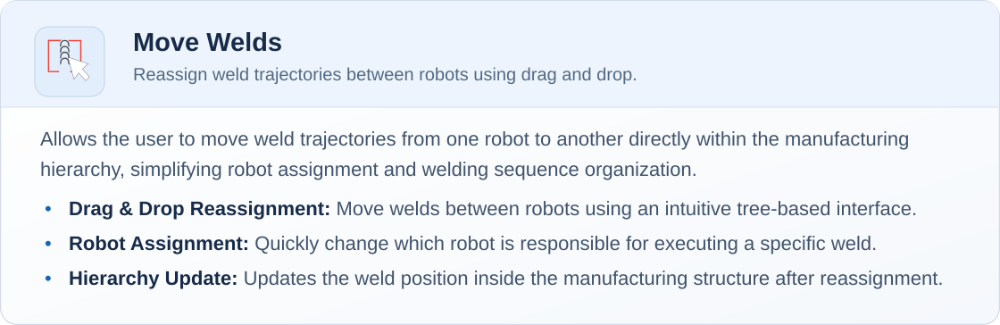</picture></a>

 
<a href="https://youtu.be/5uwMWgmB7Lk"><strong>Surface Weld Generator - FreeCAD Plugin Demo</strong></a>

<a href="./C3P_WdCurve_Tools/Weld_Loader_Pro"><picture><source media="(prefers-color-scheme: dark)" srcset="./docs/readme-svg/open-materials.svg"><source media="(prefers-color-scheme: light)" srcset="./docs/light/open-materials-light.svg"></picture></a>

<a name="readme-image-044" href="#readme-image-044"><picture><source media="(prefers-color-scheme: dark)" srcset="./docs/readme-svg/double.svg"><source media="(prefers-color-scheme: light)" srcset="./docs/light/double-light.svg"></picture></a>

<a name="readme-image-045" href="#toolbar-layout"><picture><source media="(prefers-color-scheme: dark)" srcset="./docs/readme-svg/category-length.svg"><source media="(prefers-color-scheme: light)" srcset="./docs/light/category-length-light.svg"></picture></a>

<a name="readme-image-046" href="#readme-image-046"><picture><source media="(prefers-color-scheme: dark)" srcset="./docs/readme-svg/tool-weld-length-report.svg"><source media="(prefers-color-scheme: light)" srcset="./docs/light/tool-weld-length-report-light.svg">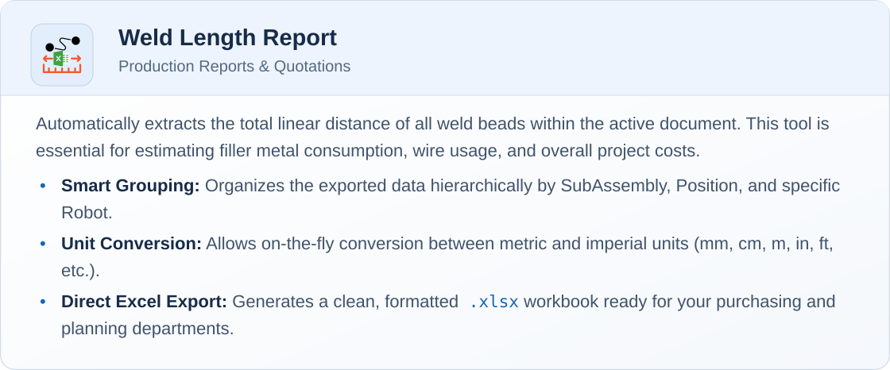</picture></a>

 
<a href="https://youtu.be/hXmbLb0A_RI"><strong>FreeCAD - Plugin - Total welding distance Demo</strong></a>

<a href="./MANUFAI_Workbench/Reports"><picture><source media="(prefers-color-scheme: dark)" srcset="./docs/readme-svg/open-materials.svg"><source media="(prefers-color-scheme: light)" srcset="./docs/light/open-materials-light.svg"></picture></a>

<a name="readme-image-047" href="#readme-image-047"><picture><source media="(prefers-color-scheme: dark)" srcset="./docs/readme-svg/double.svg"><source media="(prefers-color-scheme: light)" srcset="./docs/light/double-light.svg"></picture></a>

<a name="readme-image-048" href="#toolbar-layout"><picture><source media="(prefers-color-scheme: dark)" srcset="./docs/readme-svg/category-cycle-time-tools.svg"><source media="(prefers-color-scheme: light)" srcset="./docs/light/category-cycle-time-tools-light.svg"></picture></a>

<a name="readme-image-049" href="#readme-image-049"><picture><source media="(prefers-color-scheme: dark)" srcset="./docs/readme-svg/tool-process.svg"><source media="(prefers-color-scheme: light)" srcset="./docs/light/tool-process-light.svg">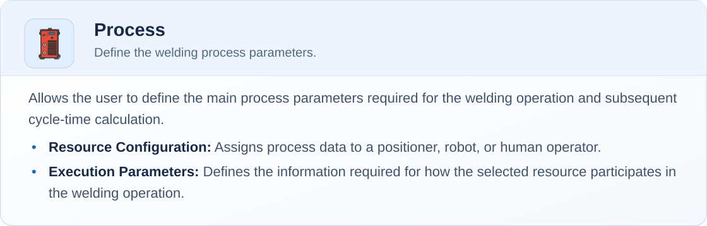</picture></a>

 
<a href="https://youtu.be/5uwMWgmB7Lk"><strong>Surface Weld Generator - FreeCAD Plugin Demo</strong></a>

<a href="./C3P_WdCurve_Tools/Weld_Loader_Pro"><picture><source media="(prefers-color-scheme: dark)" srcset="./docs/readme-svg/open-materials.svg"><source media="(prefers-color-scheme: light)" srcset="./docs/light/open-materials-light.svg"></picture></a>

<a name="readme-image-050" href="#readme-image-050"><picture><source media="(prefers-color-scheme: dark)" srcset="./docs/readme-svg/tool-assign-process.svg"><source media="(prefers-color-scheme: light)" srcset="./docs/light/tool-assign-process-light.svg">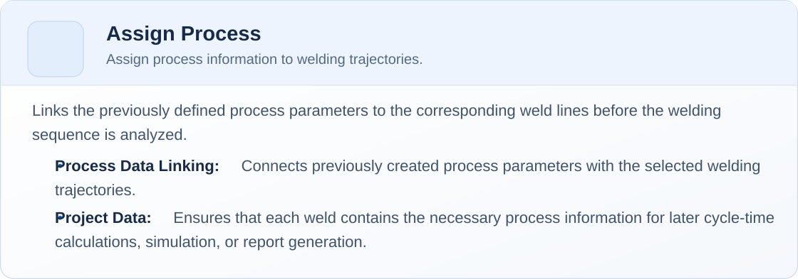</picture></a>

 
<a href="https://youtu.be/5uwMWgmB7Lk"><strong>Surface Weld Generator - FreeCAD Plugin Demo</strong></a>

<a href="./C3P_WdCurve_Tools/Weld_Loader_Pro"><picture><source media="(prefers-color-scheme: dark)" srcset="./docs/readme-svg/open-materials.svg"><source media="(prefers-color-scheme: light)" srcset="./docs/light/open-materials-light.svg"></picture></a>

<a name="readme-image-051" href="#readme-image-051"><picture><source media="(prefers-color-scheme: dark)" srcset="./docs/readme-svg/LINE.svg"><source media="(prefers-color-scheme: light)" srcset="./docs/light/LINE-light.svg"></picture></a>

<a name="readme-image-052" href="#readme-image-052"><picture><source media="(prefers-color-scheme: dark)" srcset="./docs/readme-svg/tool-welding-parameters.svg"><source media="(prefers-color-scheme: light)" srcset="./docs/light/tool-welding-parameters-light.svg">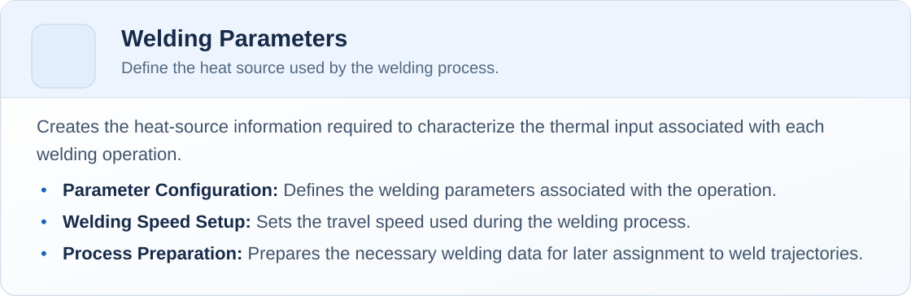</picture></a>

 
<a href="https://youtu.be/5uwMWgmB7Lk"><strong>Surface Weld Generator - FreeCAD Plugin Demo</strong></a>

<a href="./C3P_WdCurve_Tools/Weld_Loader_Pro"><picture><source media="(prefers-color-scheme: dark)" srcset="./docs/readme-svg/open-materials.svg"><source media="(prefers-color-scheme: light)" srcset="./docs/light/open-materials-light.svg"></picture></a>

<a name="readme-image-053" href="#readme-image-053"><picture><source media="(prefers-color-scheme: dark)" srcset="./docs/readme-svg/tool-assign-welding-parameters.svg"><source media="(prefers-color-scheme: light)" srcset="./docs/light/tool-assign-welding-parameters-light.svg">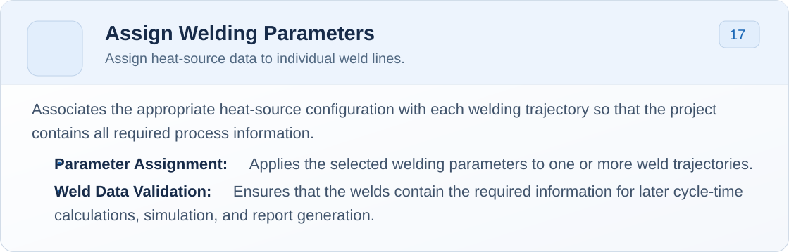</picture></a>

 
<a href="https://youtu.be/5uwMWgmB7Lk"><strong>Surface Weld Generator - FreeCAD Plugin Demo</strong></a>

<a href="./C3P_WdCurve_Tools/Weld_Loader_Pro"><picture><source media="(prefers-color-scheme: dark)" srcset="./docs/readme-svg/open-materials.svg"><source media="(prefers-color-scheme: light)" srcset="./docs/light/open-materials-light.svg"></picture></a>

<a name="readme-image-054" href="#readme-image-054"><picture><source media="(prefers-color-scheme: dark)" srcset="./docs/readme-svg/LINE.svg"><source media="(prefers-color-scheme: light)" srcset="./docs/light/LINE-light.svg"></picture></a>

<a name="readme-image-055" href="#readme-image-055"><picture><source media="(prefers-color-scheme: dark)" srcset="./docs/readme-svg/tool-cycle-time.svg"><source media="(prefers-color-scheme: light)" srcset="./docs/light/tool-cycle-time-light.svg">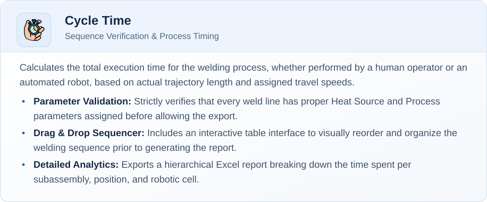</picture></a>

 
<a href="https://youtu.be/Giv5xZ7Uw44"><strong>FreeCAD Plugin - Cycle time report - Robot or Manual welding Demo</strong></a>

<a href="./MANUFAI_Workbench/Find_Weld_Edges"><picture><source media="(prefers-color-scheme: dark)" srcset="./docs/readme-svg/open-materials.svg"><source media="(prefers-color-scheme: light)" srcset="./docs/light/open-materials-light.svg"></picture></a>

<a name="readme-image-056" href="#readme-image-056"><picture><source media="(prefers-color-scheme: dark)" srcset="./docs/readme-svg/double.svg"><source media="(prefers-color-scheme: light)" srcset="./docs/light/double-light.svg"></picture></a>

<a name="readme-image-057" href="#toolbar-layout"><picture><source media="(prefers-color-scheme: dark)" srcset="./docs/readme-svg/category-weight.svg"><source media="(prefers-color-scheme: light)" srcset="./docs/light/category-weight-light.svg"></picture></a>

<a name="readme-image-058" href="#readme-image-058"><picture><source media="(prefers-color-scheme: dark)" srcset="./docs/readme-svg/tool-create-materials.svg"><source media="(prefers-color-scheme: light)" srcset="./docs/light/tool-create-materials-light.svg">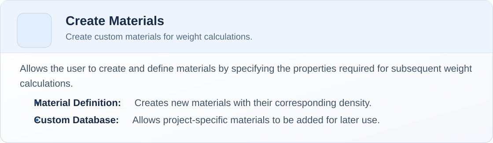</picture></a>

 
<a href="https://youtu.be/5uwMWgmB7Lk"><strong>Surface Weld Generator - FreeCAD Plugin Demo</strong></a>

<a href="./C3P_WdCurve_Tools/Weld_Loader_Pro"><picture><source media="(prefers-color-scheme: dark)" srcset="./docs/readme-svg/open-materials.svg"><source media="(prefers-color-scheme: light)" srcset="./docs/light/open-materials-light.svg"></picture></a>

<a name="readme-image-059" href="#readme-image-059"><picture><source media="(prefers-color-scheme: dark)" srcset="./docs/readme-svg/tool-assign-materials.svg"><source media="(prefers-color-scheme: light)" srcset="./docs/light/tool-assign-materials-light.svg">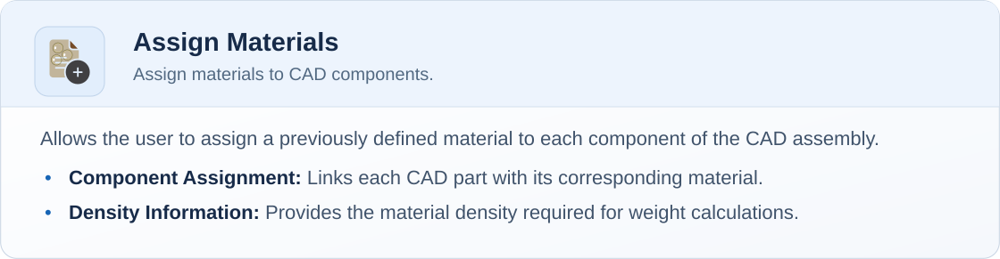</picture></a>

 
<a href="https://youtu.be/5uwMWgmB7Lk"><strong>Surface Weld Generator - FreeCAD Plugin Demo</strong></a>

<a href="./C3P_WdCurve_Tools/Weld_Loader_Pro"><picture><source media="(prefers-color-scheme: dark)" srcset="./docs/readme-svg/open-materials.svg"><source media="(prefers-color-scheme: light)" srcset="./docs/light/open-materials-light.svg"></picture></a>

<a name="readme-image-060" href="#readme-image-060"><picture><source media="(prefers-color-scheme: dark)" srcset="./docs/readme-svg/LINE.svg"><source media="(prefers-color-scheme: light)" srcset="./docs/light/LINE-light.svg"></picture></a>

<a name="readme-image-061" href="#readme-image-061"><picture><source media="(prefers-color-scheme: dark)" srcset="./docs/readme-svg/tool-weight-of-welding-and-welded-part.svg"><source media="(prefers-color-scheme: light)" srcset="./docs/light/tool-weight-of-welding-and-welded-part-light.svg">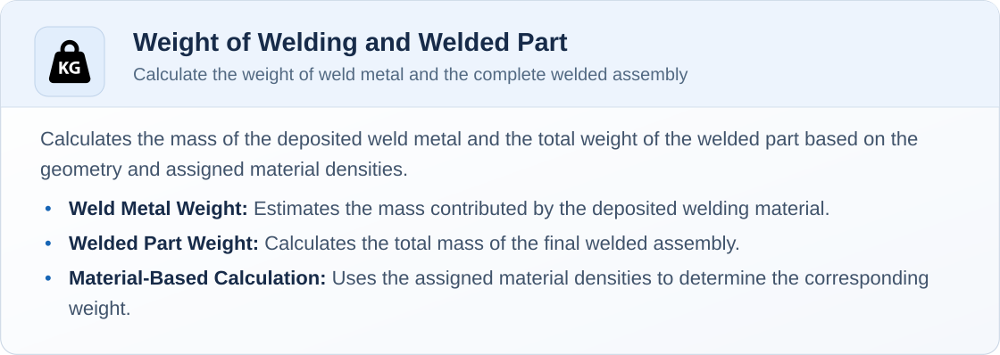</picture></a>

 
<a href="https://youtu.be/HbsH8DEtrP8"><strong>FreeCAD plugin welded part weight report Demo</strong></a>

<a href="./MANUFAI_Workbench/Weight_Report"><picture><source media="(prefers-color-scheme: dark)" srcset="./docs/readme-svg/open-materials.svg"><source media="(prefers-color-scheme: light)" srcset="./docs/light/open-materials-light.svg"></picture></a>

<a name="readme-image-062" href="#readme-image-062"><picture><source media="(prefers-color-scheme: dark)" srcset="./docs/readme-svg/double.svg"><source media="(prefers-color-scheme: light)" srcset="./docs/light/double-light.svg"></picture></a>

<a name="readme-image-063" href="#toolbar-layout"><picture><source media="(prefers-color-scheme: dark)" srcset="./docs/readme-svg/category-wso.svg"><source media="(prefers-color-scheme: light)" srcset="./docs/light/category-wso-light.svg"></picture></a>

<a name="readme-image-064" href="#readme-image-064"><picture><source media="(prefers-color-scheme: dark)" srcset="./docs/readme-svg/tool-export-stl.svg"><source media="(prefers-color-scheme: light)" srcset="./docs/light/tool-export-stl-light.svg">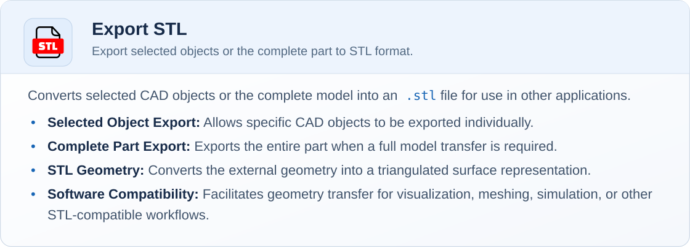</picture></a>

 
<a href="https://youtu.be/HbsH8DEtrP8"><strong>FreeCAD plugin welded part weight report Demo</strong></a>

<a name="readme-image-065" href="#readme-image-065"><picture><source media="(prefers-color-scheme: dark)" srcset="./docs/readme-svg/LINE.svg"><source media="(prefers-color-scheme: light)" srcset="./docs/light/LINE-light.svg"></picture></a>

<a href="./MANUFAI_Workbench/Weight_Report"><picture><source media="(prefers-color-scheme: dark)" srcset="./docs/readme-svg/open-materials.svg"><source media="(prefers-color-scheme: light)" srcset="./docs/light/open-materials-light.svg"></picture></a>

<a name="readme-image-066" href="#readme-image-066"><picture><source media="(prefers-color-scheme: dark)" srcset="./docs/readme-svg/tool-export-as-dk-project.svg"><source media="(prefers-color-scheme: light)" srcset="./docs/light/tool-export-as-dk-project-light.svg">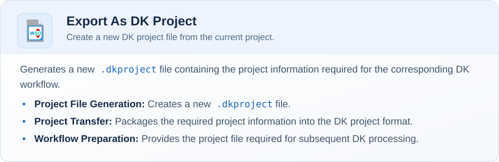</picture></a>

 
<a href="https://youtu.be/48nRLUuxqVA"><strong>WSO with DK Algorithm Demo</strong></a>

 
<a href="https://youtu.be/bhIbrSHBmeU"><strong>Sequence Visualizer [Output] Demo</strong></a>

<a href="./MANUFAI_Workbench/Sequence_AI_Advisor"><picture><source media="(prefers-color-scheme: dark)" srcset="./docs/readme-svg/open-materials.svg"><source media="(prefers-color-scheme: light)" srcset="./docs/light/open-materials-light.svg"></picture></a>

<a name="readme-image-067" href="#readme-image-067"><picture><source media="(prefers-color-scheme: dark)" srcset="./docs/readme-svg/double.svg"><source media="(prefers-color-scheme: light)" srcset="./docs/light/double-light.svg"></picture></a>

<a name="readme-image-068" href="#toolbar-layout"><picture><source media="(prefers-color-scheme: dark)" srcset="./docs/readme-svg/category-simulation.svg"><source media="(prefers-color-scheme: light)" srcset="./docs/light/category-simulation-light.svg"></picture></a>

<a name="readme-image-069" href="#readme-image-069"><picture><source media="(prefers-color-scheme: dark)" srcset="./docs/readme-svg/tool-assign-sequence.svg"><source media="(prefers-color-scheme: light)" srcset="./docs/light/tool-assign-sequence-light.svg">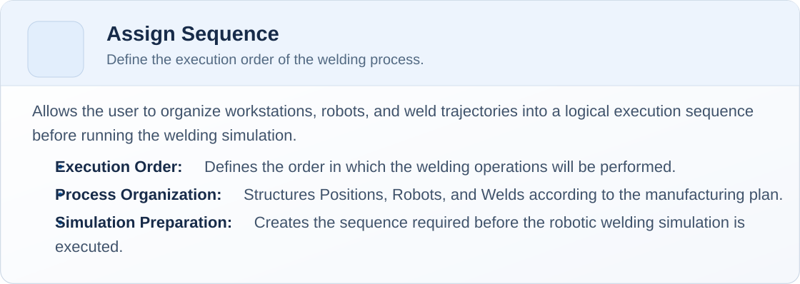</picture></a>

 
<a href="https://youtu.be/HbsH8DEtrP8"><strong>FreeCAD plugin welded part weight report Demo</strong></a>

<a href="./MANUFAI_Workbench/Weight_Report"><picture><source media="(prefers-color-scheme: dark)" srcset="./docs/readme-svg/open-materials.svg"><source media="(prefers-color-scheme: light)" srcset="./docs/light/open-materials-light.svg"></picture></a>

<a name="readme-image-070" href="#readme-image-070"><picture><source media="(prefers-color-scheme: dark)" srcset="./docs/readme-svg/LINE.svg"><source media="(prefers-color-scheme: light)" srcset="./docs/light/LINE-light.svg"></picture></a>

<a name="readme-image-071" href="#readme-image-071"><picture><source media="(prefers-color-scheme: dark)" srcset="./docs/readme-svg/tool-weld-simulation.svg"><source media="(prefers-color-scheme: light)" srcset="./docs/light/tool-weld-simulation-light.svg">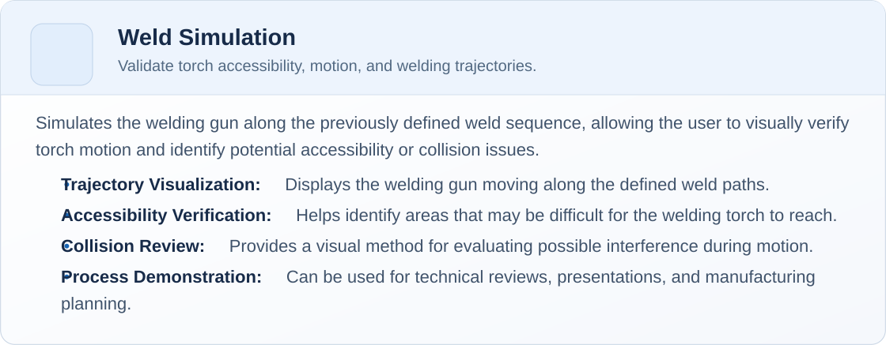</picture></a>

 
<a href="https://youtu.be/kuIgRGPw8nU"><strong>FreeCAD Plugin - Simulate welding gun on a trajectory Demo</strong></a>

<a href="./MANUFAI_Workbench/Welding_Gun_Simulation"><picture><source media="(prefers-color-scheme: dark)" srcset="./docs/readme-svg/open-materials.svg"><source media="(prefers-color-scheme: light)" srcset="./docs/light/open-materials-light.svg"></picture></a>

<a name="readme-image-072" href="#readme-image-072"><picture><source media="(prefers-color-scheme: dark)" srcset="./docs/readme-svg/LINE.svg"><source media="(prefers-color-scheme: light)" srcset="./docs/light/LINE-light.svg"></picture></a>

<a name="readme-image-073" href="#readme-image-073"><picture><source media="(prefers-color-scheme: dark)" srcset="./docs/readme-svg/tool-weld-visualizer.svg"><source media="(prefers-color-scheme: light)" srcset="./docs/light/tool-weld-visualizer-light.svg">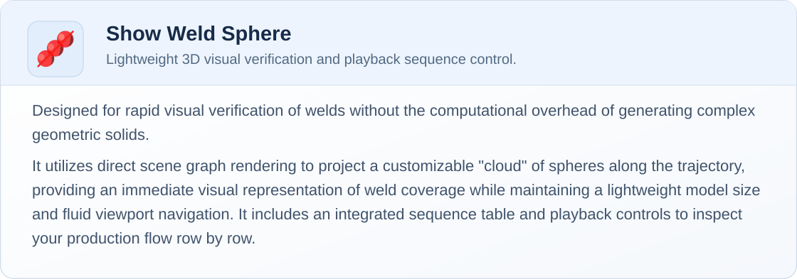</picture></a>

 
<a href="https://youtu.be/Ccb7qmT_r68"><strong>Weld Visualizer (Sphere Mode) - FreeCAD Plugin Demo</strong></a>

<a href="./MANUFAI_Workbench/Weld_Visualizer"><picture><source media="(prefers-color-scheme: dark)" srcset="./docs/readme-svg/open-materials.svg"><source media="(prefers-color-scheme: light)" srcset="./docs/light/open-materials-light.svg"></picture></a>

<a name="readme-image-074" href="#readme-image-074"><picture><source media="(prefers-color-scheme: dark)" srcset="./docs/readme-svg/LINE.svg"><source media="(prefers-color-scheme: light)" srcset="./docs/light/LINE-light.svg"></picture></a>

<a name="readme-image-075" href="#readme-image-075"><picture><source media="(prefers-color-scheme: dark)" srcset="./docs/readme-svg/tool-visualizer-cmd.svg"><source media="(prefers-color-scheme: light)" srcset="./docs/light/tool-visualizer-cmd-light.svg">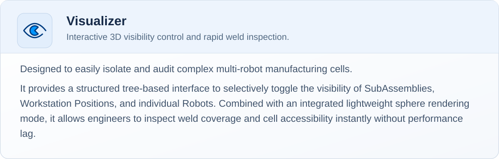</picture></a>

 
<a href="https://youtu.be/TU_ENLACE"><strong>Assembly Visualizer - FreeCAD Plugin Demo</strong></a>

<a href="./MANUFAI_Workbench/Assembly_Visualizer"><picture><source media="(prefers-color-scheme: dark)" srcset="./docs/readme-svg/open-materials.svg"><source media="(prefers-color-scheme: light)" srcset="./docs/light/open-materials-light.svg"></picture></a>

 

<a name="readme-image-076" href="#readme-image-076"><picture><source media="(prefers-color-scheme: dark)" srcset="./docs/readme-svg/double.svg"><source media="(prefers-color-scheme: light)" srcset="./docs/light/double-light.svg"></picture></a>

<a name="readme-image-077" href="#toolbar-layout"><picture><source media="(prefers-color-scheme: dark)" srcset="./docs/readme-svg/section-datum-alignment-tools.svg"><source media="(prefers-color-scheme: light)" srcset="./docs/light/section-datum-alignment-tools-light.svg"></picture></a>

<a name="readme-image-078" href="#readme-image-078"><picture><source media="(prefers-color-scheme: dark)" srcset="./docs/readme-svg/tool-toggle-visibility-recursive.svg"><source media="(prefers-color-scheme: light)" srcset="./docs/light/tool-toggle-visibility-recursive-light.svg">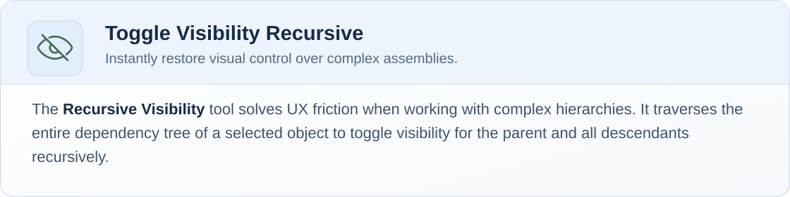</picture></a>

 
<a href="https://youtu.be/360sB3FVUp4"><strong>Recursive Visibility Toggle for Complex Assemblies - FreeCAD Plugin Demo</strong></a>

<a href="./Datum_321_Alignment/Recursive_Visibility"><picture><source media="(prefers-color-scheme: dark)" srcset="./docs/readme-svg/open-materials.svg"><source media="(prefers-color-scheme: light)" srcset="./docs/light/open-materials-light.svg"></picture></a>

<a name="readme-image-079" href="#readme-image-079"><picture><source media="(prefers-color-scheme: dark)" srcset="./docs/readme-svg/LINE.svg"><source media="(prefers-color-scheme: light)" srcset="./docs/light/LINE-light.svg"></picture></a>

<a name="readme-image-080" href="#readme-image-080"><picture><source media="(prefers-color-scheme: dark)" srcset="./docs/readme-svg/tool-create-center-point.svg"><source media="(prefers-color-scheme: light)" srcset="./docs/light/tool-create-center-point-light.svg">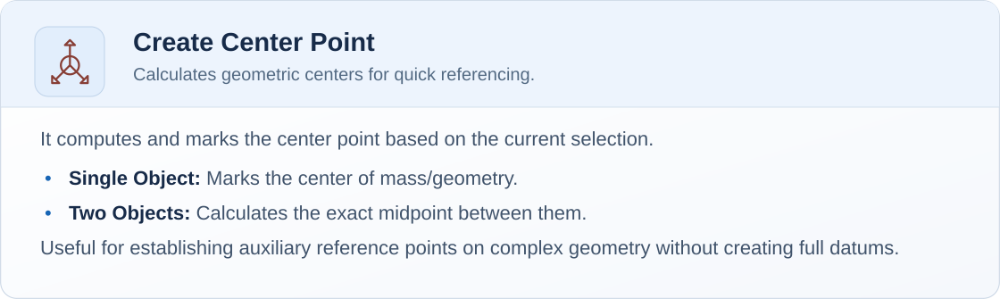</picture></a>

 
<a href="https://youtu.be/AsVGiXEPmd4"><strong>Center Point - MANUFAI FreeCAD Plugin Demo</strong></a>

<a href="./Datum_321_Alignment/Center_Point"><picture><source media="(prefers-color-scheme: dark)" srcset="./docs/readme-svg/open-materials.svg"><source media="(prefers-color-scheme: light)" srcset="./docs/light/open-materials-light.svg"></picture></a>

<a name="readme-image-081" href="#readme-image-081"><picture><source media="(prefers-color-scheme: dark)" srcset="./docs/readme-svg/LINE.svg"><source media="(prefers-color-scheme: light)" srcset="./docs/light/LINE-light.svg"></picture></a>

<a name="readme-image-082" href="#readme-image-082"><picture><source media="(prefers-color-scheme: dark)" srcset="./docs/readme-svg/tool-create-sphere-at-origin.svg"><source media="(prefers-color-scheme: light)" srcset="./docs/light/tool-create-sphere-at-origin-light.svg">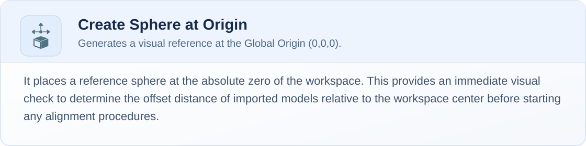</picture></a>

 
<a href="https://youtu.be/HbsH8DEtrP8"><strong>FreeCAD plugin welded part weight report Demo</strong></a>

<a href="./Datum_321_Alignment/Create_Sphere_Origin"><picture><source media="(prefers-color-scheme: dark)" srcset="./docs/readme-svg/open-materials.svg"><source media="(prefers-color-scheme: light)" srcset="./docs/light/open-materials-light.svg"></picture></a>

<a name="readme-image-083" href="#toolbar-layout"><picture><source media="(prefers-color-scheme: dark)" srcset="./docs/readme-svg/category%203-2-1%20Datum%20Based%20Alignment.svg"><source media="(prefers-color-scheme: light)" srcset="./docs/light/category%203-2-1%20Datum%20Based%20Alignment-light.svg"></picture></a>

<a name="readme-image-084" href="#readme-image-084"><picture><source media="(prefers-color-scheme: dark)" srcset="./docs/readme-svg/LINE.svg"><source media="(prefers-color-scheme: light)" srcset="./docs/light/LINE-light.svg"></picture></a>

<a name="readme-image-085" href="#readme-image-085"><picture><source media="(prefers-color-scheme: dark)" srcset="./docs/readme-svg/tool-datum-a.svg"><source media="(prefers-color-scheme: light)" srcset="./docs/light/tool-datum-a-light.svg">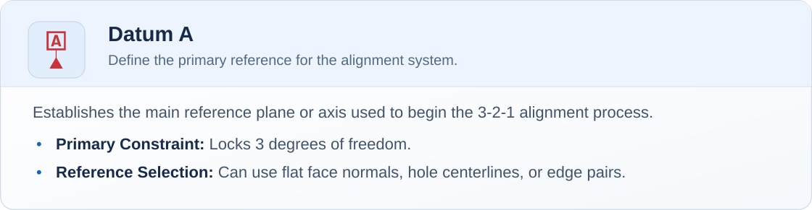</picture></a>

<a name="readme-image-086" href="#readme-image-086"><picture><source media="(prefers-color-scheme: dark)" srcset="./docs/readme-svg/tool-datum-b.svg"><source media="(prefers-color-scheme: light)" srcset="./docs/light/tool-datum-b-light.svg">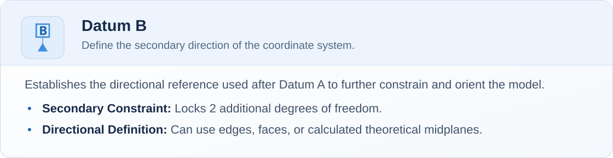</picture></a>

<a name="readme-image-087" href="#readme-image-087"><picture><source media="(prefers-color-scheme: dark)" srcset="./docs/readme-svg/tool-datum-c.svg"><source media="(prefers-color-scheme: light)" srcset="./docs/light/tool-datum-c-light.svg">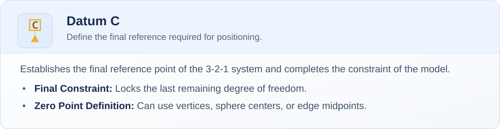</picture></a>

<a name="readme-image-088" href="#readme-image-088"><picture><source media="(prefers-color-scheme: dark)" srcset="./docs/readme-svg/tool-move-model-to-origin.svg"><source media="(prefers-color-scheme: light)" srcset="./docs/light/tool-move-model-to-origin-light.svg">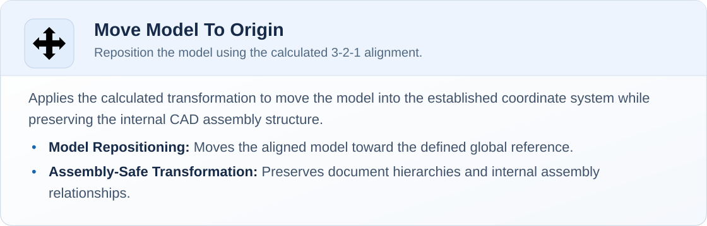</picture></a>

 
<a href="https://youtu.be/hPKx3S9DQLc"><strong>3-2-1 Datum Based Alignment - MANUFAI FreeCAD Plugin Demo</strong></a>

<a href="./Datum_321_Alignment/Create_Sphere_Origin"><picture><source media="(prefers-color-scheme: dark)" srcset="./docs/readme-svg/open-materials.svg"><source media="(prefers-color-scheme: light)" srcset="./docs/light/open-materials-light.svg"></picture></a>

<a name="readme-image-089" href="#toolbar-layout"><picture><source media="(prefers-color-scheme: dark)" srcset="./docs/readme-svg/category%20tools.svg"><source media="(prefers-color-scheme: light)" srcset="./docs/light/category%20tools-light.svg"></picture></a>

<a name="readme-image-090" href="#readme-image-090"><picture><source media="(prefers-color-scheme: dark)" srcset="./docs/readme-svg/LINE.svg"><source media="(prefers-color-scheme: light)" srcset="./docs/light/LINE-light.svg"></picture></a>

<a name="readme-image-091" href="#readme-image-091"><picture><source media="(prefers-color-scheme: dark)" srcset="./docs/readme-svg/tool-reset-pos.svg"><source media="(prefers-color-scheme: light)" srcset="./docs/light/tool-reset-pos-light.svg">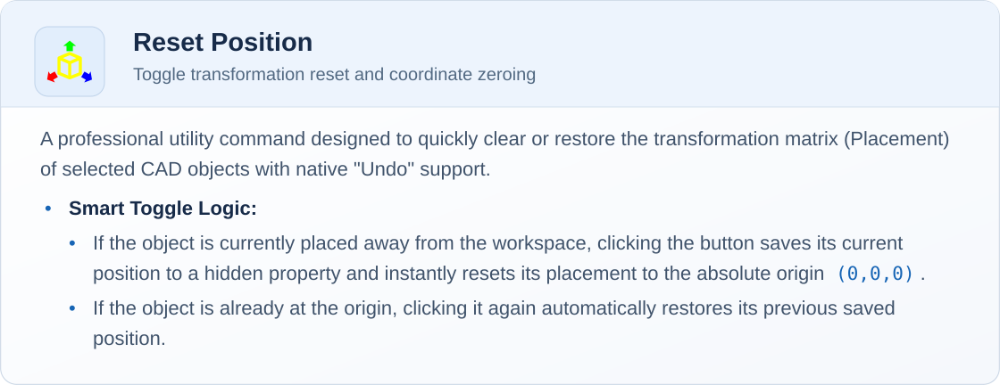</picture></a>

 
<a href="https://youtu.be/TU_ENLACE"><strong>Reset Position - FreeCAD Plugin Demo</strong></a>

<a href="./MANUFAI_Workbench/Reset_Position"><picture><source media="(prefers-color-scheme: dark)" srcset="./docs/readme-svg/open-materials.svg"><source media="(prefers-color-scheme: light)" srcset="./docs/light/open-materials-light.svg"></picture></a>

<a name="readme-image-092" href="#readme-image-092"><picture><source media="(prefers-color-scheme: dark)" srcset="./docs/readme-svg/LINE.svg"><source media="(prefers-color-scheme: light)" srcset="./docs/light/LINE-light.svg"></picture></a>

<a name="readme-image-093" href="#readme-image-093"><picture><source media="(prefers-color-scheme: dark)" srcset="./docs/readme-svg/tool-show-welding-widget-command.svg"><source media="(prefers-color-scheme: light)" srcset="./docs/light/tool-show-welding-widget-command-light.svg"></picture></a>

 
<a href="https://youtu.be/Yp307CxQaUM"><strong>Welding Reference Tool - FreeCAD Plugin Demo</strong></a>

<a href="./Datum_321_Alignment/Welding_Reference"><picture><source media="(prefers-color-scheme: dark)" srcset="./docs/readme-svg/open-materials.svg"><source media="(prefers-color-scheme: light)" srcset="./docs/light/open-materials-light.svg"></picture></a>

<a name="readme-image-094" href="#readme-image-094"><picture><source media="(prefers-color-scheme: dark)" srcset="./docs/readme-svg/LINE.svg"><source media="(prefers-color-scheme: light)" srcset="./docs/light/LINE-light.svg"></picture></a>

<a name="readme-image-095" href="#readme-image-095"><picture><source media="(prefers-color-scheme: dark)" srcset="./docs/readme-svg/tool-launch-find-data-panel.svg"><source media="(prefers-color-scheme: light)" srcset="./docs/light/tool-launch-find-data-panel-light.svg"></picture></a>

 
<a href="https://youtu.be/AJxwoL3yqto"><strong>How to see all the weld data? - MANUFAI FreeCAD plugin Demo</strong></a>

<a href="./Datum_321_Alignment/Find_Data_Panel"><picture><source media="(prefers-color-scheme: dark)" srcset="./docs/readme-svg/open-materials.svg"><source media="(prefers-color-scheme: light)" srcset="./docs/light/open-materials-light.svg"></picture></a>

<a name="readme-image-096" href="#readme-image-096"><picture><source media="(prefers-color-scheme: dark)" srcset="./docs/readme-svg/LINE.svg"><source media="(prefers-color-scheme: light)" srcset="./docs/light/LINE-light.svg"></picture></a>

<a name="readme-image-097" href="#readme-image-097"><picture><source media="(prefers-color-scheme: dark)" srcset="./docs/readme-svg/tool-focus-object-command.svg"><source media="(prefers-color-scheme: light)" srcset="./docs/light/tool-focus-object-command-light.svg"></picture></a>

 
<a href="https://youtu.be/vnDtbglly2k"><strong>Focus on Object - FreeCAD Plugin Demo</strong></a>

<a href="./Datum_321_Alignment/Focus_on_Object"><picture><source media="(prefers-color-scheme: dark)" srcset="./docs/readme-svg/open-materials.svg"><source media="(prefers-color-scheme: light)" srcset="./docs/light/open-materials-light.svg"></picture></a>

<a name="readme-image-098" href="#readme-image-098"><picture><source media="(prefers-color-scheme: dark)" srcset="./docs/readme-svg/LINE.svg"><source media="(prefers-color-scheme: light)" srcset="./docs/light/LINE-light.svg"></picture></a>

<a name="readme-image-099" href="#readme-image-099"><picture><source media="(prefers-color-scheme: dark)" srcset="./docs/readme-svg/tool-move-weld-lines.svg"><source media="(prefers-color-scheme: light)" srcset="./docs/light/tool-move-weld-lines-light.svg"></picture></a>

 
<a href="https://youtu.be/HbsH8DEtrP8"><strong>FreeCAD plugin welded part weight report Demo</strong></a>

<a href="./Datum_321_Alignment/Smart_Discretize"><picture><source media="(prefers-color-scheme: dark)" srcset="./docs/readme-svg/open-materials.svg"><source media="(prefers-color-scheme: light)" srcset="./docs/light/open-materials-light.svg"></picture></a>

<a name="readme-image-100" href="#readme-image-100"><picture><source media="(prefers-color-scheme: dark)" srcset="./docs/readme-svg/LINE.svg"><source media="(prefers-color-scheme: light)" srcset="./docs/light/LINE-light.svg"></picture></a>

<a name="readme-image-101" href="#readme-image-101"><picture><source media="(prefers-color-scheme: dark)" srcset="./docs/readme-svg/tool-discretize.svg"><source media="(prefers-color-scheme: light)" srcset="./docs/light/tool-discretize-light.svg"></picture></a>

 
<a href="https://youtu.be/HbsH8DEtrP8"><strong>FreeCAD plugin welded part weight report Demo</strong></a>

<a href="./Datum_321_Alignment/Smart_Discretize"><picture><source media="(prefers-color-scheme: dark)" srcset="./docs/readme-svg/open-materials.svg"><source media="(prefers-color-scheme: light)" srcset="./docs/light/open-materials-light.svg"></picture></a>

 

<a name="readme-image-102" href="#readme-image-102"><picture><source media="(prefers-color-scheme: dark)" srcset="./docs/readme-svg/double.svg"><source media="(prefers-color-scheme: light)" srcset="./docs/light/double-light.svg"></picture></a>

<a name="readme-image-103" href="#toolbar-layout"><picture><source media="(prefers-color-scheme: dark)" srcset="./docs/readme-svg/section-c3p-wdcurve-tools.svg"><source media="(prefers-color-scheme: light)" srcset="./docs/light/section-c3p-wdcurve-tools-light.svg"></picture></a>

<a name="readme-image-104" href="#readme-image-104"><picture><source media="(prefers-color-scheme: dark)" srcset="./docs/readme-svg/tool-line-weld-table.svg"><source media="(prefers-color-scheme: light)" srcset="./docs/light/tool-line-weld-table-light.svg"></picture></a>

 
<a href="https://youtu.be/wSOsoFvLScI"><strong>Line Weld Table &amp; WDCurve Export - FreeCAD Plugin Demo</strong></a>

<a href="./C3P_WdCurve_Tools/Line_Weld_Table"><picture><source media="(prefers-color-scheme: dark)" srcset="./docs/readme-svg/open-materials.svg"><source media="(prefers-color-scheme: light)" srcset="./docs/light/open-materials-light.svg"></picture></a>

<a name="readme-image-105" href="#readme-image-105"><picture><source media="(prefers-color-scheme: dark)" srcset="./docs/readme-svg/tool-show-names.svg"><source media="(prefers-color-scheme: light)" srcset="./docs/light/tool-show-names-light.svg"></picture></a>

 
<a href="https://youtu.be/uVRiyf8H4nk"><strong>Weld Path Name &amp; Direction Display - FreeCAD Plugin Demo</strong></a>

<a href="./C3P_WdCurve_Tools/Show_Names"><picture><source media="(prefers-color-scheme: dark)" srcset="./docs/readme-svg/open-materials.svg"><source media="(prefers-color-scheme: light)" srcset="./docs/light/open-materials-light.svg"></picture></a>

<a name="readme-image-106" href="#readme-image-106"><picture><source media="(prefers-color-scheme: dark)" srcset="./docs/readme-svg/tool-selection-mode.svg"><source media="(prefers-color-scheme: light)" srcset="./docs/light/tool-selection-mode-light.svg"></picture></a>

 
<a href="https://youtu.be/Y3D3PVF0ubI"><strong>X-Ray Weld Selection Mode - FreeCAD Plugin Demo</strong></a>

<a href="./C3P_WdCurve_Tools/Selection_Mode"><picture><source media="(prefers-color-scheme: dark)" srcset="./docs/readme-svg/open-materials.svg"><source media="(prefers-color-scheme: light)" srcset="./docs/light/open-materials-light.svg"></picture></a>

 

<a name="readme-image-107" href="#readme-image-107"><picture><source media="(prefers-color-scheme: dark)" srcset="./docs/readme-svg/double.svg"><source media="(prefers-color-scheme: light)" srcset="./docs/light/double-light.svg"></picture></a>

<a name="readme-image-108" href="#toolbar-layout"><picture><source media="(prefers-color-scheme: dark)" srcset="./docs/readme-svg/section-robodk-process-automation.svg"><source media="(prefers-color-scheme: light)" srcset="./docs/light/section-robodk-process-automation-light.svg"></picture></a>

<a name="readme-image-109" href="#readme-image-109"><picture><source media="(prefers-color-scheme: dark)" srcset="./docs/readme-svg/tool-weld-data-to-robodk.svg"><source media="(prefers-color-scheme: light)" srcset="./docs/light/tool-weld-data-to-robodk-light.svg"></picture></a>

 
<a href="https://youtu.be/bNV_s38_P9E"><strong>FreeCAD Plugin - Robotic Cell Modeling for automatic transfer of weld data</strong></a>

 
<a href="https://youtu.be/PpmaKM3XEzY"><strong>FreeCAD to RoboDK welding Modeling and Simulation</strong></a>

 
<a href="https://youtu.be/_DmwPQABFhU"><strong>Weld Path to Robot Program - FreeCAD Plugin Demo</strong></a>

<a href="./RoboDK_Process_Automation/Weld_Data_to_RoboDK"><picture><source media="(prefers-color-scheme: dark)" srcset="./docs/readme-svg/open-materials.svg"><source media="(prefers-color-scheme: light)" srcset="./docs/light/open-materials-light.svg"></picture></a>

<a name="readme-image-110" href="#readme-image-110"><picture><source media="(prefers-color-scheme: dark)" srcset="./docs/readme-svg/LINE.svg"><source media="(prefers-color-scheme: light)" srcset="./docs/light/LINE-light.svg"></picture></a>

<a name="readme-image-111" href="#readme-image-111"><picture><source media="(prefers-color-scheme: dark)" srcset="./docs/readme-svg/tool-export-full.svg"><source media="(prefers-color-scheme: light)" srcset="./docs/light/tool-export-full-light.svg"></picture></a>

 
<a href="https://youtu.be/HbsH8DEtrP8"><strong>FreeCAD plugin welded part weight report Demo</strong></a>

<a href="./Datum_321_Alignment/Create_Sphere_Origin"><picture><source media="(prefers-color-scheme: dark)" srcset="./docs/readme-svg/open-materials.svg"><source media="(prefers-color-scheme: light)" srcset="./docs/light/open-materials-light.svg"></picture></a>

<a name="readme-image-112" href="#readme-image-112"><picture><source media="(prefers-color-scheme: dark)" srcset="./docs/readme-svg/LINE.svg"><source media="(prefers-color-scheme: light)" srcset="./docs/light/LINE-light.svg"></picture></a>

<a name="readme-image-113" href="#readme-image-113"><picture><source media="(prefers-color-scheme: dark)" srcset="./docs/readme-svg/tool-glue-manager.svg"><source media="(prefers-color-scheme: light)" srcset="./docs/light/tool-glue-manager-light.svg"></picture></a>

 
<a href="https://youtu.be/iWT9zPO1s58"><strong>Dispensing operations with RoboDK - MANUFAI FreeCAD Plugin Demo</strong></a>

<a href="./RoboDK_Process_Automation/Glue_Manager"><picture><source media="(prefers-color-scheme: dark)" srcset="./docs/readme-svg/open-materials.svg"><source media="(prefers-color-scheme: light)" srcset="./docs/light/open-materials-light.svg"></picture></a>

<a name="readme-image-114" href="#readme-image-114"><picture><source media="(prefers-color-scheme: dark)" srcset="./docs/readme-svg/LINE.svg"><source media="(prefers-color-scheme: light)" srcset="./docs/light/LINE-light.svg"></picture></a>

<a name="readme-image-115" href="#readme-image-115"><picture><source media="(prefers-color-scheme: dark)" srcset="./docs/readme-svg/tool-drilling-manager.svg"><source media="(prefers-color-scheme: light)" srcset="./docs/light/tool-drilling-manager-light.svg"></picture></a>

 
<a href="https://youtu.be/Aw_dtBkk4sY"><strong>Automated Drilling - FreeCAD Plugin Demo</strong></a>

<a href="./RoboDK_Process_Automation/Drilling_Manager"><picture><source media="(prefers-color-scheme: dark)" srcset="./docs/readme-svg/open-materials.svg"><source media="(prefers-color-scheme: light)" srcset="./docs/light/open-materials-light.svg"></picture></a>

<a name="readme-image-116" href="#readme-image-116"><picture><source media="(prefers-color-scheme: dark)" srcset="./docs/readme-svg/double.svg"><source media="(prefers-color-scheme: light)" srcset="./docs/light/double-light.svg"></picture></a>

 

