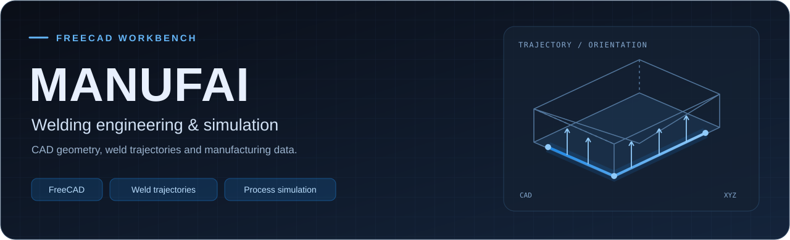

<a href="https://www.manufai.com/freecad"> <strong>Download plugin</strong></a> &nbsp;·&nbsp;
<a href="#installation">Installation</a> &nbsp;·&nbsp;
<a href="#activation">Activation</a> &nbsp;·&nbsp;
<a href="#toolbar-layout">Tool index</a> &nbsp;·&nbsp;
<a href="#repository-resources">Test resources</a>

<table>
<tr><th>FreeCAD</th><th>Installer</th><th>External workflows</th></tr>
<tr><td><code>1.1.1</code> required</td><td>Windows <code>.exe</code></td><td>RoboDK · C3P · WSO</td></tr>
</table>

## Welding engineering & simulation

 <strong>MANUFAI</strong> is a specialized workbench for FreeCAD, developed to integrate 3D CAD design with the planning, preparation, and simulation of welding processes.   

Its main objective is to transform CAD geometry into usable manufacturing information, enabling users to define welding trajectories, tool orientations, process parameters, operation sequences, and the data required for subsequent simulations, all within the same working environment.

The plugin is designed to facilitate the transition between digital design and manufacturing process execution, reducing manual tasks and centralizing the information associated with the welding process.

<strong>Key capabilities</strong>

 

<ul>
  <li>
    <strong>Intelligent Geometry Analysis:</strong>
    Analyzes the 3D model geometry to identify edges and potentially weldable
    regions, including T-joints, 90° joints, and other relevant configurations.
  </li>

  <li>
    <strong>Weld Path Generation:</strong>
    Allows users to generate and configure welding trajectories from the selected
    geometry, including continuous welds, edge offsets, and intermittent welds.
  </li>

  <li>
    <strong>Welding Orientation Definition:</strong>
    Calculates and assigns normal vectors and orientations along the welding
    trajectories, providing the information required to correctly define the
    position and orientation of the welding torch.
  </li>

  <li>
    <strong>Process Parameter Management:</strong>
    Allows technological information and welding process parameters to be assigned,
    such as speeds, materials, preparation data, resources, and other information
    required for subsequent calculations and simulations.
  </li>

  <li>
    <strong>Process Simulation &amp; Sequencing:</strong>
    Facilitates the definition of the welding execution order and allows operations
    performed by robots, human operators, or auxiliary equipment to be organized,
    supporting process analysis and cycle-time calculations.
  </li>

  <li>
    <strong>Robotic Workflow Integration:</strong>
    Prepares welding trajectories and orientation information for use in external
    robotic simulation and programming tools, such as RoboDK.
  </li>

  <li>
    <strong>Manufacturing Data Organization:</strong>
    Structures project information within FreeCAD, facilitating the organization
    of welds, positions, resources, and manufacturing operations.
  </li>

  <li>
    <strong>Engineering Reports:</strong>
    Generates useful information for project documentation and analysis, including
    welding length, operation times, process parameters, and manufacturing-related
    estimates.
  </li>
</ul>

<strong>Interoperability: from CAD to manufacturing</strong>

 

 <strong>MANUFAI</strong> is designed to integrate FreeCAD into a broader manufacturing workflow, facilitating the connection between CAD design, process preparation, simulation, and manufacturing programming.  

The plugin acts as a bridge between the information generated in FreeCAD and specialized simulation, robotics, and analysis tools, enabling the transfer of welding trajectories, orientations, and process data to external platforms used in industrial environments.

<ul>
  <li>
    <strong>Integration with Specialized Software:</strong>
    Facilitates connectivity with tools such as RoboDK, C3P, and other simulation and computational environments.
  </li>

  <li>
    <strong>Manufacturing Data Transfer:</strong>
    Enables the export of welding trajectories and process parameters for subsequent stages of simulation, programming, or validation.
  </li>

  <li>
    <strong>Pre-Manufacturing Validation:</strong>
    Helps evaluate aspects such as trajectory, orientation, kinematics, and process behavior before physical implementation.
  </li>

  <li>
    <strong>Digital Workflow Continuity:</strong>
    Maintains a structured connection between the CAD model and the subsequent stages of engineering and manufacturing.
  </li>
</ul>

In this way, <strong>MANUFAI</strong> allows FreeCAD to function not only as a design tool, but also as a starting point for the planning, simulation, and digital preparation of welding processes.

## Download & installation

<ol>
<li><strong>Download.</strong> Get the <code>.exe</code> installer from <a href="https://www.manufai.com/freecad">MANUFAI – FreeCAD Plugin</a>.</li>
<li><strong>Install.</strong> Run the executable and follow the setup wizard. If prompted by Windows SmartScreen, click “Run anyway.” The installer automatically locates your FreeCAD <code>Mod</code> directory.</li>
<li><strong>Restart FreeCAD.</strong> The MANUFAI workbench will be available in the workbench selector.</li>
</ol>

<strong>Required FreeCAD version:</strong> <code>1.1.1</code>.

<a href="https://youtu.be/3LZCjwZW4YY">Watch installation tutorial · Sign up and download FreeCAD Plugin</a>

## Activation

<table><tr>
<td width="66" align="center"></td>
<td><strong>Activator</strong> Select MANUFAI in the FreeCAD workbench selector, then click the Activator button.</td>
</tr></table>
<ol>
<li>Obtain your <strong>Serial Key</strong> and enter it into the corresponding field.</li>
<li>Click <code>+</code> to add the key.</li>
<li>Click <code>Activate</code>.</li>
</ol>

<a href="https://youtu.be/MNOla3Mc2aI">Watch activation tutorial · Get your license key and activate MANUFAI FreeCAD plugin</a>

## Plugin Component Manager

<table><tr>
<td width="66" align="center"></td>
<td><strong>Modifier</strong> Open the Plugin Component Manager to choose which toolbars and features are displayed.</td>
</tr></table>
<ol>
<li>Click the <strong>Modifier</strong> button in the MANUFAI toolbar. The Plugin Component Manager setup window opens.</li>
<li>Check or uncheck the components you want to show or hide.</li>
<li>Click <code>Install</code> to save the changes, then restart FreeCAD.</li>
</ol>
<ul>
<li><strong>MANUFAI Workbench</strong> — required; cannot be disabled.</li>
<li>3-2-1 Datum Based Alignment Tools.</li>
<li>C3P – WdCurve Tools.</li>
<li>RoboDK &amp; Process Automation.</li>
</ul>

## Repository structure & test resources

To ensure you can replicate the workflows shown in the demonstrations, <strong>each tool/button has its own dedicated folder</strong> in this repository. Inside each tool's folder, you will find the following organized resources:

<ul>
  <li>
    <strong>Tool Icon:</strong>
    The image file of the button for easy visual identification.
  </li>
  <li>
    <strong>📂 01 Files needed to test:</strong>
    Contains the exact input files (CAD models, scripts, etc.) required to perform the test shown in the video.
  </li>
 <li>
    <strong>📂 02 Output:</strong>
   Contains the <strong>final result</strong> generated by the tool (exported files, reports, or modified geometry), serving as a reference to verify that the tool executed correctly.
  </li>
</ul>

## Tool index

Choose a component to browse its tools. Each tool includes its description, demonstration video and test resources.

<strong>MANUFAI Workbench</strong>

 

<strong><a href="#make-weld-trajectories">Make Weld Trajectories</a></strong>

<ul>
<li><a href="#edge-split"> Edge Split</a></li>
<li><a href="#find-weldable-edges"> Find Weldable Edges</a></li>
<li><a href="#weld-creators"> Weld Creators</a></li>
<li><a href="#add-normals"> Add Normals</a></li>
<li><a href="#surface-weld"> Surface Weld</a></li>
<li><a href="#weld-loader"> Weld Loader</a></li>
</ul>

<strong><a href="#positions">Positions</a></strong>

<ul>
<li><a href="#make-positions"> Make Positions Groups</a></li>
<li><a href="#assign-welds-to-robots"> Assign Welds To Robots</a></li>
<li><a href="#subassembly"> SubAssembly</a></li>
<li><a href="#assign-positions"> Assign Positions</a></li>
<li><a href="#move-subassembly"> Move SubAssembly</a></li>
<li><a href="#move-welds"> Move Welds</a></li>
</ul>

<strong><a href="#length">Length</a></strong>

<ul>
<li><a href="#weld-length-report"> Weld Length Report</a></li>
</ul>

<strong><a href="#cycle-time-tools">Cycle Time</a></strong>

<ul>
<li><a href="#process"> Process</a></li>
<li><a href="#assign-process"> Assign Process</a></li>
<li><a href="#welding-parameters"> Welding Parameters</a></li>
<li><a href="#assign-welding-parameters"> Assign Welding Parameters</a></li>
<li><a href="#cycle-time"> Cycle Time</a></li>
</ul>

<strong><a href="#weight">Weight</a></strong>

<ul>
<li><a href="#create-materials"> Create Materials</a></li>
<li><a href="#assign-materials"> Assign Materials</a></li>
<li><a href="#weight-of-welding-and-welded-part"> Weight of Welding and Welded Part</a></li>
</ul>

<strong><a href="#wso">Welding Sequence AI Advisor</a></strong>

<ul>
<li><a href="#export-stl"> Export STL</a></li>
<li><a href="#export-as-dk-project"> Export As DK Project</a></li>
</ul>

<strong><a href="#simulation">Sequence and Process Visualization</a></strong>

<ul>
<li><a href="#assign-sequence"> Assign Sequence</a></li>
<li><a href="#weld-simulation"> Weld Simulation</a></li>
<li><a href="#weld-visualizer"> Show Weld Sphere</a></li>
<li><a href="#visualizer-cmd"> Visualizer</a></li>
</ul>

<strong>3-2-1 Datum Based Alignment &amp; Tools</strong>

 
<ul>
<li><a href="#toggle-visibility-recursive"> Toggle Visibility Recursive</a></li>
<li><a href="#create-center-point"> Create Center Point</a></li>
<li><a href="#create-sphere-at-origin"> Create Sphere at Origin</a></li>
<li><a href="#datum-a"> Datum A</a></li>
<li><a href="#datum-b"> Datum B</a></li>
<li><a href="#datum-c"> Datum C</a></li>
<li><a href="#3-2-1-alignment"> 3-2-1 Datum-Based Alignment</a></li>
<li><a href="#move-model-to-origin"> Move Model To Origin</a></li>
<li><a href="#reset-pos"> Reset Position</a></li>
<li><a href="#show-welding-widget-command"> Show Welding Widget</a></li>
<li><a href="#launch-find-data-panel"> Launch Find Data Panel</a></li>
<li><a href="#focus-object-command"> Focus Object</a></li>
<li><a href="#move-weld-lines"> Move Weld Lines</a></li>
<li><a href="#discretize"> Discretize</a></li>
</ul>

<strong>C3P – WdCurve Tools</strong>

 
<ul>
<li><a href="#line-weld-table"> Line Weld Table</a></li>
<li><a href="#show-names"> Show Names</a></li>
<li><a href="#selection-mode"> Selection Mode (X-Ray &amp; Filter)</a></li>
</ul>

<strong>RoboDK &amp; Process Automation</strong>

 
<ul>
<li><a href="#weld-data-to-robodk"> Export To .rdk Project</a></li>
<li><a href="#export-full"> Export Full</a></li>
<li><a href="#export-selected"> Export Selected</a></li>
<li><a href="#glue-manager"> Glue Manager</a></li>
<li><a href="#drilling-manager"> Drilling Manager</a></li>
</ul>

<h2></h2>

### Make Weld Trajectories

<table>
<tr>
<td width="66" align="center" valign="middle"></td>
<td><h4>Edge Split</h4>
Geometric Extraction &amp; Intersection
</td>
</tr>
<tr><td colspan="2">

This tool automatically scans the 3D model (or specific selected parts) to extract all solid edges. It brings them into a global coordinate system and splits the intersecting lines based on a user-defined tolerance threshold.

<ul>
<li><strong>Automated Cleanup:</strong> Generates a clean object with the split edges and automatically hides the original solid bodies to keep the workspace clear.</li>
<li><strong>Assembly Aware:</strong> Respects the global position of parts nested inside complex assemblies or linked objects.</li>
</ul>

<a href="./MANUFAI_Workbench/Edge_Splitting"><strong>Test files &amp; output</strong></a> &nbsp;·&nbsp; <a href="https://www.youtube.com/watch?v=BuyjTM-gB38"><strong>Watch demo</strong></a>

Video previews

 

 <a href="https://www.youtube.com/watch?v=BuyjTM-gB38">Welding FreeCAD add-on - Automatic weldable edges recognition Demo</a>

</td></tr>
</table>

<table>
<tr>
<td width="66" align="center" valign="middle"></td>
<td><h4>Find Weldable Edges</h4>
Weldable Union Recognition &amp; Filtering
</td>
</tr>
<tr><td colspan="2">

This tool automatically identifies and extracts edges that are viable candidates for welding. It analyzes the faces and bounding boxes of the 3D model to detect structural joints, filtering out unneeded geometry based on user-defined length and distance thresholds.

<ul>
<li><strong>Smart Detection:</strong> Analyzes complex geometry to distinguish between actual structural joints and regular aesthetic CAD edges.</li>
<li><strong>Length Filtering:</strong> Automatically ignores edges that are shorter than your specified minimum length, preventing the processing of insignificant details.</li>
<li><strong>Automated Output:</strong> Generates a clean "Weldedges" object ready for path generation, hiding the original selection to keep your viewport clear.</li>
</ul>

<a href="./MANUFAI_Workbench/Find_Weld_Edges"><strong>Test files &amp; output</strong></a> &nbsp;·&nbsp; <a href="https://www.youtube.com/watch?v=BuyjTM-gB38"><strong>Watch demo</strong></a>

Video previews

 

 <a href="https://www.youtube.com/watch?v=BuyjTM-gB38">Welding FreeCAD add-on - Automatic weldable edges recognition Demo</a>

</td></tr>
</table>

<table>
<tr>
<td width="66" align="center" valign="middle"></td>
<td><h4>Weld Creators</h4>
Trajectory Generation
</td>
</tr>
<tr><td colspan="2">

This core module transforms extracted edges into processable welding trajectories. Beyond just creating paths, it calculates the <strong>Normal Vectors</strong> (torch orientation angles) required for accurate process simulation in both FreeCAD and RoboDK.

Weld creation modes:

<ul>
<li><strong>Make Weld:</strong> Manual mode. You directly select the specific edges where the weld beads should be placed.</li>
<li><strong>Make Weld with All Edges:</strong> Automated mode. Instantly generates welds on all the viable edges detected in the previous filtering step.</li>
<li><strong>Make Weld with Specific Length:</strong> Trims the weld bead by defining offset distances from the start or end (useful for avoiding corners).</li>
<li><strong>Make Weld with Chosen Points:</strong> High precision mode. Graphically define the exact Start and End points of the trajectory.</li>
<li><strong>Make Weld with Multiple Specific Lengths:</strong> Segmented mode. Allows you to create stitch or intermittent welds along a single edge.</li>
<li><strong>By Bead Quantity:</strong> Specify the exact number of weld segments you need, and the system automatically calculates the required gap and length to fit the edge perfectly.</li>
<li><strong>By Bead Length:</strong> Define the exact length of each weld bead, and let the algorithm determine how many segments fit and the correct pitch between them.</li>
<li><strong>By Bead Pitch:</strong> Set the specific center-to-center distance between each weld bead to strictly comply with engineering blueprints.</li>
</ul>

<strong>Smart Vector Control:</strong> Automatically calculates bisector angles between faces and allows manual overrides (angle offsets) or individual normal corrections to avoid robot torch collisions.

<a href="./MANUFAI_Workbench/Weld_Trajectory_Generation"><strong>Test files &amp; output</strong></a> &nbsp;·&nbsp; <a href="https://youtu.be/QdZxZB9vzDA"><strong>Watch demo</strong></a>

Video previews

 

 <a href="https://youtu.be/QdZxZB9vzDA">FreeCAD - Welding plugin - Define Welds Demo</a>

</td></tr>
</table>

<table>
<tr>
<td width="66" align="center" valign="middle"></td>
<td><h4>Add Normals</h4>
Create and define orientation normals along the welding path
</td>
</tr>
<tr><td colspan="2">

Generates normal vectors along the selected weld trajectory in FreeCAD, allowing the user to define the orientation required for later robotic welding simulation and offline programming in RoboDK.

<ul>
<li><strong>Normal Generation:</strong> Creates normal vectors along the weld path based on the selected geometry.</li>
<li><strong>Tool Orientation:</strong> Defines the approach direction and orientation that the welding torch should follow.</li>
<li><strong>Trajectory Preparation:</strong> Prepares the weld path with the orientation information required for robotic simulation.</li>
<li><strong>RoboDK Integration:</strong> Provides the directional data needed to correctly transfer and simulate the welding trajectory in RoboDK.</li>
</ul>

<a href="./MANUFAI_Workbench/Weld_Trajectory_Generation"><strong>Test files &amp; output</strong></a> &nbsp;·&nbsp; <a href="https://youtu.be/QdZxZB9vzDA"><strong>Watch demo</strong></a>

Video previews

 

 <a href="https://youtu.be/QdZxZB9vzDA">FreeCAD - Welding plugin - Define Welds Demo</a>

</td></tr>
</table>

<table>
<tr>
<td width="66" align="center" valign="middle"></td>
<td><h4>Surface Weld</h4>
Volumetric modeling and physical joint representation
</td>
</tr>
<tr><td colspan="2">

Designed for visual validation and mechanical documentation. Unlike trajectory modules that generate invisible paths for robots, this tool generates the <strong>actual solid geometry</strong> representing Fillet, Butt, and Complex Curve welds. This is essential for collision detection, mass calculation, and rendering.

<ul>
<li><strong>Edge Weld (Auto-Detect):</strong> Automatically detects the geometric type of the edge (Straight, Arc, BSpline, etc.) and generates a solid weld bead between two intersecting faces. It uses an advanced parallel transport algorithm to prevent the 3D shape from twisting along complex curves.</li>
<li><strong>Butt Weld (Angular):</strong> Generates an extruded arc shape to accurately represent V-groove and butt welding joints between two planar faces.</li>
<li><strong>WeldLine Constructor:</strong> A built-in freehand polyline tool to manually draw 3D weld.</li>
</ul>

<a href="./MANUFAI_Workbench/Surface_Weld_Generator"><strong>Test files &amp; output</strong></a> &nbsp;·&nbsp; <a href="https://www.youtube.com/watch?v=5uwMWgmB7Lk"><strong>Watch demo</strong></a>

Video previews

 

 <a href="https://www.youtube.com/watch?v=5uwMWgmB7Lk">Surface Weld Generator - FreeCAD Plugin Demo</a>

</td></tr>
</table>

<table>
<tr>
<td width="66" align="center" valign="middle"></td>
<td><h4>Weld Loader</h4>
Advanced Welding Data Importer &amp; Interoperability
</td>
</tr>
<tr><td colspan="2">

A robust synchronization tool designed to bridge external welding design software with FreeCAD. It specializes in parsing industry-standard trajectory files while preserving critical manufacturing parameters.

<ul>
<li><strong>Multi-Format Support:</strong> Native parsing of <code>.WDCurve</code> and <code>.cwsf</code> (CastWorks) files, including global heat source parameters like Voltage (U) and Current (I).</li>
<li><strong>WSO:</strong> Accepts <code>.dkproj</code> files containing the sequence created by WSO.</li>
<li><strong>Smart Geometry Reconstruction:</strong> Automatically cleans duplicate coordinate points, detects closed curves, and reconstructs valid 3D wires for simulation.</li>
<li><strong>Manufacturing Metadata:</strong> Imports and assigns complete process metadata including sequence numbers, layer organization, welding speed, efficiency, and automated lead time calculations.</li>
</ul>

<a href="./C3P_WdCurve_Tools/Weld_Loader_Pro"><strong>Test files &amp; output</strong></a> &nbsp;·&nbsp; <a href="https://www.youtube.com/watch?v=5uwMWgmB7Lk"><strong>Watch demo</strong></a>

Video previews

 

 <a href="https://www.youtube.com/watch?v=5uwMWgmB7Lk">Surface Weld Generator - FreeCAD Plugin Demo</a>

</td></tr>
</table>

### Positions

<table>
<tr>
<td width="66" align="center" valign="middle"></td>
<td><h4>Make Positions Groups</h4>
Create and organize workstation position groups.
</td>
</tr>
<tr><td colspan="2">

Adds a new Positions Group to the FreeCAD tree, allowing the user to define specific workstations (Positions) 
with their own kinematic constraints, such as linear or rotational axes, positioning speeds, and constant rotation times.

<ul>
<li>
<strong>Tree Organization:</strong>
Creates a dedicated Positions Group in the FreeCAD project tree.
</li>
<li>
<strong>Workstation Structure:</strong>
Helps organize the different positions used during the welding process.
</li>
<li>
<strong>Process Planning:</strong>
Provides a structured hierarchy for later robot and weld assignments.
</li>
</ul>

<a href="./C3P_WdCurve_Tools/Weld_Loader_Pro"><strong>Test files &amp; output</strong></a> &nbsp;·&nbsp; <a href="https://www.youtube.com/watch?v=5uwMWgmB7Lk"><strong>Watch demo</strong></a>

Video previews

 

 <a href="https://www.youtube.com/watch?v=5uwMWgmB7Lk">Surface Weld Generator - FreeCAD Plugin Demo</a>

</td></tr>
</table>

<table>
<tr>
<td width="66" align="center" valign="middle"></td>
<td><h4>Assign Welds To Robots</h4>
Define workstations and assign welds to specific robots
</td>
</tr>
<tr><td colspan="2">

Allows the user to organize and distribute welds among the robots assigned to each workstation. This helps define which robot is responsible for executing each welding trajectory during the manufacturing process.

<ul>
<li><strong>Robot Assignment:</strong> Assigns individual welds to a specific robot within a Position Group.</li>
<li><strong>Workload Organization:</strong>Helps distribute welding operations between multiple robots in the same workstation.</li>
<li><strong>Process Planning:</strong> Creates a structured relationship between positions, robots, and weld trajectories for later simulation and process execution.</li>
</ul>

<a href="./MANUFAI_Workbench/Robot_Assignment"><strong>Test files &amp; output</strong></a> &nbsp;·&nbsp; <a href="https://www.youtube.com/watch?v=TU_ENLACE"><strong>Watch demo</strong></a>

Video previews

 

 <a href="https://www.youtube.com/watch?v=TU_ENLACE">Robotic Cell &amp; Assignment Manager - FreeCAD Plugin Demo</a>

</td></tr>
</table>

<table>
<tr>
<td width="66" align="center" valign="middle"></td>
<td><h4>SubAssembly</h4>
Create and organize manufacturing SubAssemblies.
</td>
</tr>
<tr><td colspan="2">

Allows the user to divide complex CAD assemblies into logical
manufacturing SubAssemblies, providing a structured organization
of the components involved in the welding process.

<ul>
<li>
<strong>Visual Part Grouping:</strong>
Organizes CAD parts into logical manufacturing SubAssemblies.
</li>
<li>
<strong>Tree Organization:</strong>
Creates a clear manufacturing hierarchy inside the FreeCAD tree.
</li>
<li>
<strong>CAD Preservation:</strong>
Organizes the parts without modifying the original CAD constraints.
</li>
</ul>

<a href="./C3P_WdCurve_Tools/Weld_Loader_Pro"><strong>Test files &amp; output</strong></a> &nbsp;·&nbsp; <a href="https://www.youtube.com/watch?v=5uwMWgmB7Lk"><strong>Watch demo</strong></a>

Video previews

 

 <a href="https://www.youtube.com/watch?v=5uwMWgmB7Lk">Surface Weld Generator - FreeCAD Plugin Demo</a>

</td></tr>
</table>

<table>
<tr>
<td width="66" align="center" valign="middle"></td>
<td><h4>Assign Positions</h4>
Assign manufacturing positions to SubAssemblies
</td>
</tr>
<tr><td colspan="2">

 Links each manufacturing SubAssembly with the physical welding
workstation or Position where its welding operations will be performed.

<ul>
<li>
<strong>Workstation Mapping:</strong>
Assigns welding Positions to specific SubAssemblies.
</li>
<li>
<strong>Drag &amp; Drop Assignment:</strong>
Provides an intuitive interface for connecting SubAssemblies
with their corresponding manufacturing Positions.
</li>
<li>
<strong>Automatic Data Inheritance:</strong>
Propagates manufacturing information through the hierarchy:
<em>SubAssembly → Position → Robot → Weld</em>.
</li>
</ul>

<a href="./MANUFAI_Workbench/SubAssembly_Manager"><strong>Test files &amp; output</strong></a> &nbsp;·&nbsp; <a href="https://www.youtube.com/watch?v=TU_ENLACE"><strong>Watch demo</strong></a>

Video previews

 

 <a href="https://www.youtube.com/watch?v=TU_ENLACE">SubAssembly &amp; Position Manager - FreeCAD Plugin Demo</a>

</td></tr>
</table>

<table>
<tr>
<td width="66" align="center" valign="middle"></td>
<td><h4>Move SubAssembly</h4>
Move CAD parts between SubAssemblies using drag and drop.
</td>
</tr>
<tr><td colspan="2">

Allows the user to reorganize the manufacturing structure by dragging
CAD parts from one SubAssembly to another directly within the FreeCAD
tree view.

<ul>
<li>
<strong>Drag &amp; Drop Reorganization:</strong>
Move parts between different SubAssemblies using the tree interface.
</li>
<li>
<strong>SubAssembly Assignment:</strong>
Changes the manufacturing group to which a CAD part belongs.
</li>
<li>
<strong>Hierarchy Organization:</strong>
Keeps the project structure organized after parts are reassigned.
</li>
</ul>

<a href="./MANUFAI_Workbench/Hierarchy_Organizers"><strong>Test files &amp; output</strong></a> &nbsp;·&nbsp; <a href="https://www.youtube.com/watch?v=TU_ENLACE"><strong>Watch demo</strong></a>

Video previews

 

 <a href="https://www.youtube.com/watch?v=TU_ENLACE">Smart Hierarchy Organizers - FreeCAD Plugin Demo</a>

</td></tr>
</table>

<table>
<tr>
<td width="66" align="center" valign="middle"></td>
<td><h4>Move Welds</h4>
Reassign weld trajectories between robots using drag and drop.
</td>
</tr>
<tr><td colspan="2">

Allows the user to move weld trajectories from one robot to another
directly within the manufacturing hierarchy, simplifying robot assignment
and welding sequence organization.

<ul>
<li>
<strong>Drag &amp; Drop Reassignment:</strong>
Move welds between robots using an intuitive tree-based interface.
</li>
<li>
<strong>Robot Assignment:</strong>
Quickly change which robot is responsible for executing a specific weld.
</li>
<li>
<strong>Hierarchy Update:</strong>
Updates the weld position inside the manufacturing structure after reassignment.
</li>
</ul>

<a href="./C3P_WdCurve_Tools/Weld_Loader_Pro"><strong>Test files &amp; output</strong></a> &nbsp;·&nbsp; <a href="https://www.youtube.com/watch?v=5uwMWgmB7Lk"><strong>Watch demo</strong></a>

Video previews

 

 <a href="https://www.youtube.com/watch?v=5uwMWgmB7Lk">Surface Weld Generator - FreeCAD Plugin Demo</a>

</td></tr>
</table>

### Length

<table>
<tr>
<td width="66" align="center" valign="middle"></td>
<td><h4>Weld Length Report</h4>
Production Reports &amp; Quotations
</td>
</tr>
<tr><td colspan="2">

Automatically extracts the total linear distance of all weld beads within the active document. This tool is essential for estimating filler metal consumption, wire usage, and overall project costs.

<ul>
<li><strong>Smart Grouping:</strong> Organizes the exported data hierarchically by SubAssembly, Position, and specific Robot.</li>
<li><strong>Unit Conversion:</strong> Allows on-the-fly conversion between metric and imperial units (mm, cm, m, in, ft, etc.).</li> 
<li><strong>Direct Excel Export:</strong> Generates a clean, formatted <code>.xlsx</code> workbook ready for your purchasing and planning departments.</li>
</ul>

<a href="./MANUFAI_Workbench/Reports"><strong>Test files &amp; output</strong></a> &nbsp;·&nbsp; <a href="https://www.youtube.com/watch?v=hXmbLb0A_RI"><strong>Watch demo</strong></a>

Video previews

 

 <a href="https://www.youtube.com/watch?v=hXmbLb0A_RI">FreeCAD - Plugin - Total welding distance Demo</a>

</td></tr>
</table>

### Cycle Time

<table>
<tr>
<td width="66" align="center" valign="middle"></td>
<td><h4>Process</h4>
Define the welding process parameters.
</td>
</tr>
<tr><td colspan="2">

Allows the user to define the main process parameters required
for the welding operation and subsequent cycle-time calculation.

<ul>
<li><strong>Resource Configuration:</strong> Assigns process data to a positioner, robot, or human operator.</li>
<li><strong>Execution Parameters:</strong>Defines the information required for how the selected resource participates in the welding operation.</li>
</ul>

<a href="./C3P_WdCurve_Tools/Weld_Loader_Pro"><strong>Test files &amp; output</strong></a> &nbsp;·&nbsp; <a href="https://www.youtube.com/watch?v=5uwMWgmB7Lk"><strong>Watch demo</strong></a>

Video previews

 

 <a href="https://www.youtube.com/watch?v=5uwMWgmB7Lk">Surface Weld Generator - FreeCAD Plugin Demo</a>

</td></tr>
</table>

<table>
<tr>
<td width="66" align="center" valign="middle"></td>
<td><h4>Assign Process</h4>
Assign process information to welding trajectories.
</td>
</tr>
<tr><td colspan="2">

Links the previously defined process parameters to the
corresponding weld lines before the welding sequence is analyzed.

<ul>
<li><strong>Process Data Linking:</strong> Connects previously created process parameters with the selected welding trajectories.</li>
<li><strong>Project Data:</strong> Ensures that each weld contains the necessary process information for later cycle-time calculations, simulation, or report generation.</li>
</ul>

<a href="./C3P_WdCurve_Tools/Weld_Loader_Pro"><strong>Test files &amp; output</strong></a> &nbsp;·&nbsp; <a href="https://www.youtube.com/watch?v=5uwMWgmB7Lk"><strong>Watch demo</strong></a>

Video previews

 

 <a href="https://www.youtube.com/watch?v=5uwMWgmB7Lk">Surface Weld Generator - FreeCAD Plugin Demo</a>

</td></tr>
</table>

<table>
<tr>
<td width="66" align="center" valign="middle"></td>
<td><h4>Welding Parameters</h4>
Define the heat source used by the welding process.
</td>
</tr>
<tr><td colspan="2">

Creates the heat-source information required to characterize
the thermal input associated with each welding operation.

<ul>
<li><strong>Parameter Configuration:</strong> Defines the welding parameters associated with the operation.</li>
<li><strong>Welding Speed Setup:</strong> Sets the travel speed used during the welding process.</li>
<li><strong>Process Preparation:</strong> Prepares the necessary welding data for later assignment to weld trajectories.</li>
</ul>

<a href="./C3P_WdCurve_Tools/Weld_Loader_Pro"><strong>Test files &amp; output</strong></a> &nbsp;·&nbsp; <a href="https://www.youtube.com/watch?v=5uwMWgmB7Lk"><strong>Watch demo</strong></a>

Video previews

 

 <a href="https://www.youtube.com/watch?v=5uwMWgmB7Lk">Surface Weld Generator - FreeCAD Plugin Demo</a>

</td></tr>
</table>

<table>
<tr>
<td width="66" align="center" valign="middle"></td>
<td><h4>Assign Welding Parameters</h4>
Assign heat-source data to individual weld lines.
</td>
</tr>
<tr><td colspan="2">

Associates the appropriate heat-source configuration with each
welding trajectory so that the project contains all required
process information.

<ul>
<li><strong>Parameter Assignment:</strong> Applies the selected welding parameters to one or more weld trajectories.</li>
<li><strong>Weld Data Validation:</strong> Ensures that the welds contain the required information for later cycle-time calculations, simulation, and report generation.</li>
</ul>

<a href="./C3P_WdCurve_Tools/Weld_Loader_Pro"><strong>Test files &amp; output</strong></a> &nbsp;·&nbsp; <a href="https://www.youtube.com/watch?v=5uwMWgmB7Lk"><strong>Watch demo</strong></a>

Video previews

 

 <a href="https://www.youtube.com/watch?v=5uwMWgmB7Lk">Surface Weld Generator - FreeCAD Plugin Demo</a>

</td></tr>
</table>

<table>
<tr>
<td width="66" align="center" valign="middle"></td>
<td><h4>Cycle Time</h4>
Sequence Verification &amp; Process Timing
</td>
</tr>
<tr><td colspan="2">

Calculates the total execution time for the welding process, whether performed by a human operator or an automated robot, based on actual trajectory length and assigned travel speeds.

<ul>
<li><strong>Parameter Validation:</strong> Strictly verifies that every weld line has proper Heat Source and Process parameters assigned before allowing the export.</li>
<li><strong>Drag &amp; Drop Sequencer:</strong> Includes an interactive table interface to visually reorder and organize the welding sequence prior to generating the report.</li>
<li><strong>Detailed Analytics:</strong> Exports a hierarchical Excel report breaking down the time spent per subassembly, position, and robotic cell.</li>
</ul>

<a href="./MANUFAI_Workbench/Find_Weld_Edges"><strong>Test files &amp; output</strong></a> &nbsp;·&nbsp; <a href="https://www.youtube.com/watch?v=Giv5xZ7Uw44"><strong>Watch demo</strong></a>

Video previews

 

 <a href="https://www.youtube.com/watch?v=Giv5xZ7Uw44">FreeCAD Plugin - Cycle time report - Robot or Manual welding Demo</a>

</td></tr>
</table>

### Weight

<table>
<tr>
<td width="66" align="center" valign="middle"></td>
<td><h4>Create Materials</h4>
Create custom materials for weight calculations.
</td>
</tr>
<tr><td colspan="2">

Allows the user to create and define materials by specifying
the properties required for subsequent weight calculations.

<ul>
<li>
<strong>Material Definition:</strong>Creates new materials with their corresponding density.
</li>
<li>
<strong>Custom Database:</strong>Allows project-specific materials to be added for later use.
</li>
</ul>

<a href="./C3P_WdCurve_Tools/Weld_Loader_Pro"><strong>Test files &amp; output</strong></a> &nbsp;·&nbsp; <a href="https://www.youtube.com/watch?v=5uwMWgmB7Lk"><strong>Watch demo</strong></a>

Video previews

 

 <a href="https://www.youtube.com/watch?v=5uwMWgmB7Lk">Surface Weld Generator - FreeCAD Plugin Demo</a>

</td></tr>
</table>

<table>
<tr>
<td width="66" align="center" valign="middle"></td>
<td><h4>Assign Materials</h4>
Assign materials to CAD components.
</td>
</tr>
<tr><td colspan="2">

Allows the user to assign a previously defined material
to each component of the CAD assembly.

<ul>
<li>
<strong>Component Assignment:</strong> Links each CAD part with its corresponding material.
</li>
<li>
<strong>Density Information:</strong>Provides the material density required for weight calculations.
</li>
</ul>

<a href="./C3P_WdCurve_Tools/Weld_Loader_Pro"><strong>Test files &amp; output</strong></a> &nbsp;·&nbsp; <a href="https://www.youtube.com/watch?v=5uwMWgmB7Lk"><strong>Watch demo</strong></a>

Video previews

 

 <a href="https://www.youtube.com/watch?v=5uwMWgmB7Lk">Surface Weld Generator - FreeCAD Plugin Demo</a>

</td></tr>
</table>

<table>
<tr>
<td width="66" align="center" valign="middle"></td>
<td><h4>Weight of Welding and Welded Part</h4>
Calculate the weight of weld metal and the complete welded assembly
</td>
</tr>
<tr><td colspan="2">

 Calculates the mass of the deposited weld metal and the total weight
of the welded part based on the geometry and assigned material densities.

<ul>
<li>
<strong>Weld Metal Weight:</strong>
Estimates the mass contributed by the deposited welding material.
</li>
<li>
<strong>Welded Part Weight:</strong>
Calculates the total mass of the final welded assembly.
</li>
<li>
<strong>Material-Based Calculation:</strong>
Uses the assigned material densities to determine the corresponding weight.
</li>
</ul>

<a href="./MANUFAI_Workbench/Weight_Report"><strong>Test files &amp; output</strong></a> &nbsp;·&nbsp; <a href="https://www.youtube.com/watch?v=HbsH8DEtrP8"><strong>Watch demo</strong></a>

Video previews

 

 <a href="https://www.youtube.com/watch?v=HbsH8DEtrP8">FreeCAD plugin welded part weight report Demo</a>

</td></tr>
</table>

### Welding Sequence AI Advisor

<table>
<tr>
<td width="66" align="center" valign="middle"></td>
<td><h4>Export STL</h4>
Export selected objects or the complete part to STL format.
</td>
</tr>
<tr><td colspan="2">

 Converts selected CAD objects or the complete model into an
<code>.stl</code> file for use in other applications.

<ul>
<li>
<strong>Selected Object Export:</strong>
Allows specific CAD objects to be exported individually.
</li>
<li>
<strong>Complete Part Export:</strong>
Exports the entire part when a full model transfer is required.
</li>
<li>
<strong>STL Geometry:</strong>
Converts the external geometry into a triangulated surface representation.
</li>
<li>
<strong>Software Compatibility:</strong>
Facilitates geometry transfer for visualization, meshing,
simulation, or other STL-compatible workflows.
</li>
</ul>

<a href="./MANUFAI_Workbench/Weight_Report"><strong>Test files &amp; output</strong></a> &nbsp;·&nbsp; <a href="https://www.youtube.com/watch?v=HbsH8DEtrP8"><strong>Watch demo</strong></a>

Video previews

 

 <a href="https://www.youtube.com/watch?v=HbsH8DEtrP8">FreeCAD plugin welded part weight report Demo</a>

</td></tr>
</table>

<table>
<tr>
<td width="66" align="center" valign="middle"></td>
<td><h4>Export As DK Project</h4>
Create a new DK project file from the current project.
</td>
</tr>
<tr><td colspan="2">

 Generates a new <code>.dkproject</code> file containing the project
information required for the corresponding DK workflow.

<ul>
<li>
<strong>Project File Generation:</strong>
Creates a new <code>.dkproject</code> file.
</li>
<li>
<strong>Project Transfer:</strong>
Packages the required project information into the DK project format.
</li>
<li>
<strong>Workflow Preparation:</strong>
Provides the project file required for subsequent DK processing.
</li>
</ul>

<a href="./MANUFAI_Workbench/Sequence_AI_Advisor"><strong>Test files &amp; output</strong></a> &nbsp;·&nbsp; <a href="https://youtu.be/48nRLUuxqVA"><strong>Watch demo 1</strong></a> &nbsp;·&nbsp; <a href="https://youtu.be/bhIbrSHBmeU"><strong>Watch demo 2</strong></a>

Video previews

 

 <a href="https://youtu.be/48nRLUuxqVA">WSO with DK Algorithm Demo</a>

 <a href="https://youtu.be/bhIbrSHBmeU">Sequence Visualizer [Output] Demo</a>

</td></tr>
</table>

### Sequence and Process Visualization

<table>
<tr>
<td width="66" align="center" valign="middle"></td>
<td><h4>Assign Sequence</h4>
Define the execution order of the welding process.
</td>
</tr>
<tr><td colspan="2">

Allows the user to organize workstations, robots, and weld trajectories
into a logical execution sequence before running the welding simulation.

<ul>
<li>
<strong>Execution Order:</strong>
Defines the order in which the welding operations will be performed.
</li>
<li>
<strong>Process Organization:</strong>
Structures Positions, Robots, and Welds according to the manufacturing plan.
</li>
<li>
<strong>Simulation Preparation:</strong>
Creates the sequence required before the robotic welding simulation is executed.
</li>
</ul>

<a href="./MANUFAI_Workbench/Weight_Report"><strong>Test files &amp; output</strong></a> &nbsp;·&nbsp; <a href="https://www.youtube.com/watch?v=HbsH8DEtrP8"><strong>Watch demo</strong></a>

Video previews

 

 <a href="https://www.youtube.com/watch?v=HbsH8DEtrP8">FreeCAD plugin welded part weight report Demo</a>

</td></tr>
</table>

<table>
<tr>
<td width="66" align="center" valign="middle"></td>
<td><h4>Weld Simulation</h4>
Validate torch accessibility, motion, and welding trajectories.
</td>
</tr>
<tr><td colspan="2">

Simulates the welding gun along the previously defined weld sequence,
allowing the user to visually verify torch motion and identify potential
accessibility or collision issues.

<ul>
<li>
<strong>Trajectory Visualization:</strong>
Displays the welding gun moving along the defined weld paths.
</li>
<li>
<strong>Accessibility Verification:</strong>
Helps identify areas that may be difficult for the welding torch to reach.
</li>
<li>
<strong>Collision Review:</strong>
Provides a visual method for evaluating possible interference during motion.
</li>
<li>
<strong>Process Demonstration:</strong>
Can be used for technical reviews, presentations, and manufacturing planning.
</li>
</ul>

<a href="./MANUFAI_Workbench/Welding_Gun_Simulation"><strong>Test files &amp; output</strong></a> &nbsp;·&nbsp; <a href="https://www.youtube.com/watch?v=kuIgRGPw8nU"><strong>Watch demo</strong></a>

Video previews

 

 <a href="https://www.youtube.com/watch?v=kuIgRGPw8nU">FreeCAD Plugin - Simulate welding gun on a trajectory Demo</a>

</td></tr>
</table>

<table>
<tr>
<td width="66" align="center" valign="middle"></td>
<td><h4>Show Weld Sphere</h4>
Lightweight 3D visual verification and playback sequence control.
</td>
</tr>
<tr><td colspan="2">

Designed for rapid visual verification of welds without the computational overhead of generating complex geometric solids.

It utilizes direct scene graph rendering to project a customizable "cloud" of spheres along the trajectory, providing an immediate visual representation of weld coverage while maintaining a lightweight model size and fluid viewport navigation. It includes an integrated sequence table and playback controls to inspect your production flow row by row.

<a href="./MANUFAI_Workbench/Weld_Visualizer"><strong>Test files &amp; output</strong></a> &nbsp;·&nbsp; <a href="https://www.youtube.com/watch?v=Ccb7qmT_r68"><strong>Watch demo</strong></a>

Video previews

 

 <a href="https://www.youtube.com/watch?v=Ccb7qmT_r68">Weld Visualizer (Sphere Mode) - FreeCAD Plugin Demo</a>

</td></tr>
</table>

<table>
<tr>
<td width="66" align="center" valign="middle"></td>
<td><h4>Visualizer</h4>
Interactive 3D visibility control and rapid weld inspection.
</td>
</tr>
<tr><td colspan="2">

Designed to easily isolate and audit complex multi-robot manufacturing cells.

It provides a structured tree-based interface to selectively toggle the visibility of SubAssemblies, Workstation Positions, and individual Robots. Combined with an integrated lightweight sphere rendering mode, it allows engineers to inspect weld coverage and cell accessibility instantly without performance lag.

<a href="./MANUFAI_Workbench/Assembly_Visualizer"><strong>Test files &amp; output</strong></a> &nbsp;·&nbsp; <a href="https://www.youtube.com/watch?v=TU_ENLACE"><strong>Watch demo</strong></a>

Video previews

 

 <a href="https://www.youtube.com/watch?v=TU_ENLACE">Assembly Visualizer - FreeCAD Plugin Demo</a>

</td></tr>
</table>

<a href="#toolbar-layout">Tool index ↑</a> &nbsp;·&nbsp; <a href="#top">Back to top ↑</a>

<h2></h2>

<table>
<tr>
<td width="66" align="center" valign="middle"></td>
<td><h4>Toggle Visibility Recursive</h4>
Instantly restore visual control over complex assemblies.
</td>
</tr>
<tr><td colspan="2">

The <strong>Recursive Visibility</strong> tool solves UX friction when working with complex hierarchies. It traverses the entire dependency tree of a selected object to toggle visibility for the parent and all descendants recursively.

<a href="./Datum_321_Alignment/Recursive_Visibility"><strong>Test files &amp; output</strong></a> &nbsp;·&nbsp; <a href="https://www.youtube.com/watch?v=360sB3FVUp4"><strong>Watch demo</strong></a>

Video previews

 

 <a href="https://www.youtube.com/watch?v=360sB3FVUp4">Recursive Visibility Toggle for Complex Assemblies - FreeCAD Plugin Demo</a>

</td></tr>
</table>

<table>
<tr>
<td width="66" align="center" valign="middle"></td>
<td><h4>Create Center Point</h4>
Calculates geometric centers for quick referencing.
</td>
</tr>
<tr><td colspan="2">

It computes and marks the center point based on the current selection.

<ul>
<li><strong>Single Object:</strong> Marks the center of mass/geometry.</li>
<li><strong>Two Objects:</strong> Calculates the exact midpoint between them.</li>
</ul>

Useful for establishing auxiliary reference points on complex geometry without creating full datums.

<a href="./Datum_321_Alignment/Center_Point"><strong>Test files &amp; output</strong></a> &nbsp;·&nbsp; <a href="https://www.youtube.com/watch?v=AsVGiXEPmd4"><strong>Watch demo</strong></a>

Video previews

 

 <a href="https://www.youtube.com/watch?v=AsVGiXEPmd4">Center Point - MANUFAI FreeCAD Plugin Demo</a>

</td></tr>
</table>

<table>
<tr>
<td width="66" align="center" valign="middle"></td>
<td><h4>Create Sphere at Origin</h4>
Generates a visual reference at the Global Origin (0,0,0).
</td>
</tr>
<tr><td colspan="2">

It places a reference sphere at the absolute zero of the workspace. This provides an immediate visual check to determine the offset distance of imported models relative to the workspace center before starting any alignment procedures.

<a href="./Datum_321_Alignment/Create_Sphere_Origin"><strong>Test files &amp; output</strong></a> &nbsp;·&nbsp; <a href="https://www.youtube.com/watch?v=HbsH8DEtrP8"><strong>Watch demo</strong></a>

Video previews

 

 <a href="https://www.youtube.com/watch?v=HbsH8DEtrP8">FreeCAD plugin welded part weight report Demo</a>

</td></tr>
</table>

<table>
<tr>
<td width="66" align="center" valign="middle"></td>
<td><h4>Datum A</h4>
Define the primary reference for the alignment system.
</td>
</tr>
<tr><td colspan="2">

Establishes the main reference plane or axis used to begin the
3-2-1 alignment process.

<ul>
<li>
<strong>Primary Constraint:</strong>
Locks 3 degrees of freedom.
</li>
<li>
<strong>Reference Selection:</strong>
Can use flat face normals, hole centerlines, or edge pairs.
</li>
</ul>

<a href="./Datum_321_Alignment/Create_Sphere_Origin"><strong>Test files &amp; output</strong></a> &nbsp;·&nbsp; <a href="https://www.youtube.com/watch?v=HbsH8DEtrP8"><strong>Watch demo</strong></a>

Video previews

 

 <a href="https://www.youtube.com/watch?v=HbsH8DEtrP8">FreeCAD plugin welded part weight report Demo</a>

</td></tr>
</table>

<table>
<tr>
<td width="66" align="center" valign="middle"></td>
<td><h4>Datum B</h4>
Define the secondary direction of the coordinate system.
</td>
</tr>
<tr><td colspan="2">

Establishes the directional reference used after Datum A to further
constrain and orient the model.

<ul>
<li>
<strong>Secondary Constraint:</strong>
Locks 2 additional degrees of freedom.
</li>
<li>
<strong>Directional Definition:</strong>
Can use edges, faces, or calculated theoretical midplanes.
</li>
</ul>

<a href="./Datum_321_Alignment/Create_Sphere_Origin"><strong>Test files &amp; output</strong></a> &nbsp;·&nbsp; <a href="https://www.youtube.com/watch?v=HbsH8DEtrP8"><strong>Watch demo</strong></a>

Video previews

 

 <a href="https://www.youtube.com/watch?v=HbsH8DEtrP8">FreeCAD plugin welded part weight report Demo</a>

</td></tr>
</table>

<table>
<tr>
<td width="66" align="center" valign="middle"></td>
<td><h4>Datum C</h4>
Define the final reference required for positioning.
</td>
</tr>
<tr><td colspan="2">

Establishes the final reference point of the 3-2-1 system and
completes the constraint of the model.

<ul>
<li>
<strong>Final Constraint:</strong>
Locks the last remaining degree of freedom.
</li>
<li>
<strong>Zero Point Definition:</strong>
Can use vertices, sphere centers, or edge midpoints.
</li>
</ul>

<a href="./Datum_321_Alignment/Create_Sphere_Origin"><strong>Test files &amp; output</strong></a> &nbsp;·&nbsp; <a href="https://www.youtube.com/watch?v=HbsH8DEtrP8"><strong>Watch demo</strong></a>

Video previews

 

 <a href="https://www.youtube.com/watch?v=HbsH8DEtrP8">FreeCAD plugin welded part weight report Demo</a>

</td></tr>
</table>

<table>
<tr>
<td width="66" align="center" valign="middle"></td>
<td><h4>3-2-1 Datum-Based Alignment</h4>
This suite provides a step-by-step workflow to establish a definitive coordinate system (CSYS) using standard 3-2-1 alignment logic. It guides you from reference identification to assembly-safe model repositioning
</td>
</tr>
<tr><td colspan="2">

Uses Datum A, Datum B, and Datum C to establish a definitive
coordinate system based on standard 3-2-1 alignment principles.

<ul>
<li>
<strong>Reference Combination:</strong>
Combines the three selected datum references.
</li>
<li>
<strong>Coordinate System Definition:</strong>
Determines the orientation and origin required to correctly
reposition the model.
</li>
</ul>

<a href="./Datum_321_Alignment/Create_Sphere_Origin"><strong>Test files &amp; output</strong></a> &nbsp;·&nbsp; <a href="https://www.youtube.com/watch?v=HbsH8DEtrP8"><strong>Watch demo</strong></a>

Video previews

 

 <a href="https://www.youtube.com/watch?v=HbsH8DEtrP8">FreeCAD plugin welded part weight report Demo</a>

</td></tr>
</table>

<table>
<tr>
<td width="66" align="center" valign="middle"></td>
<td><h4>Move Model To Origin</h4>
Reposition the model using the calculated 3-2-1 alignment.
</td>
</tr>
<tr><td colspan="2">

Applies the calculated transformation to move the model into the
established coordinate system while preserving the internal CAD
assembly structure.

<ul>
<li>
<strong>Model Repositioning:</strong>
Moves the aligned model toward the defined global reference.
</li>
<li>
<strong>Assembly-Safe Transformation:</strong>
Preserves document hierarchies and internal assembly relationships.
</li>
</ul>

<a href="./Datum_321_Alignment/Create_Sphere_Origin"><strong>Test files &amp; output</strong></a> &nbsp;·&nbsp; <a href="https://www.youtube.com/watch?v=hPKx3S9DQLc"><strong>Watch demo</strong></a>

Video previews

 

 <a href="https://www.youtube.com/watch?v=hPKx3S9DQLc">3-2-1 Datum Based Alignment - MANUFAI FreeCAD Plugin Demo</a>

</td></tr>
</table>

<table>
<tr>
<td width="66" align="center" valign="middle"></td>
<td><h4>Reset Position</h4>
Toggle transformation reset and coordinate zeroing
</td>
</tr>
<tr><td colspan="2">

A professional utility command designed to quickly clear or restore the transformation matrix (Placement) of selected CAD objects with native "Undo" support.

<ul>
<li><strong>Smart Toggle Logic:</strong>
<ul>
<li>If the object is currently placed away from the workspace, clicking the button saves its current position to a hidden property and instantly resets its placement to the absolute origin <code>(0,0,0)</code>.</li>
<li>If the object is already at the origin, clicking it again automatically restores its previous saved position.</li>
</ul>
</li>
</ul>

<a href="./MANUFAI_Workbench/Reset_Position"><strong>Test files &amp; output</strong></a> &nbsp;·&nbsp; <a href="https://www.youtube.com/watch?v=TU_ENLACE"><strong>Watch demo</strong></a>

Video previews

 

 <a href="https://www.youtube.com/watch?v=TU_ENLACE">Reset Position - FreeCAD Plugin Demo</a>

</td></tr>
</table>

<table>
<tr>
<td width="66" align="center" valign="middle"></td>
<td><h4>Show Welding Widget</h4>
2D Blueprint to 3D Model Synchronization.
</td>
</tr>
<tr><td colspan="2">

The <strong>Welding Reference Tool</strong> allows engineers to work with blueprints, technical images, or diagrams directly within the 3D environment, eliminating the need to keep a PDF open on a second monitor.

It enables the import of 2D documentation to place digital markers and logically link them with real 3D objects in the document.

Key Capabilities:

<ul>
<li><strong>Interactive Mapping:</strong> Load any image (PNG, JPG) and place "weld points" simply by clicking on the drawing.</li>
<li><strong>Digital Linkage:</strong> Associate each 2D mark with an existing weld bead in the 3D model for full traceability.</li>
</ul>

<a href="./Datum_321_Alignment/Welding_Reference"><strong>Test files &amp; output</strong></a> &nbsp;·&nbsp; <a href="https://www.youtube.com/watch?v=Yp307CxQaUM"><strong>Watch demo</strong></a>

Video previews

 

 <a href="https://www.youtube.com/watch?v=Yp307CxQaUM">Welding Reference Tool - FreeCAD Plugin Demo</a>

</td></tr>
</table>

<table>
<tr>
<td width="66" align="center" valign="middle"></td>
<td><h4>Launch Find Data Panel</h4>
Centralized control for weld tracking and interoperability.
</td>
</tr>
<tr><td colspan="2">

This tool opens a dedicated side panel that automatically scans the active document to identify and list all generated <strong>Weld Objects</strong>. It serves as the bridge between FreeCAD and external collaborators.

Key Features:

<ul>
<li><strong>Instant Detection:</strong> Click to locate and highlight specific weld beads in the 3D view immediately.</li>
<li><strong>Flexible Data Export:</strong> Generates a <code>.txt</code> report of the selected welds. It offers two modes:
</li><li><strong>Simple Report:</strong> Exports essential identification, coordinates, and basic geometry data.</li>
<li><strong>Detailed Dump:</strong> Exports <strong>every single internal property</strong>. Ideal for deep debugging or external solvers needing raw parametric data.</li>
</ul>

<a href="./Datum_321_Alignment/Find_Data_Panel"><strong>Test files &amp; output</strong></a> &nbsp;·&nbsp; <a href="https://www.youtube.com/watch?v=AJxwoL3yqto"><strong>Watch demo</strong></a>

Video previews

 

 <a href="https://www.youtube.com/watch?v=AJxwoL3yqto">How to see all the weld data? - MANUFAI FreeCAD plugin Demo</a>

</td></tr>
</table>

<table>
<tr>
<td width="66" align="center" valign="middle"></td>
<td><h4>Focus Object</h4>
Instant Navigation.
</td>
</tr>
<tr><td colspan="2">

A productivity shortcut that instantly zooms and centers the camera on the object currently selected in the tree or list. Essential for locating small weld segments in large-scale environments.

<a href="./Datum_321_Alignment/Focus_on_Object"><strong>Test files &amp; output</strong></a> &nbsp;·&nbsp; <a href="https://www.youtube.com/watch?v=vnDtbglly2k"><strong>Watch demo</strong></a>

Video previews

 

 <a href="https://www.youtube.com/watch?v=vnDtbglly2k">Focus on Object - FreeCAD Plugin Demo</a>

</td></tr>
</table>

<table>
<tr>
<td width="66" align="center" valign="middle"></td>
<td><h4>Move Weld Lines</h4>
Precision Trajectory Re-positioning.
</td>
</tr>
<tr><td colspan="2">

A multi-modal suite designed to reposition welding paths without losing their internal manufacturing data. It provides three specialized workflows to handle any alignment scenario:

<ul>
<li><strong>Smart Projection:</strong> Aligns the entire weld line to a target edge by calculating the shortest distance to the path's center, ensuring perfect surface contact while preserving the original shape.</li>
<li><strong>Circular Alignment:</strong> Specialized for pipes and bosses. It detects circular/arc edges and snaps one or multiple weld lines to them using the first point as a precise anchor.</li>
<li><strong>Manual Transformer:</strong> A real-time editing panel for fine-tuning. Rotate and translate paths using precision spinboxes (<code>X, Y, Z, Rx, Ry, Rz</code>) with automatic recalculation of lead times and distances.</li>
</ul>

<a href="./Datum_321_Alignment/Smart_Discretize"><strong>Test files &amp; output</strong></a> &nbsp;·&nbsp; <a href="https://www.youtube.com/watch?v=HbsH8DEtrP8"><strong>Watch demo</strong></a>

Video previews

 

 <a href="https://www.youtube.com/watch?v=HbsH8DEtrP8">FreeCAD plugin welded part weight report Demo</a>

</td></tr>
</table>

<table>
<tr>
<td width="66" align="center" valign="middle"></td>
<td><h4>Discretize</h4>
Geometry-Aware Path Projection.
</td>
</tr>
<tr><td colspan="2">

A high-precision tool that refines welding trajectories by projecting existing data onto target CAD edges. It eliminates the "floating path" issue by snapping the simulation points directly to the physical geometry.

<ul>
<li><strong>Adaptive Point Density:</strong> Unlike standard discretization, this tool distinguishes between geometries:
<ul>
<li><i>Curved Edges:</i> Applies the user-defined <b>Curve Density</b> for smooth robotic motion.</li>
<li><i>Straight Edges:</i> Automatically optimizes to just <b>2 points</b> (Start/End), reducing redundant controller data and OLP complexity.</li>
</ul>
</li>
<li><strong>Multi-Edge Selection:</strong> Capable of projecting a single weld trajectory across multiple disparate edges (Compound support).</li>
<li><strong>Real-Time Optimization:</strong> Includes a "Corner Detection" logic that preserves points only where direction changes significantly ($cos(	heta) &lt; 0.9999$).</li>
<li><strong>Automatic Sync:</strong> Updates all internal MANUFAI metrics (Distance, Pts, and LeadTime) immediately after projection.</li>
</ul>

<a href="./Datum_321_Alignment/Smart_Discretize"><strong>Test files &amp; output</strong></a> &nbsp;·&nbsp; <a href="https://www.youtube.com/watch?v=HbsH8DEtrP8"><strong>Watch demo</strong></a>

Video previews

 

 <a href="https://www.youtube.com/watch?v=HbsH8DEtrP8">FreeCAD plugin welded part weight report Demo</a>

</td></tr>
</table>

<a href="#toolbar-layout">Tool index ↑</a> &nbsp;·&nbsp; <a href="#top">Back to top ↑</a>

<h2></h2>

<table>
<tr>
<td width="66" align="center" valign="middle"></td>
<td><h4>Line Weld Table</h4>
Parameter Editor &amp; WDCurve Exporter
</td>
</tr>
<tr><td colspan="2">

Provides a comprehensive tabular interface to audit and refine technical data for all weld lines within the document. This is the <strong>final stage</strong> of the workflow.

<ul>
<li><strong>Bulk Editing:</strong> Batch modify Voltage (U), Current (I), Speed (V), and Sequence parameters.</li>
<li><strong>Sequence Management:</strong> Reorder the welding sequence via drag-and-drop.</li>
<li><strong>Parallel Operations:</strong> Define simultaneous tasks for multi-robot synchronization.</li>
<li><strong>Final Export:</strong> Generates the <code>.WDCurve</code> file, exporting only active layers for external processing.</li>
</ul>

<a href="./C3P_WdCurve_Tools/Line_Weld_Table"><strong>Test files &amp; output</strong></a> &nbsp;·&nbsp; <a href="https://www.youtube.com/watch?v=wSOsoFvLScI"><strong>Watch demo</strong></a>

Video previews

 

 <a href="https://www.youtube.com/watch?v=wSOsoFvLScI">Line Weld Table &amp; WDCurve Export - FreeCAD Plugin Demo</a>

</td></tr>
</table>

<table>
<tr>
<td width="66" align="center" valign="middle"></td>
<td><h4>Show Names</h4>
Orientation &amp; ID HUD.
</td>
</tr>
<tr><td colspan="2">

Toggles a "Head-Up Display" in the 3D view for all weld lines.

<ul>
<li><strong>ID Labels:</strong> Shows the name/number of the weld floating above it.</li>
<li><strong>Direction Markers:</strong> Clearly marks the <strong>Start (O)</strong> and <strong>End (X)</strong> of the path to verify torch direction visually.</li>
</ul>

<a href="./C3P_WdCurve_Tools/Show_Names"><strong>Test files &amp; output</strong></a> &nbsp;·&nbsp; <a href="https://www.youtube.com/watch?v=uVRiyf8H4nk"><strong>Watch demo</strong></a>

Video previews

 

 <a href="https://www.youtube.com/watch?v=uVRiyf8H4nk">Weld Path Name &amp; Direction Display - FreeCAD Plugin Demo</a>

</td></tr>
</table>

<table>
<tr>
<td width="66" align="center" valign="middle"></td>
<td><h4>Selection Mode (X-Ray &amp; Filter)</h4>
Visual isolation and Selection Lock.
</td>
</tr>
<tr><td colspan="2">

A specialized view mode designed for working in complex assemblies.

<ul>
<li><strong>X-Ray Vision:</strong> Makes the 3D geometry transparent while keeping weld lines solid and visible.</li>
<li><strong>Click-Through Blocker:</strong> <strong>Selection Filter.</strong> Strictly blocks the selection of 3D geometry (faces/bodies), ensuring that clicks <strong>only register on weld lines</strong>. This prevents accidental selection of the background model.</li>
</ul>

<a href="./C3P_WdCurve_Tools/Selection_Mode"><strong>Test files &amp; output</strong></a> &nbsp;·&nbsp; <a href="https://www.youtube.com/watch?v=Y3D3PVF0ubI"><strong>Watch demo</strong></a>

Video previews

 

 <a href="https://www.youtube.com/watch?v=Y3D3PVF0ubI">X-Ray Weld Selection Mode - FreeCAD Plugin Demo</a>

</td></tr>
</table>

<a href="#toolbar-layout">Tool index ↑</a> &nbsp;·&nbsp; <a href="#top">Back to top ↑</a>

<h2></h2>

<table>
<tr>
<td width="66" align="center" valign="middle"></td>
<td><h4>Export To .rdk Project</h4>
Automated Welding Path &amp; Program Generation.
</td>
</tr>
<tr><td colspan="2">

A powerful FreeCAD add-on designed specifically for <strong>Robotic Welding</strong> applications. It eliminates manual coordinate entry by synchronizing design geometry with robot logic:

<ul>
<li><strong>Path Modeling:</strong> Design complex welding trajectories directly within the FreeCAD environment.</li>
<li><strong>Automatic Program Creation:</strong> The plugin extracts path data and generates ready-to-use robot programs in RoboDK instantly.</li>
<li><strong>Data Synchronization:</strong> Ensures that every vertex and edge of the weld seam is accurately translated into robot targets.</li>
</ul>

<a href="./RoboDK_Process_Automation/Weld_Data_to_RoboDK"><strong>Test files &amp; output</strong></a> &nbsp;·&nbsp; <a href="https://youtu.be/bNV_s38_P9E"><strong>Watch demo 1</strong></a> &nbsp;·&nbsp; <a href="https://youtu.be/PpmaKM3XEzY"><strong>Watch demo 2</strong></a> &nbsp;·&nbsp; <a href="https://www.youtube.com/watch?v=_DmwPQABFhU"><strong>Watch demo 3</strong></a>

Video previews

 

 <a href="https://youtu.be/bNV_s38_P9E">FreeCAD Plugin - Robotic Cell Modeling for automatic transfer of weld data</a>

 <a href="https://youtu.be/PpmaKM3XEzY">FreeCAD to RoboDK welding Modeling and Simulation</a>

 <a href="https://www.youtube.com/watch?v=_DmwPQABFhU">Weld Path to Robot Program - FreeCAD Plugin Demo</a>

</td></tr>
</table>

<table>
<tr>
<td width="66" align="center" valign="middle"></td>
<td><h4>Export Full</h4>
Transfer the complete visible CAD assembly to RoboDK
</td>
</tr>
<tr><td colspan="2">

Exports the entire visible FreeCAD assembly directly to RoboDK,
allowing the complete model to be transferred to the robotic
simulation environment in a single operation.

<ul>
<li>
<strong>Complete Assembly Export:</strong>
Transfers all visible components of the current CAD assembly.
</li>
<li>
<strong>RoboDK Integration:</strong>
Sends the geometry directly to the RoboDK simulation environment.
</li>
<li>
<strong>Coordinate Alignment:</strong>
Uses the CAD reference coordinate system to maintain proper
alignment between the FreeCAD model and the RoboDK station.
</li>
</ul>

<a href="./Datum_321_Alignment/Create_Sphere_Origin"><strong>Test files &amp; output</strong></a> &nbsp;·&nbsp; <a href="https://www.youtube.com/watch?v=HbsH8DEtrP8"><strong>Watch demo</strong></a>

Video previews

 

 <a href="https://www.youtube.com/watch?v=HbsH8DEtrP8">FreeCAD plugin welded part weight report Demo</a>

</td></tr>
</table>

<table>
<tr>
<td width="66" align="center" valign="middle"></td>
<td><h4>Export Selected</h4>
Transfer only selected CAD components to RoboDK.
</td>
</tr>
<tr><td colspan="2">

 Exports only the parts selected by the user in FreeCAD,
allowing specific components to be transferred to RoboDK
without exporting the complete assembly.

<ul>
<li>
<strong>Selective Export:</strong>
Transfers only the components selected in the FreeCAD model.
</li>
<li>
<strong>Partial Updates:</strong>
Useful when only specific parts need to be added or updated
in the RoboDK station.
</li>
<li>
<strong>Isolated Testing:</strong>
Allows individual components or groups of parts to be evaluated
without transferring the complete assembly.
</li>
</ul>

<a href="./RoboDK_Process_Automation/RoboDK_Export_Tools"><strong>Test files &amp; output</strong></a> &nbsp;·&nbsp; <a href="https://www.youtube.com/watch?v=RDRtrwVmNSQ"><strong>Watch demo</strong></a>

Video previews

 

 <a href="https://www.youtube.com/watch?v=RDRtrwVmNSQ">CAD to Robot Export - FreeCAD Plugin Demo</a>

</td></tr>
</table>

<table>
<tr>
<td width="66" align="center" valign="middle"></td>
<td><h4>Glue Manager</h4>
Weld-to-Dispensing Path Conversion.
</td>
</tr>
<tr><td colspan="2">

This tool repurposes existing MANUFAI weld paths (<code>Pts</code> data) to create precise adhesive dispensing trajectories.

<ul>
<li><strong>Non-Destructive Transformation:</strong> Includes a dedicated panel to Scale, Translate, and Rotate the path locally without altering the original CAD geometry.</li>
<li><strong>Smart Export:</strong> Automatically calculates surface normals for correct gun orientation and exports the transformed data to RoboDK as a "Curve Follow Project".</li>
</ul>

<a href="./RoboDK_Process_Automation/Glue_Manager"><strong>Test files &amp; output</strong></a> &nbsp;·&nbsp; <a href="https://www.youtube.com/watch?v=iWT9zPO1s58"><strong>Watch demo</strong></a>

Video previews

 

 <a href="https://www.youtube.com/watch?v=iWT9zPO1s58">Dispensing operations with RoboDK - MANUFAI FreeCAD Plugin Demo</a>

</td></tr>
</table>

<table>
<tr>
<td width="66" align="center" valign="middle"></td>
<td><h4>Drilling Manager</h4>
Automated Hole &amp; Rivet Processing.
</td>
</tr>
<tr><td colspan="2">

A complete suite for automating drilling or riveting operations. It detects circular edges on the 3D model to extract centers and normal vectors automatically.

<ul>
<li><strong>Operation Modes:</strong>
<ul>
<li><strong>Manual:</strong> Step-by-step definition (Start/End points) for visual depth control.</li>
<li><strong>Precision:</strong> Apply specific numeric depth values to single holes.</li>
<li><strong>Batch Processing:</strong> The <strong>"Crown Jewel"</strong> feature—select dozens of holes and apply global drilling parameters to all of them instantly.</li>
</ul>
</li>
<li><strong>Full Simulation:</strong> Generates complete Approach, Drill, and Retract targets within RoboDK automatically.</li>
</ul>

<a href="./RoboDK_Process_Automation/Drilling_Manager"><strong>Test files &amp; output</strong></a> &nbsp;·&nbsp; <a href="https://www.youtube.com/watch?v=Aw_dtBkk4sY"><strong>Watch demo</strong></a>

Video previews

 

 <a href="https://www.youtube.com/watch?v=Aw_dtBkk4sY">Automated Drilling - FreeCAD Plugin Demo</a>

</td></tr>
</table>

<a href="#toolbar-layout">Tool index ↑</a> &nbsp;·&nbsp; <a href="#top">Back to top ↑</a>

