<!-- MANUFAI documentation: SVG descriptions and navigation, with original HTML video previews. -->

<a name="readme-image-002" href="#readme-image-002">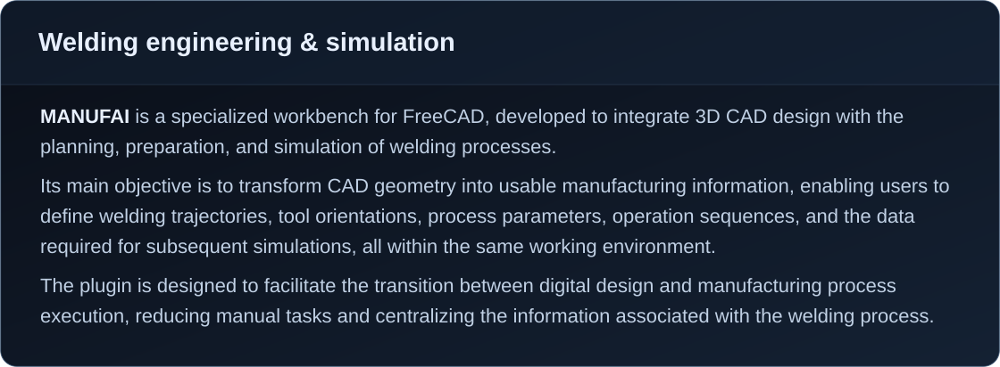</a>

<a name="readme-image-003" href="#readme-image-003">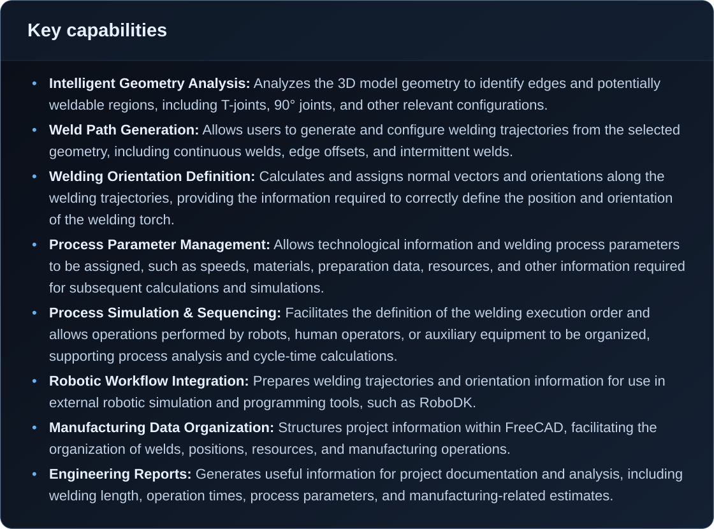</a>

<a name="readme-image-004" href="#readme-image-004">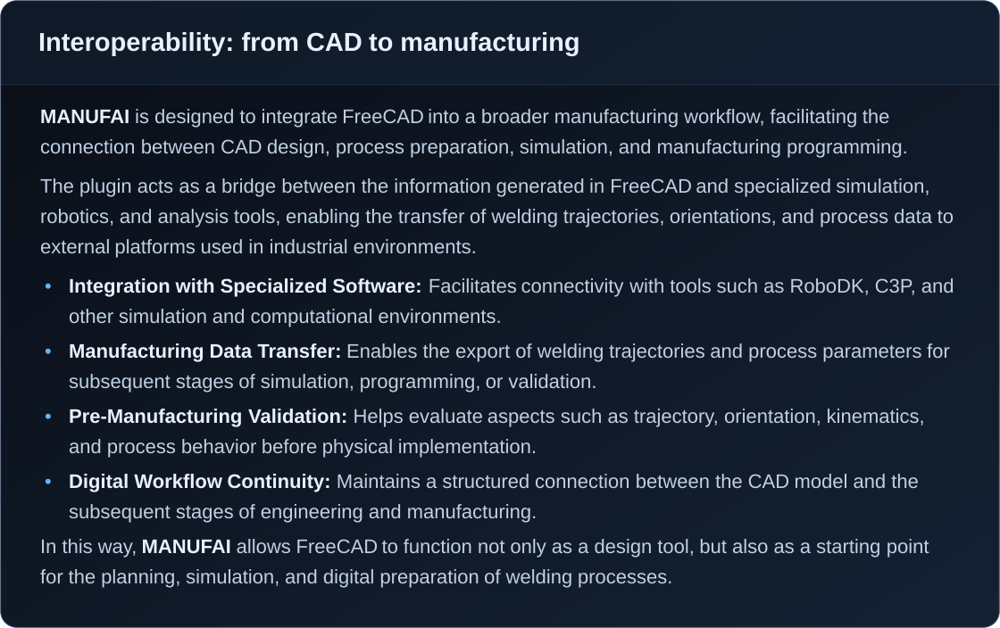</a>

<a name="readme-image-006" href="#readme-image-006">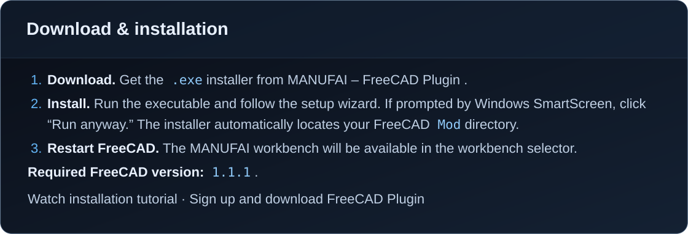</a>

 

<a name="readme-image-008" href="#readme-image-008">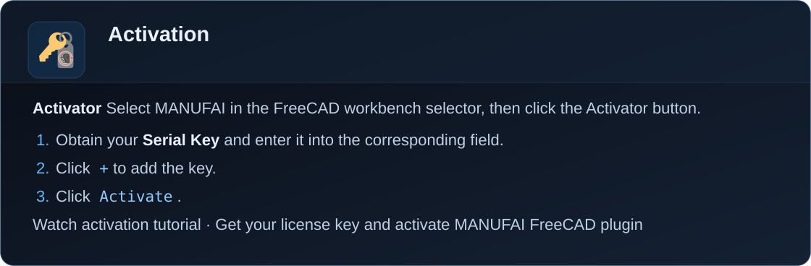</a>

<a name="readme-image-010" href="#readme-image-010">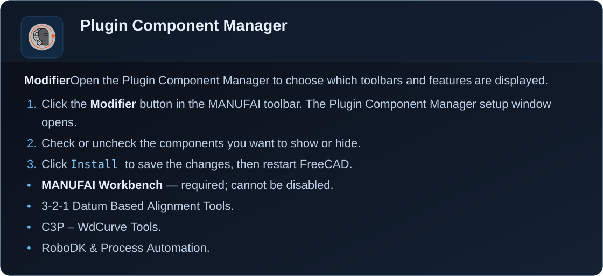</a>

<a name="readme-image-012" href="#readme-image-012">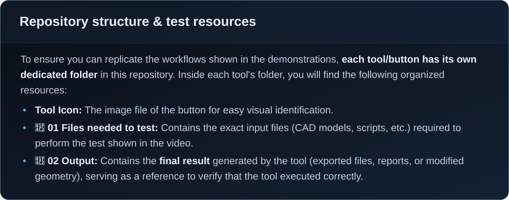</a>

 

 

 

 

 

 

 

<a name="readme-image-016" href="#readme-image-016">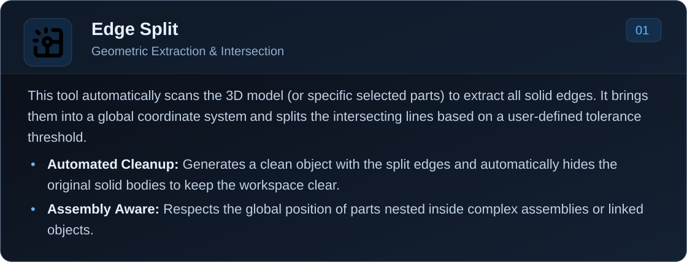</a>

 
<a href="https://youtu.be/BuyjTM-gB38"><strong>Welding FreeCAD add-on - Automatic weldable edges recognition Demo</strong></a>

<a name="readme-image-017" href="#readme-image-017">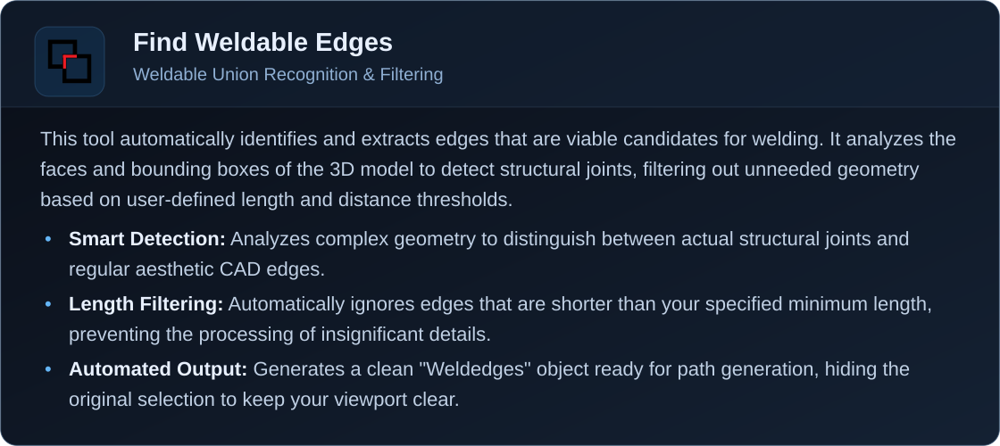</a>

 
<a href="https://youtu.be/BuyjTM-gB38"><strong>Welding FreeCAD add-on - Automatic weldable edges recognition Demo</strong></a>

<a name="readme-image-019" href="#readme-image-019">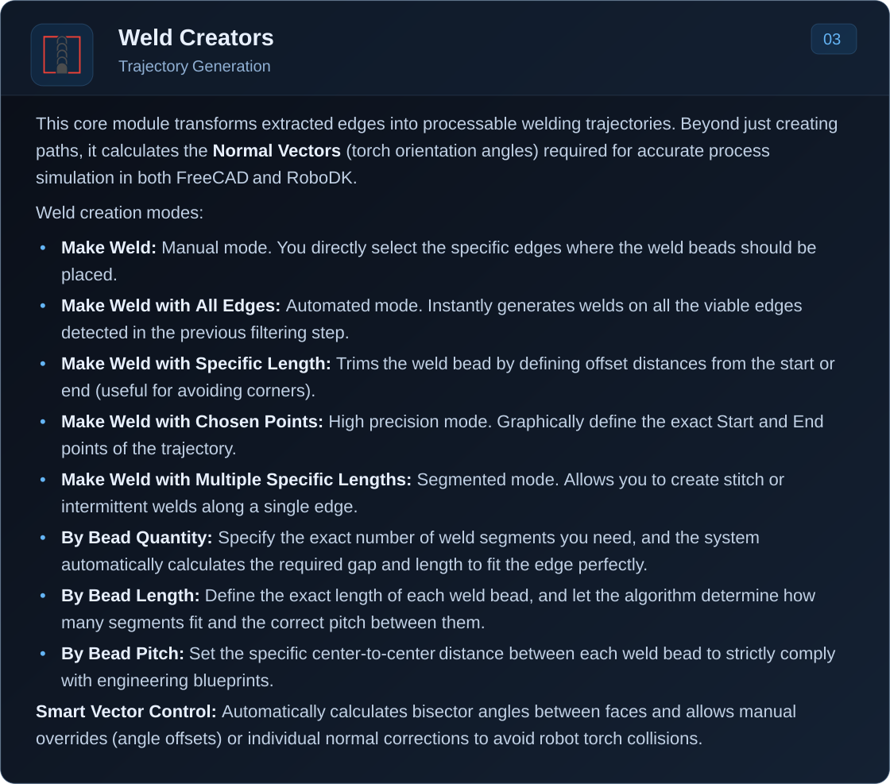</a>

<a name="readme-image-020" href="#readme-image-020">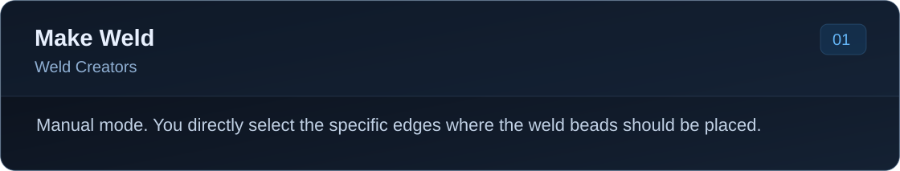</a>

 
<a href="https://youtu.be/QdZxZB9vzDA"><strong>FreeCAD - Welding plugin - Define Welds Demo</strong></a>

<a name="readme-image-021" href="#readme-image-021">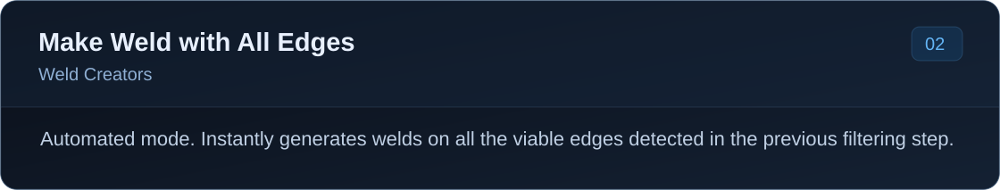</a>

 
<a href="https://youtu.be/QdZxZB9vzDA"><strong>FreeCAD - Welding plugin - Define Welds Demo</strong></a>

<a name="readme-image-022" href="#readme-image-022">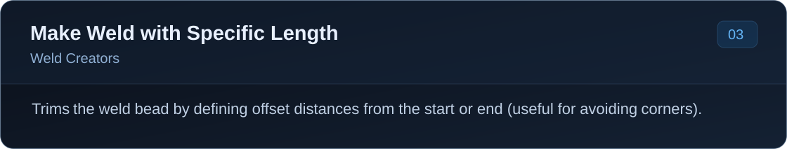</a>

 
<a href="https://youtu.be/QdZxZB9vzDA"><strong>FreeCAD - Welding plugin - Define Welds Demo</strong></a>

<a name="readme-image-023" href="#readme-image-023">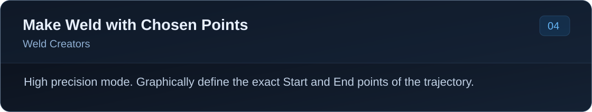</a>

 
<a href="https://youtu.be/QdZxZB9vzDA"><strong>FreeCAD - Welding plugin - Define Welds Demo</strong></a>

<a name="readme-image-024" href="#readme-image-024">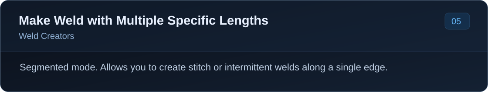</a>

 
<a href="https://youtu.be/QdZxZB9vzDA"><strong>FreeCAD - Welding plugin - Define Welds Demo</strong></a>

<a name="readme-image-025" href="#readme-image-025">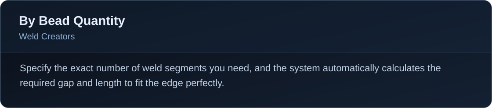</a>

 
<a href="https://youtu.be/QdZxZB9vzDA"><strong>FreeCAD - Welding plugin - Define Welds Demo</strong></a>

<a name="readme-image-026" href="#readme-image-026">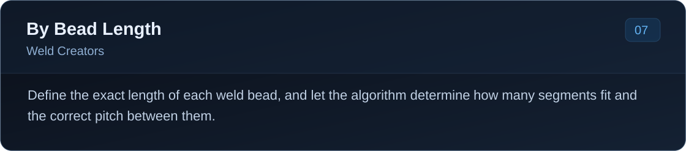</a>

 
<a href="https://youtu.be/QdZxZB9vzDA"><strong>FreeCAD - Welding plugin - Define Welds Demo</strong></a>

<a name="readme-image-027" href="#readme-image-027">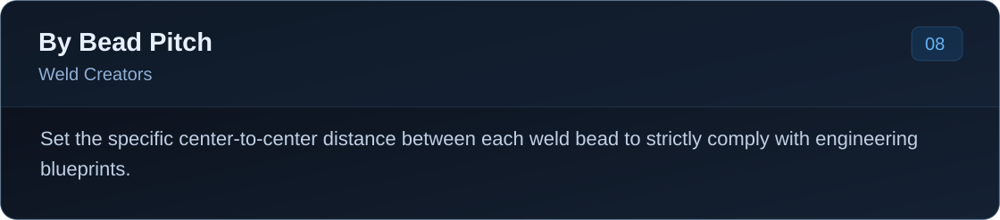</a>

 
<a href="https://youtu.be/QdZxZB9vzDA"><strong>FreeCAD - Welding plugin - Define Welds Demo</strong></a>

<a name="readme-image-029" href="#readme-image-029">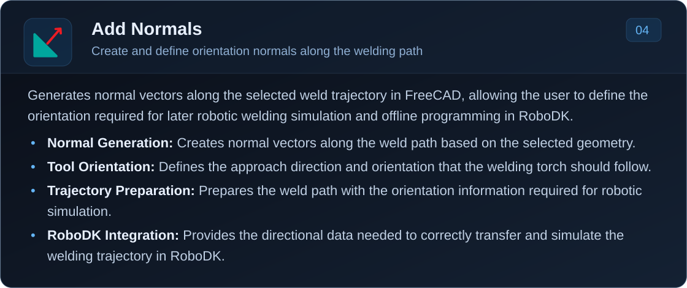</a>

 
<a href="https://youtu.be/QdZxZB9vzDA"><strong>FreeCAD - Welding plugin - Define Welds Demo</strong></a>

<a name="readme-image-031" href="#readme-image-031">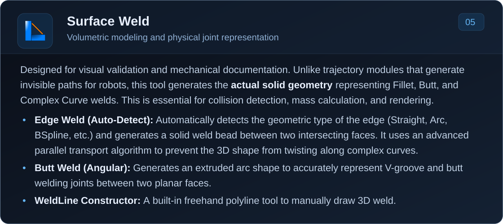</a>

 
<a href="https://youtu.be/5uwMWgmB7Lk"><strong>Surface Weld Generator - FreeCAD Plugin Demo</strong></a>

<a name="readme-image-033" href="#readme-image-033">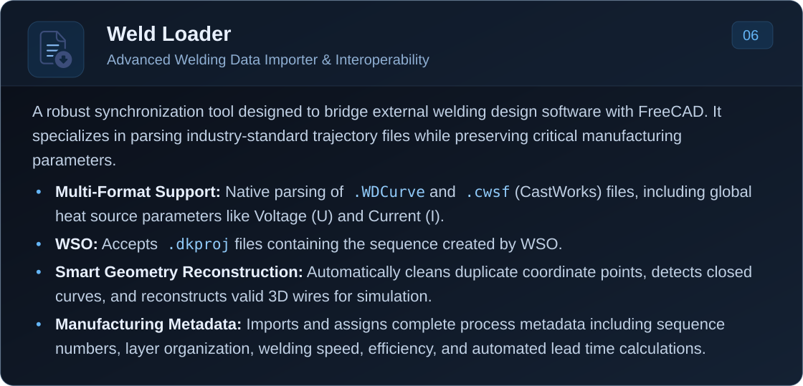</a>

 
<a href="https://youtu.be/5uwMWgmB7Lk"><strong>Surface Weld Generator - FreeCAD Plugin Demo</strong></a>

<a name="readme-image-036" href="#readme-image-036">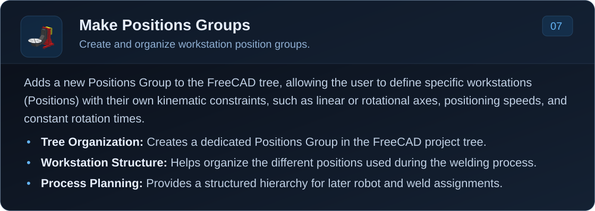</a>

 
<a href="https://youtu.be/5uwMWgmB7Lk"><strong>Surface Weld Generator - FreeCAD Plugin Demo</strong></a>

<a name="readme-image-037" href="#readme-image-037">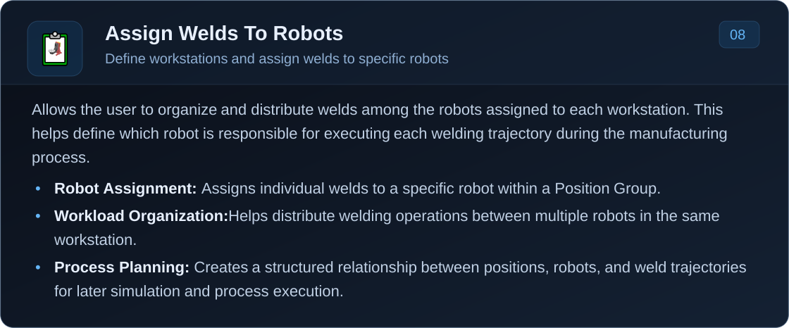</a>

 
<a href="https://youtu.be/TU_ENLACE"><strong>Robotic Cell &amp; Assignment Manager - FreeCAD Plugin Demo</strong></a>

<a name="readme-image-039" href="#readme-image-039">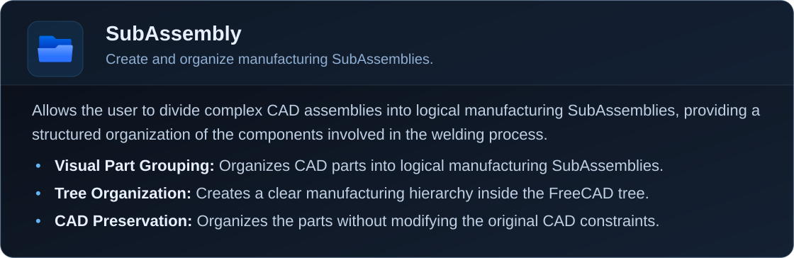</a>

 
<a href="https://youtu.be/5uwMWgmB7Lk"><strong>Surface Weld Generator - FreeCAD Plugin Demo</strong></a>

<a name="readme-image-040" href="#readme-image-040">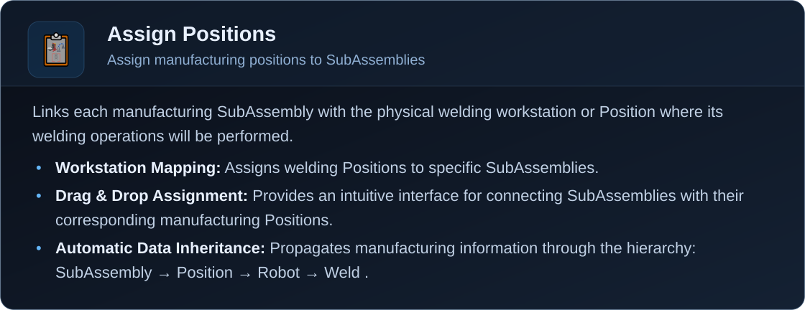</a>

 
<a href="https://youtu.be/TU_ENLACE"><strong>SubAssembly &amp; Position Manager - FreeCAD Plugin Demo</strong></a>

<a name="readme-image-042" href="#readme-image-042">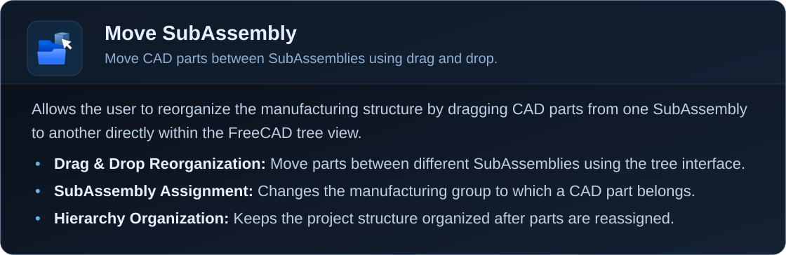</a>

 
<a href="https://youtu.be/TU_ENLACE"><strong>Smart Hierarchy Organizers - FreeCAD Plugin Demo</strong></a>

<a name="readme-image-043" href="#readme-image-043">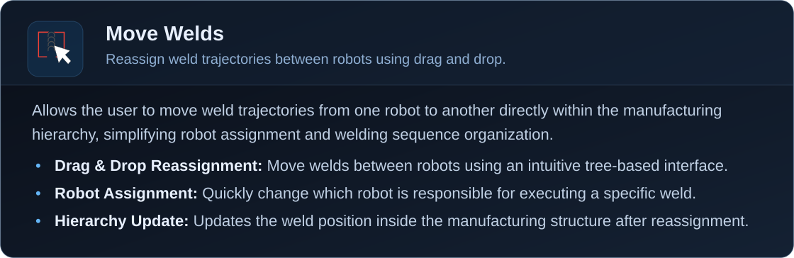</a>

 
<a href="https://youtu.be/5uwMWgmB7Lk"><strong>Surface Weld Generator - FreeCAD Plugin Demo</strong></a>

<a name="readme-image-046" href="#readme-image-046">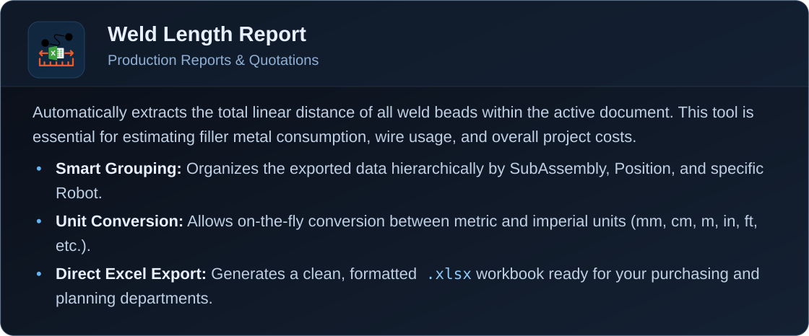</a>

 
<a href="https://youtu.be/hXmbLb0A_RI"><strong>FreeCAD - Plugin - Total welding distance Demo</strong></a>

<a name="readme-image-049" href="#readme-image-049">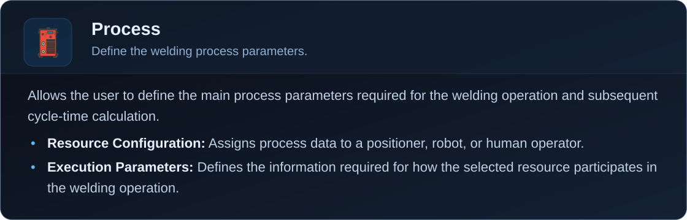</a>

 
<a href="https://youtu.be/5uwMWgmB7Lk"><strong>Surface Weld Generator - FreeCAD Plugin Demo</strong></a>

<a name="readme-image-050" href="#readme-image-050">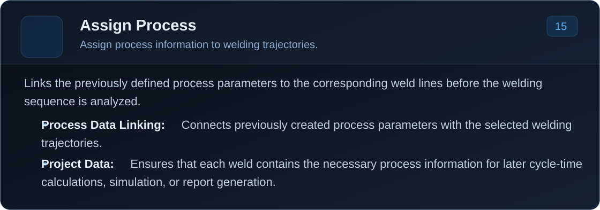</a>

 
<a href="https://youtu.be/5uwMWgmB7Lk"><strong>Surface Weld Generator - FreeCAD Plugin Demo</strong></a>

<a name="readme-image-052" href="#readme-image-052">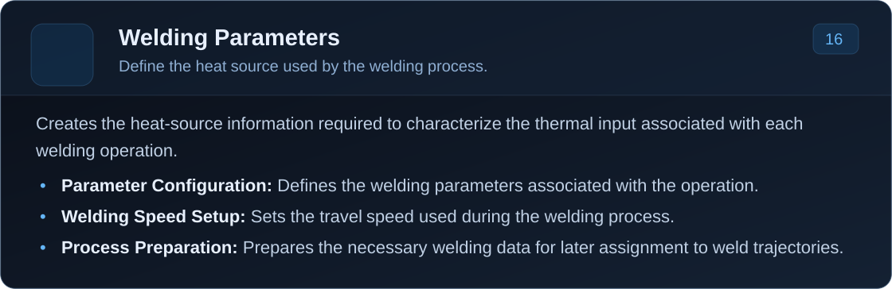</a>

 
<a href="https://youtu.be/5uwMWgmB7Lk"><strong>Surface Weld Generator - FreeCAD Plugin Demo</strong></a>

<a name="readme-image-053" href="#readme-image-053">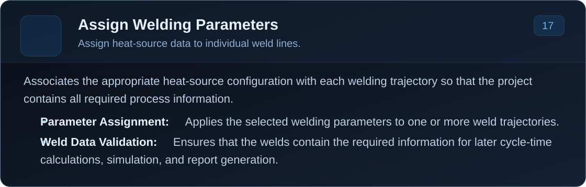</a>

 
<a href="https://youtu.be/5uwMWgmB7Lk"><strong>Surface Weld Generator - FreeCAD Plugin Demo</strong></a>

<a name="readme-image-055" href="#readme-image-055">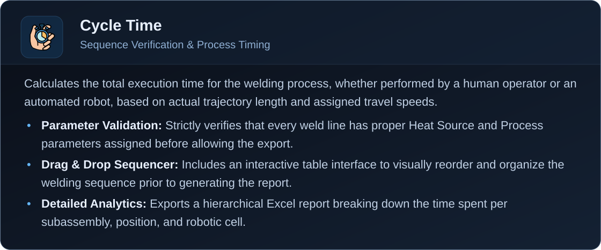</a>

 
<a href="https://youtu.be/Giv5xZ7Uw44"><strong>FreeCAD Plugin - Cycle time report - Robot or Manual welding Demo</strong></a>

<a name="readme-image-058" href="#readme-image-058">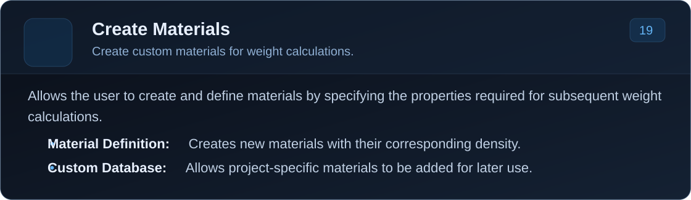</a>

 
<a href="https://youtu.be/5uwMWgmB7Lk"><strong>Surface Weld Generator - FreeCAD Plugin Demo</strong></a>

<a name="readme-image-059" href="#readme-image-059">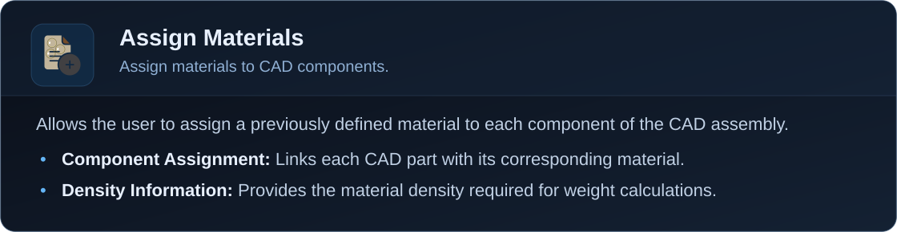</a>

 
<a href="https://youtu.be/5uwMWgmB7Lk"><strong>Surface Weld Generator - FreeCAD Plugin Demo</strong></a>

<a name="readme-image-061" href="#readme-image-061">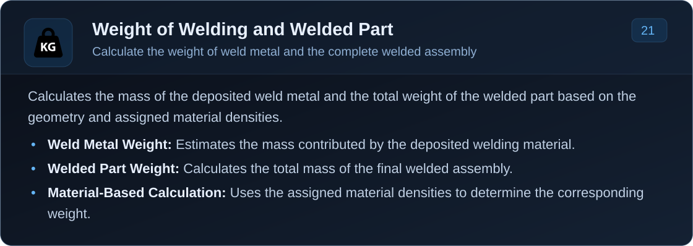</a>

 
<a href="https://youtu.be/HbsH8DEtrP8"><strong>FreeCAD plugin welded part weight report Demo</strong></a>

<a name="readme-image-064" href="#readme-image-064">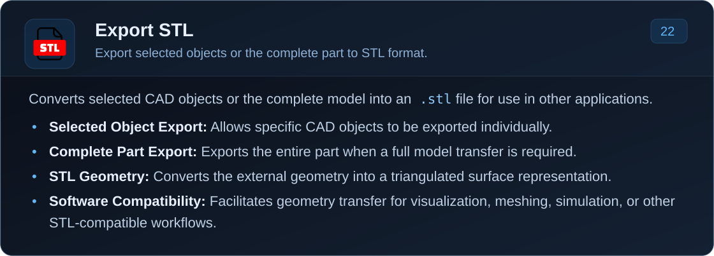</a>

 
<a href="https://youtu.be/HbsH8DEtrP8"><strong>FreeCAD plugin welded part weight report Demo</strong></a>

<a name="readme-image-066" href="#readme-image-066">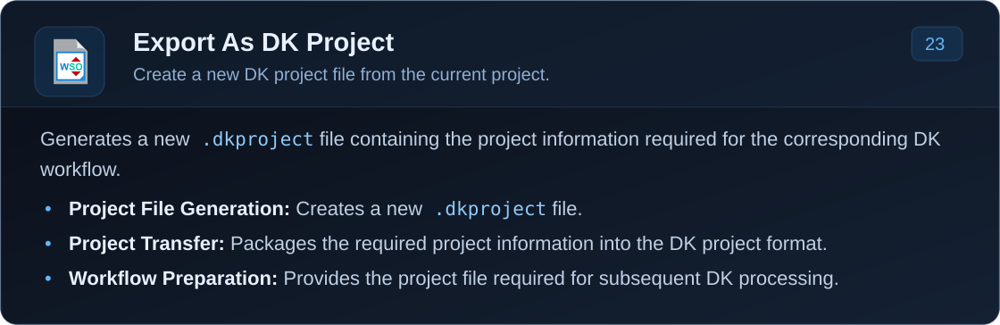</a>

 
<a href="https://youtu.be/48nRLUuxqVA"><strong>WSO with DK Algorithm Demo</strong></a>

 
<a href="https://youtu.be/bhIbrSHBmeU"><strong>Sequence Visualizer [Output] Demo</strong></a>

<a name="readme-image-069" href="#readme-image-069">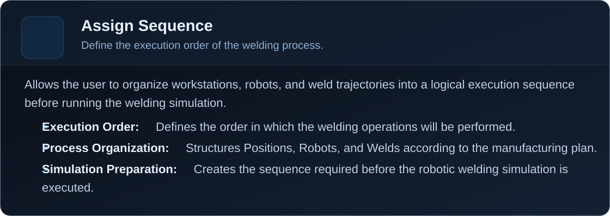</a>

 
<a href="https://youtu.be/HbsH8DEtrP8"><strong>FreeCAD plugin welded part weight report Demo</strong></a>

<a name="readme-image-071" href="#readme-image-071">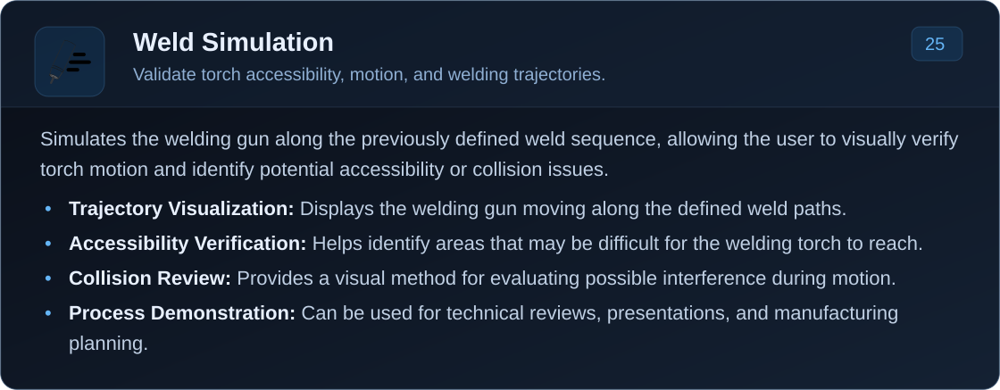</a>

 
<a href="https://youtu.be/kuIgRGPw8nU"><strong>FreeCAD Plugin - Simulate welding gun on a trajectory Demo</strong></a>

<a name="readme-image-073" href="#readme-image-073">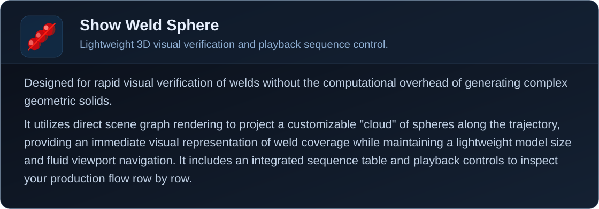</a>

 
<a href="https://youtu.be/Ccb7qmT_r68"><strong>Weld Visualizer (Sphere Mode) - FreeCAD Plugin Demo</strong></a>

<a name="readme-image-075" href="#readme-image-075">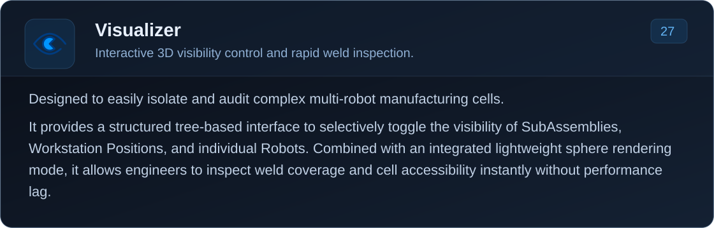</a>

 
<a href="https://youtu.be/TU_ENLACE"><strong>Assembly Visualizer - FreeCAD Plugin Demo</strong></a>

 

<a name="readme-image-078" href="#readme-image-078">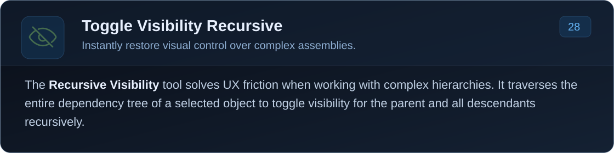</a>

 
<a href="https://youtu.be/360sB3FVUp4"><strong>Recursive Visibility Toggle for Complex Assemblies - FreeCAD Plugin Demo</strong></a>

<a name="readme-image-080" href="#readme-image-080">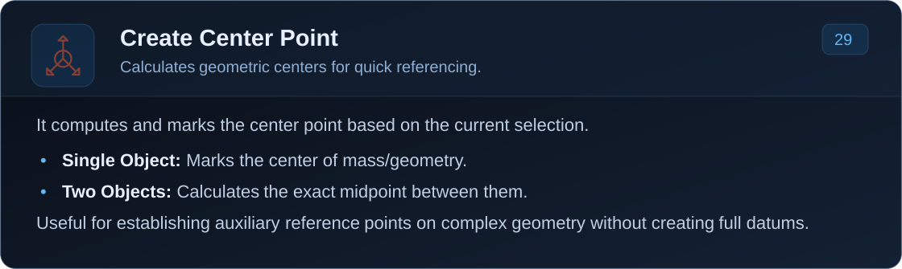</a>

 
<a href="https://youtu.be/AsVGiXEPmd4"><strong>Center Point - MANUFAI FreeCAD Plugin Demo</strong></a>

<a name="readme-image-082" href="#readme-image-082">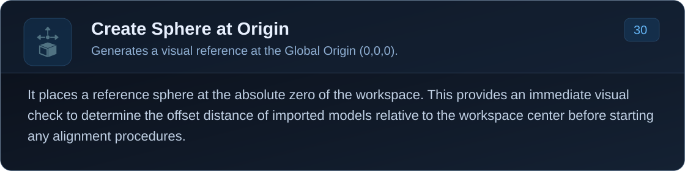</a>

 
<a href="https://youtu.be/HbsH8DEtrP8"><strong>FreeCAD plugin welded part weight report Demo</strong></a>

<a name="readme-image-085" href="#readme-image-085">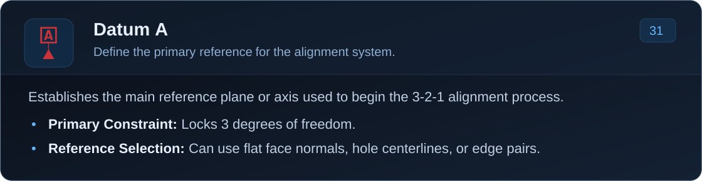</a>

<a name="readme-image-086" href="#readme-image-086">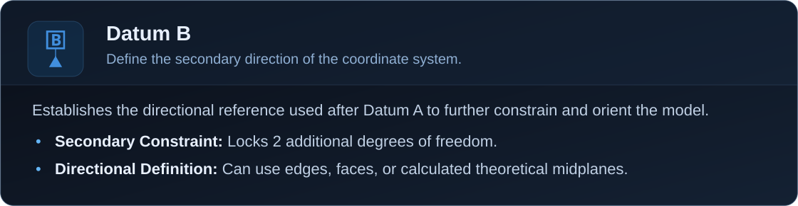</a>

<a name="readme-image-087" href="#readme-image-087">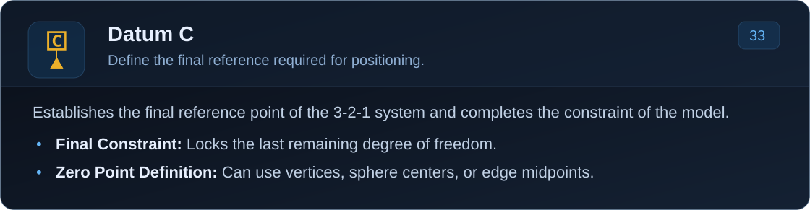</a>

<a name="readme-image-088" href="#readme-image-088">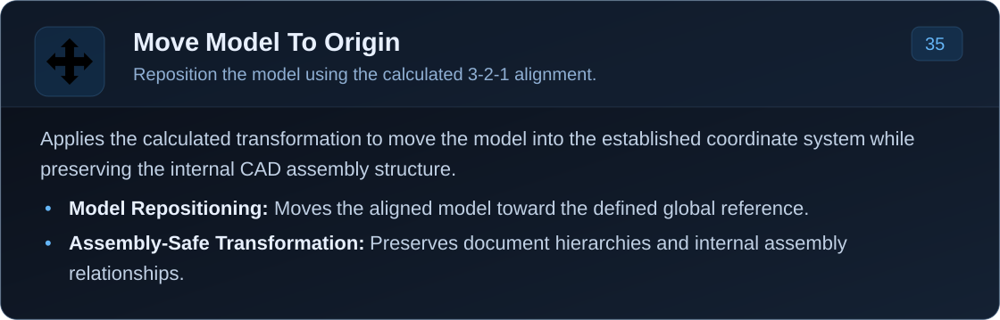</a>

 
<a href="https://youtu.be/hPKx3S9DQLc"><strong>3-2-1 Datum Based Alignment - MANUFAI FreeCAD Plugin Demo</strong></a>

<a name="readme-image-091" href="#readme-image-091">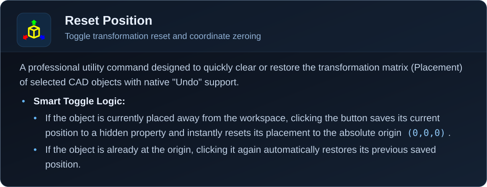</a>

 
<a href="https://youtu.be/TU_ENLACE"><strong>Reset Position - FreeCAD Plugin Demo</strong></a>

 
<a href="https://youtu.be/Yp307CxQaUM"><strong>Welding Reference Tool - FreeCAD Plugin Demo</strong></a>

 
<a href="https://youtu.be/AJxwoL3yqto"><strong>How to see all the weld data? - MANUFAI FreeCAD plugin Demo</strong></a>

 
<a href="https://youtu.be/vnDtbglly2k"><strong>Focus on Object - FreeCAD Plugin Demo</strong></a>

 
<a href="https://youtu.be/HbsH8DEtrP8"><strong>FreeCAD plugin welded part weight report Demo</strong></a>

 
<a href="https://youtu.be/HbsH8DEtrP8"><strong>FreeCAD plugin welded part weight report Demo</strong></a>

 

 
<a href="https://youtu.be/wSOsoFvLScI"><strong>Line Weld Table &amp; WDCurve Export - FreeCAD Plugin Demo</strong></a>

 
<a href="https://youtu.be/uVRiyf8H4nk"><strong>Weld Path Name &amp; Direction Display - FreeCAD Plugin Demo</strong></a>

 
<a href="https://youtu.be/Y3D3PVF0ubI"><strong>X-Ray Weld Selection Mode - FreeCAD Plugin Demo</strong></a>

 

 
<a href="https://youtu.be/bNV_s38_P9E"><strong>FreeCAD Plugin - Robotic Cell Modeling for automatic transfer of weld data</strong></a>

 
<a href="https://youtu.be/PpmaKM3XEzY"><strong>FreeCAD to RoboDK welding Modeling and Simulation</strong></a>

 
<a href="https://youtu.be/_DmwPQABFhU"><strong>Weld Path to Robot Program - FreeCAD Plugin Demo</strong></a>

 
<a href="https://youtu.be/HbsH8DEtrP8"><strong>FreeCAD plugin welded part weight report Demo</strong></a>

 
<a href="https://youtu.be/iWT9zPO1s58"><strong>Dispensing operations with RoboDK - MANUFAI FreeCAD Plugin Demo</strong></a>

 
<a href="https://youtu.be/Aw_dtBkk4sY"><strong>Automated Drilling - FreeCAD Plugin Demo</strong></a>

 
